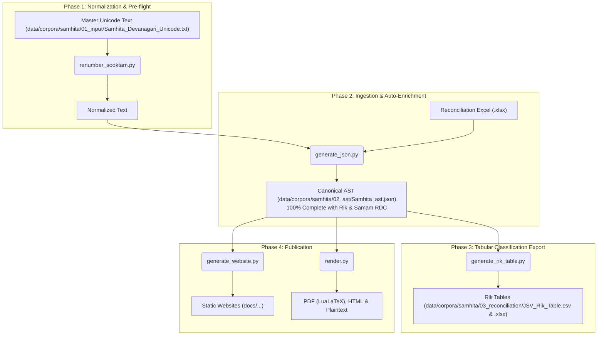
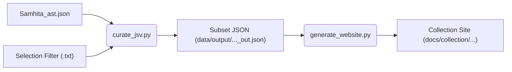
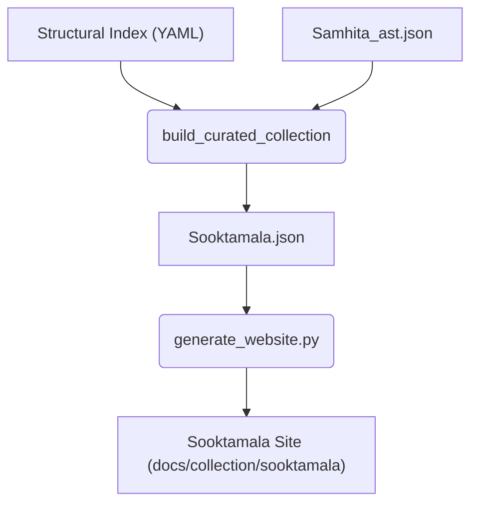
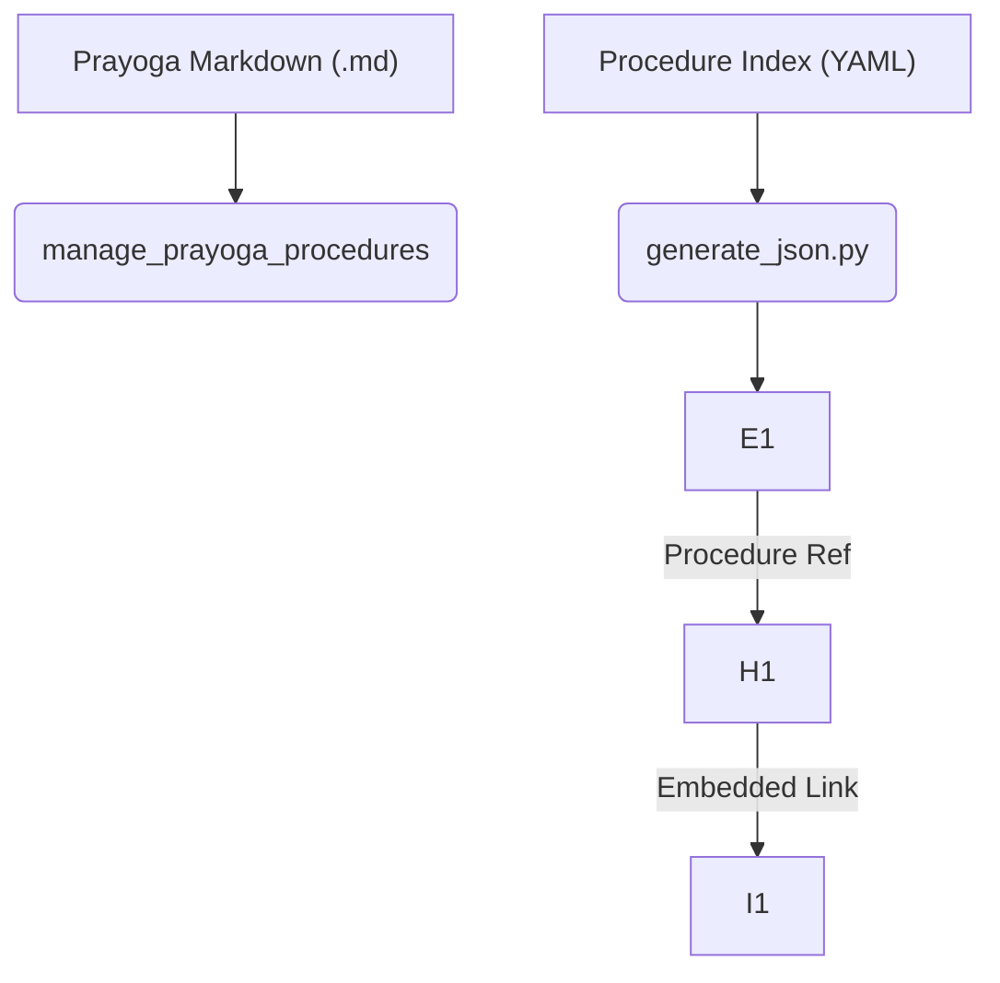

# Jaimineeya Samavedam Pipeline Architecture

This document provides a diagrammatic overview of the various workflow pipelines used to process, curate, and publish the Jaimineeya Samavedam text and metadata.

## 1. Core Data Processing Pipeline

This is the primary flow for transforming master text into the canonical AST and downstream publications.



---

## 2. Collection & Curation Workflow

This secondary pipeline is used to create specific subsets or thematic collections (like Sooktamala or Ashirvachana Samani).



---

## 3. Custom Sooktamala Pipeline

For independent collections using the P.K.S (Parva.Kandah.Samam) identifier system.



---

## 4. Prayoga & Procedure Integration

How ritual instructions are embedded into the Samam display.



---

## 5. RDC (Ṛṣi, Devatā, Chandas) Population Architecture

The generation pipeline populates two parallel sets of liturgical classifications for each subsection in the AST:

### Ṛk Verse RDC (`rik_rishi`, `rik_devata`, `rik_chandas`)
- **Direct Re-injection**: Injected from the human reconciliation workbook `data/output/Rik Reconciliation table (JSV-KSV).xlsx`.
- **Primary Indexing Key**: Matched via `Global_Rik_Num` (1 to 587 unique Ṛks across 722 subsections).
- **Fallback**: If an Excel cell is unpopulated, falls back to parsing the raw `rik_metadata` string in the subsection.
- **Data Type**: Scalar strings (`str`).

### Sāmam Chant RDC (`saman_rishi`, `saman_devata`, `saman_chandas`)
- **Direct Metadata Extraction**: Derived from each subsection's `saman_metadata` field (e.g. `।। वत्सो गायत्र्यग्निः ।। ।। शौनश्शेपो गायत्र्यग्निः ।।`).
- **Multi-Element Arrays (`List[str]`)**: An Ārṣeyam subsection may contain 1, 2, or 3 Sāmam chants. To maintain exact 1-to-1 fidelity with each chant, the fields are stored as JSON arrays:
  ```json
  "saman_rishi": ["वत्सः", "शौनश्शेपः"],
  "saman_devata": ["अग्निः", "अग्निः"],
  "saman_chandas": ["गायत्री", "गायत्री"]
  ```
- **Sanskrit Sandhi & Pada-cheda (पदच्छेदः)**:
  - Detaches scope prefixes (`द्वयोः`, `द्वयोर्`, `त्रयाणां`).
  - Decomposes Sandhi compounds (e.g., `गायत्र्यग्निः` $\rightarrow$ Chandas: `गायत्री`, Devata: `अग्निः`).
  - Restores nominative Visarga (`गोतमो` $\rightarrow$ `गोतमः`, `श्रुतर्षिर्` $\rightarrow$ `श्रुतर्षिः`, `प्रजापति` $\rightarrow$ `प्रजापतिः`).
  - Inherits parent Ṛk Chandas/Devatā if omitted in a Sāmam clause.

---

## Key Maintenance Commands

| Pipeline | Command Example |
| :--- | :--- |
| **Core AST (Parse & Enrich)** | `python src/generate_json.py --type samhita` |
| **Rik Table Export** | `python src/generate_rik_table.py --type samhita` |
| **Website** | `python src/generate_website.py --samhita` |
| **Curation** | `python src/curate_jsv.py` |
| **PDF** | `python src/render.py data/corpora/samhita/02_ast/Samhita_ast.json -kpully` |
