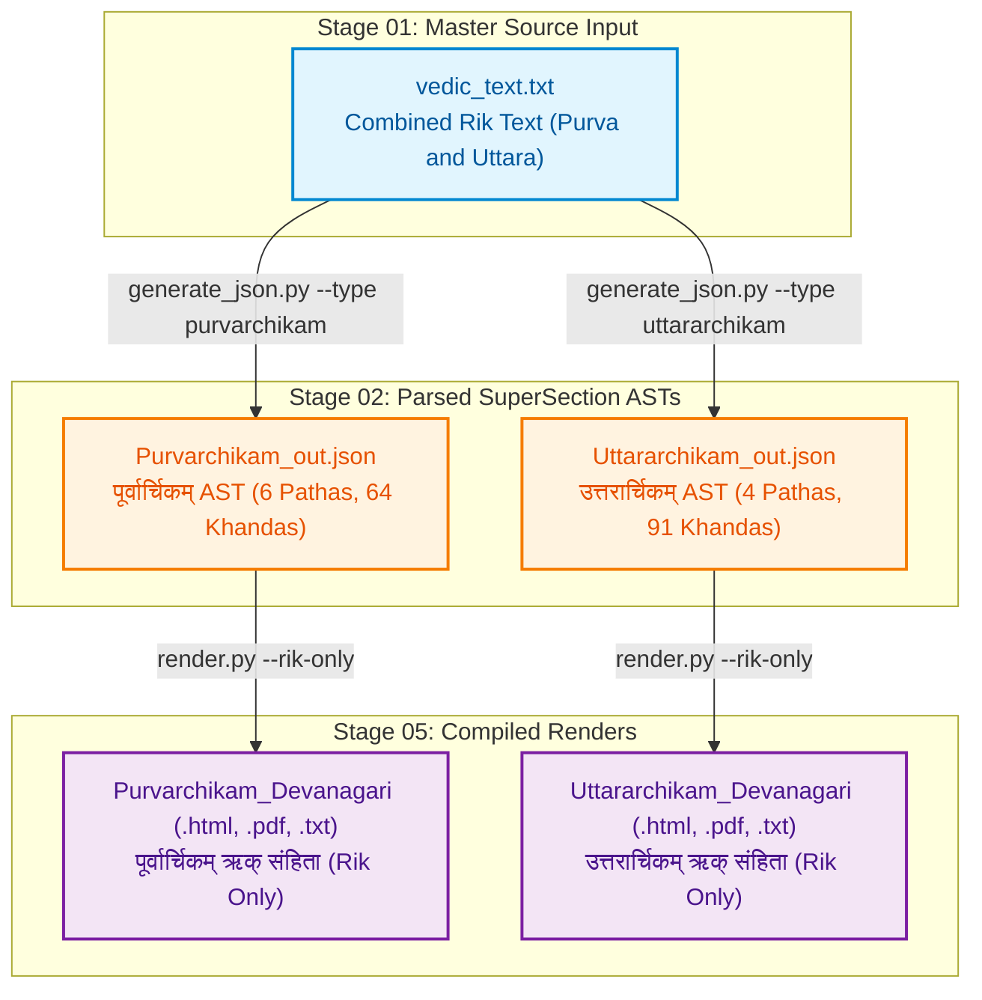

# Jaimineeya Samavedam — Traceability & Lineage Report: Rik

- **Corpus**: `Rik`
- **Edition**: `1.03`
- **Generated Timestamp**: `11-11-2026 16:11:15`
- **Validation Status**: `PASSED`

---

## 1. Liturgical Invariants & Metrics
| Metric | Active Count | Baseline Invariant | Status |
| :--- | :--- | :--- | :--- |
| **Pathas (SuperSections)** | 10 | 10 | PASS |
| **Khandas (Sections)** | 155 | 155 | PASS |
| **Samas (Liturgical Chants)** | 0 | 0 | PASS |
| **Riks (Verses)** | 1667 | 1666 | PASS |

---

## 2. End-to-End Pipeline Lineage Flowchart
The following diagram illustrates how active master inputs flow through intermediate parsed/canonical ASTs to produce each final render in `05_renders/`:



---

## 3. Direct Output-to-Source Lineage Mapping
This table directly maps each compiled file in `05_renders/` back to the active master source text in `01_input/` and intermediate AST in `02_ast/` that produced it.

| Output Render Artifact | Format | Compiled Timestamp | Purpose / Description | Master Input File (`01_input/`) | Intermediate AST (`02_ast/`) | Pipeline Generation Path |
| :--- | :--- | :--- | :--- | :--- | :--- | :--- |
| [`Purvarchikam_book_bw_Rik_Devanagari.pdf`](../05_renders/pdf/Purvarchikam_book_bw_Rik_Devanagari.pdf) | `PDF` | `11-11-2026 13:17:01` | पूर्वार्चिकम् ऋक् संहिता | [`vedic_text.txt`](../01_input/vedic_text.txt) | `Purvarchikam_out.json` | `generate_json.py --type purvarchikam -> render.py --rik-only` |
| [`Purvarchikam_book_Rik_Devanagari.pdf`](../05_renders/pdf/Purvarchikam_book_Rik_Devanagari.pdf) | `PDF` | `11-11-2026 13:14:45` | पूर्वार्चिकम् ऋक् संहिता | [`vedic_text.txt`](../01_input/vedic_text.txt) | `Purvarchikam_out.json` | `generate_json.py --type purvarchikam -> render.py --rik-only` |
| [`Purvarchikam_bw_Rik_Devanagari.pdf`](../05_renders/pdf/Purvarchikam_bw_Rik_Devanagari.pdf) | `PDF` | `11-11-2026 13:35:51` | पूर्वार्चिकम् ऋक् संहिता | [`vedic_text.txt`](../01_input/vedic_text.txt) | `Purvarchikam_out.json` | `generate_json.py --type purvarchikam -> render.py --rik-only` |
| [`Purvarchikam_Rik_Devanagari.pdf`](../05_renders/pdf/Purvarchikam_Rik_Devanagari.pdf) | `PDF` | `11-11-2026 13:12:05` | पूर्वार्चिकम् ऋक् संहिता | [`vedic_text.txt`](../01_input/vedic_text.txt) | `Purvarchikam_out.json` | `generate_json.py --type purvarchikam -> render.py --rik-only` |
| [`Purvarchikam_Rik_Devanagari_.pdf`](../05_renders/pdf/Purvarchikam_Rik_Devanagari_.pdf) | `PDF` | `02-10-2026 01:13:01` | पूर्वार्चिकम् ऋक् संहिता | [`vedic_text.txt`](../01_input/vedic_text.txt) | `Purvarchikam_out.json` | `generate_json.py --type purvarchikam -> render.py --rik-only` |
| [`Uttararchikam_book_bw_Rik_Devanagari.pdf`](../05_renders/pdf/Uttararchikam_book_bw_Rik_Devanagari.pdf) | `PDF` | `11-11-2026 13:26:31` | उत्तरार्चिकम् ऋक् संहिता | [`vedic_text.txt`](../01_input/vedic_text.txt) | `Uttararchikam_out.json` | `generate_json.py --type uttararchikam -> render.py --rik-only` |
| [`Uttararchikam_book_Rik_Devanagari.pdf`](../05_renders/pdf/Uttararchikam_book_Rik_Devanagari.pdf) | `PDF` | `11-11-2026 13:23:05` | उत्तरार्चिकम् ऋक् संहिता | [`vedic_text.txt`](../01_input/vedic_text.txt) | `Uttararchikam_out.json` | `generate_json.py --type uttararchikam -> render.py --rik-only` |
| [`Uttararchikam_bw_Rik_Devanagari.pdf`](../05_renders/pdf/Uttararchikam_bw_Rik_Devanagari.pdf) | `PDF` | `11-11-2026 13:40:24` | उत्तरार्चिकम् ऋक् संहिता | [`vedic_text.txt`](../01_input/vedic_text.txt) | `Uttararchikam_out.json` | `generate_json.py --type uttararchikam -> render.py --rik-only` |
| [`Uttararchikam_Rik_Devanagari.pdf`](../05_renders/pdf/Uttararchikam_Rik_Devanagari.pdf) | `PDF` | `11-11-2026 13:19:30` | उत्तरार्चिकम् ऋक् संहिता | [`vedic_text.txt`](../01_input/vedic_text.txt) | `Uttararchikam_out.json` | `generate_json.py --type uttararchikam -> render.py --rik-only` |
| [`Uttararchikam_Rik_Devanagari_.pdf`](../05_renders/pdf/Uttararchikam_Rik_Devanagari_.pdf) | `PDF` | `02-10-2026 01:13:01` | उत्तरार्चिकम् ऋक् संहिता | [`vedic_text.txt`](../01_input/vedic_text.txt) | `Uttararchikam_out.json` | `generate_json.py --type uttararchikam -> render.py --rik-only` |
| [`Purvarchikam_Devanagari.html`](../05_renders/html/Purvarchikam_Devanagari.html) | `HTML` | `13-10-2026 12:27:04` | पूर्वार्चिकम् ऋक् संहिता | [`vedic_text.txt`](../01_input/vedic_text.txt) | `Purvarchikam_out.json` | `generate_json.py --type purvarchikam -> render.py --rik-only` |
| [`Purvarchikam_Rik_Devanagari.html`](../05_renders/html/Purvarchikam_Rik_Devanagari.html) | `HTML` | `11-11-2026 13:12:05` | पूर्वार्चिकम् ऋक् संहिता | [`vedic_text.txt`](../01_input/vedic_text.txt) | `Purvarchikam_out.json` | `generate_json.py --type purvarchikam -> render.py --rik-only` |
| [`Uttararchikam_Devanagari.html`](../05_renders/html/Uttararchikam_Devanagari.html) | `HTML` | `13-10-2026 12:27:04` | उत्तरार्चिकम् ऋक् संहिता | [`vedic_text.txt`](../01_input/vedic_text.txt) | `Uttararchikam_out.json` | `generate_json.py --type uttararchikam -> render.py --rik-only` |
| [`Uttararchikam_Rik_Devanagari.html`](../05_renders/html/Uttararchikam_Rik_Devanagari.html) | `HTML` | `11-11-2026 13:19:30` | उत्तरार्चिकम् ऋक् संहिता | [`vedic_text.txt`](../01_input/vedic_text.txt) | `Uttararchikam_out.json` | `generate_json.py --type uttararchikam -> render.py --rik-only` |
| [`Purvarchikam_Devanagari_Unicode.txt`](../05_renders/txt/Purvarchikam_Devanagari_Unicode.txt) | `TXT` | `11-10-2026 15:26:22` | पूर्वार्चिकम् ऋक् संहिता | [`vedic_text.txt`](../01_input/vedic_text.txt) | `Purvarchikam_out.json` | `generate_json.py --type purvarchikam -> render.py --rik-only` |
| [`Purvarchikam_Rik_Devanagari_Unicode.txt`](../05_renders/txt/Purvarchikam_Rik_Devanagari_Unicode.txt) | `TXT` | `11-11-2026 13:12:05` | पूर्वार्चिकम् ऋक् संहिता | [`vedic_text.txt`](../01_input/vedic_text.txt) | `Purvarchikam_out.json` | `generate_json.py --type purvarchikam -> render.py --rik-only` |
| [`Uttararchikam_Devanagari_Unicode.txt`](../05_renders/txt/Uttararchikam_Devanagari_Unicode.txt) | `TXT` | `11-10-2026 15:26:23` | उत्तरार्चिकम् ऋक् संहिता | [`vedic_text.txt`](../01_input/vedic_text.txt) | `Uttararchikam_out.json` | `generate_json.py --type uttararchikam -> render.py --rik-only` |
| [`Uttararchikam_Rik_Devanagari_Unicode.txt`](../05_renders/txt/Uttararchikam_Rik_Devanagari_Unicode.txt) | `TXT` | `11-11-2026 13:19:30` | उत्तरार्चिकम् ऋक् संहिता | [`vedic_text.txt`](../01_input/vedic_text.txt) | `Uttararchikam_out.json` | `generate_json.py --type uttararchikam -> render.py --rik-only` |

---

## 4. Active Master Inputs (`01_input/`)
Only the active master source files utilized for pipeline generation are listed below:

| Active Input File | Size | SHA-256 Checksum |
| :--- | :--- | :--- |
| [`vedic_text.txt`](../01_input/vedic_text.txt) | 533.1 KB | `910ab0774cbcfa7b57697858cb37d5aefaa94e05c2553bc1d4b810fb766732c5` |

---

## 5. Intermediate ASTs & Canonical Datasets

### Parsed ASTs (`02_ast/`)
| AST File | Size | SHA-256 Checksum |
| :--- | :--- | :--- |
| [`Purvarchikam_out.json`](../02_ast/Purvarchikam_out.json) | 566.6 KB | `d7564589c886c88c3167a5043b368595650ec494a925e477af015b747bcc7d9f` |
| [`Uttararchikam_out.json`](../02_ast/Uttararchikam_out.json) | 764.2 KB | `8eb9262eececceb8cea371e9287e55fc0c03d31d19d5ff59449f01e38f00daf7` |

---

## 6. Compiled Render Catalog (`05_renders/`)

### PDF Documents (`05_renders/pdf/`)
| File Name | Mode / Edition | Target Script | Size | SHA-256 Checksum |
| :--- | :--- | :--- | :--- | :--- |
| [`Purvarchikam_book_bw_Rik_Devanagari.pdf`](../05_renders/pdf/Purvarchikam_book_bw_Rik_Devanagari.pdf) | Separate (Rik Only) | Devanagari (Standard) | 1.38 MB | `aa460b4306a456d7013888ef06ed9044897a024575adf82416cfcfc231bda258` |
| [`Purvarchikam_book_Rik_Devanagari.pdf`](../05_renders/pdf/Purvarchikam_book_Rik_Devanagari.pdf) | Separate (Rik Only) | Devanagari (Standard) | 1.42 MB | `a76c6c7bab51051dc7a456b4d97af0e49eb7fe1ff99fffcbb0ced6501549a4ac` |
| [`Purvarchikam_bw_Rik_Devanagari.pdf`](../05_renders/pdf/Purvarchikam_bw_Rik_Devanagari.pdf) | Separate (Rik Only) | Devanagari (Standard) | 1.32 MB | `9a7802498fb197c9ea667ecfcb925cbbdce9c110c0b04a470eb963e5183bfb59` |
| [`Purvarchikam_Rik_Devanagari.pdf`](../05_renders/pdf/Purvarchikam_Rik_Devanagari.pdf) | Separate (Rik Only) | Devanagari (Standard) | 1.36 MB | `334d5612707b35ae85f0480baac9d6820ea4edf1f6cc45c7a009e2eb105e80bb` |
| [`Purvarchikam_Rik_Devanagari_.pdf`](../05_renders/pdf/Purvarchikam_Rik_Devanagari_.pdf) | Separate (Rik Only) | Devanagari (Standard) | 268.0 KB | `8e47a4247dc27f25c893148091ea95e4beee86321461606f7dee12e4bc016da1` |
| [`Uttararchikam_book_bw_Rik_Devanagari.pdf`](../05_renders/pdf/Uttararchikam_book_bw_Rik_Devanagari.pdf) | Separate (Rik Only) | Devanagari (Standard) | 1.71 MB | `7fc8776e1456d9650464beaf7dfa651a833e0a1dc7bbe0cb53cc27fdb6309097` |
| [`Uttararchikam_book_Rik_Devanagari.pdf`](../05_renders/pdf/Uttararchikam_book_Rik_Devanagari.pdf) | Separate (Rik Only) | Devanagari (Standard) | 1.74 MB | `d0b87cc9f8e9e737dc3991b77777bd9231d1d2c35417b9c82cb155fd06ff34a3` |
| [`Uttararchikam_bw_Rik_Devanagari.pdf`](../05_renders/pdf/Uttararchikam_bw_Rik_Devanagari.pdf) | Separate (Rik Only) | Devanagari (Standard) | 1.50 MB | `0d336c331363454e55ec559ffabec0d4e72ec33974d2302746eaf7ad61f61748` |
| [`Uttararchikam_Rik_Devanagari.pdf`](../05_renders/pdf/Uttararchikam_Rik_Devanagari.pdf) | Separate (Rik Only) | Devanagari (Standard) | 1.53 MB | `7fd1c9a758765498b888b1eab8e7694adbda591046f9378d4ac1ae7b84fb71fd` |
| [`Uttararchikam_Rik_Devanagari_.pdf`](../05_renders/pdf/Uttararchikam_Rik_Devanagari_.pdf) | Separate (Rik Only) | Devanagari (Standard) | 345.2 KB | `7618111b7d281b20f4d143f792d9a1f6a8d452d7cc06c044caa32345c31e787b` |

### HTML Readers (`05_renders/html/`)
| File Name | Mode / Edition | Target Script | Size | SHA-256 Checksum |
| :--- | :--- | :--- | :--- | :--- |
| [`Purvarchikam_Devanagari.html`](../05_renders/html/Purvarchikam_Devanagari.html) | Separate (Rik Only) | Devanagari (Standard) | 3.38 MB | `9bf7ae3253b20f87a3bd3244cd1f02c37d8de533dcb84be2de229c41cb976947` |
| [`Purvarchikam_Rik_Devanagari.html`](../05_renders/html/Purvarchikam_Rik_Devanagari.html) | Separate (Rik Only) | Devanagari (Standard) | 3.56 MB | `66d46e3506413040c7b7de9aa34792c83c37118a1b993a9e8710d18be4b498c0` |
| [`Uttararchikam_Devanagari.html`](../05_renders/html/Uttararchikam_Devanagari.html) | Separate (Rik Only) | Devanagari (Standard) | 3.69 MB | `82d64825a7b4c03e5cff00298d14b241551474dd3494f226e596756ddf1b52f0` |
| [`Uttararchikam_Rik_Devanagari.html`](../05_renders/html/Uttararchikam_Rik_Devanagari.html) | Separate (Rik Only) | Devanagari (Standard) | 3.78 MB | `b994fe4c749cda4d2700877a4795e488af9386a94526f5ec1066277351a28ffb` |

### PlainText Exports (`05_renders/txt/`)
| File Name | Mode / Edition | Target Script | Size | SHA-256 Checksum |
| :--- | :--- | :--- | :--- | :--- |
| [`Purvarchikam_Devanagari_Unicode.txt`](../05_renders/txt/Purvarchikam_Devanagari_Unicode.txt) | Separate (Rik Only) | Devanagari (Standard) | 406.2 KB | `be4a30677362813e7590916d50f4db6a3aa5b7e31d17c194b748f44bc00c4f68` |
| [`Purvarchikam_Rik_Devanagari_Unicode.txt`](../05_renders/txt/Purvarchikam_Rik_Devanagari_Unicode.txt) | Separate (Rik Only) | Devanagari (Standard) | 268.4 KB | `76821cb37fa0d5b7ba4c11d2dc185db8a91de549043c9a1452b0644a66366e5e` |
| [`Uttararchikam_Devanagari_Unicode.txt`](../05_renders/txt/Uttararchikam_Devanagari_Unicode.txt) | Separate (Rik Only) | Devanagari (Standard) | 604.5 KB | `9c59142c91e906d86def5898e55265c2a2150cdaaac75ff45634818a8248d3ee` |
| [`Uttararchikam_Rik_Devanagari_Unicode.txt`](../05_renders/txt/Uttararchikam_Rik_Devanagari_Unicode.txt) | Separate (Rik Only) | Devanagari (Standard) | 288.7 KB | `699d89fca4507748ce68c049445857cc1c7082a91e975785ad5676547e3525d8` |

---

## 7. Audit Reports & Integrity Check

### Audit Reports (`06_reports/`)
| Report File | Size |
| :--- | :--- |

### Verification Command
To verify cryptographic and liturgical invariants against golden baselines:
```bash
python src/tools/validate_run.py Rik
```
