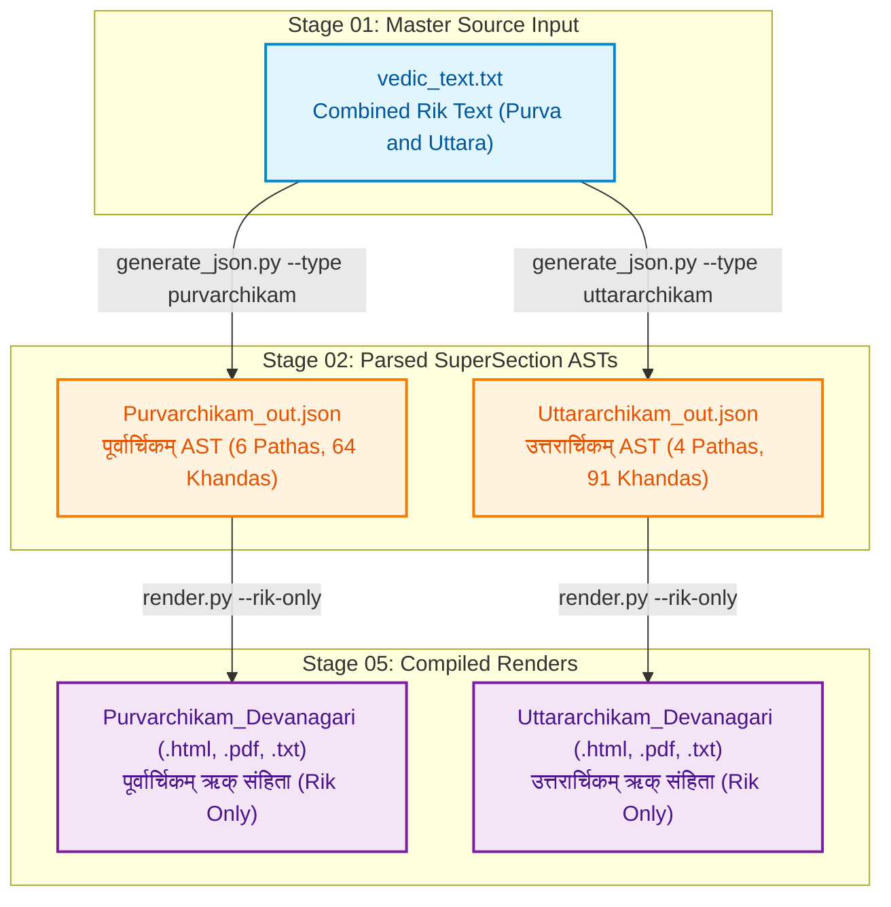

# Jaimineeya Samavedam — Traceability & Lineage Report: Rik

- **Corpus**: `Rik`
- **Edition**: `1.02`
- **Generated Timestamp**: `12-10-2026 15:55:28`
- **Validation Status**: `PASSED`

---

## 1. Liturgical Invariants & Metrics
| Metric | Active Count | Baseline Invariant | Status |
| :--- | :--- | :--- | :--- |
| **Pathas (SuperSections)** | 10 | 10 | PASS |
| **Khandas (Sections)** | 155 | 155 | PASS |
| **Samas (Liturgical Chants)** | 0 | 0 | PASS |
| **Riks (Verses)** | 1666 | 1666 | PASS |

---

## 2. End-to-End Pipeline Lineage Flowchart
The following diagram illustrates how active master inputs flow through intermediate parsed/canonical ASTs to produce each final render in `05_renders/`:



---

## 3. Direct Output-to-Source Lineage Mapping
This table directly maps each compiled file in `05_renders/` back to the active master source text in `01_input/` and intermediate AST in `02_ast/` that produced it.

| Output Render Artifact | Format | Compiled Timestamp | Purpose / Description | Master Input File (`01_input/`) | Intermediate AST (`02_ast/`) | Pipeline Generation Path |
| :--- | :--- | :--- | :--- | :--- | :--- | :--- |
| [`Purvarchikam_Rik_Devanagari.pdf`](../05_renders/pdf/Purvarchikam_Rik_Devanagari.pdf) | `PDF` | `02-10-2026 01:13:01` | पूर्वार्चिकम् ऋक् संहिता | [`vedic_text.txt`](../01_input/vedic_text.txt) | `Purvarchikam_out.json` | `generate_json.py --type purvarchikam -> render.py --rik-only` |
| [`Uttararchikam_Rik_Devanagari.pdf`](../05_renders/pdf/Uttararchikam_Rik_Devanagari.pdf) | `PDF` | `02-10-2026 01:13:01` | उत्तरार्चिकम् ऋक् संहिता | [`vedic_text.txt`](../01_input/vedic_text.txt) | `Uttararchikam_out.json` | `generate_json.py --type uttararchikam -> render.py --rik-only` |
| [`Purvarchikam_Devanagari.html`](../05_renders/html/Purvarchikam_Devanagari.html) | `HTML` | `11-10-2026 15:26:22` | पूर्वार्चिकम् ऋक् संहिता | [`vedic_text.txt`](../01_input/vedic_text.txt) | `Purvarchikam_out.json` | `generate_json.py --type purvarchikam -> render.py --rik-only` |
| [`Purvarchikam_Rik_Devanagari.html`](../05_renders/html/Purvarchikam_Rik_Devanagari.html) | `HTML` | `02-10-2026 01:13:01` | पूर्वार्चिकम् ऋक् संहिता | [`vedic_text.txt`](../01_input/vedic_text.txt) | `Purvarchikam_out.json` | `generate_json.py --type purvarchikam -> render.py --rik-only` |
| [`Uttararchikam_Devanagari.html`](../05_renders/html/Uttararchikam_Devanagari.html) | `HTML` | `11-10-2026 15:26:23` | उत्तरार्चिकम् ऋक् संहिता | [`vedic_text.txt`](../01_input/vedic_text.txt) | `Uttararchikam_out.json` | `generate_json.py --type uttararchikam -> render.py --rik-only` |
| [`Uttararchikam_Rik_Devanagari.html`](../05_renders/html/Uttararchikam_Rik_Devanagari.html) | `HTML` | `02-10-2026 01:13:01` | उत्तरार्चिकम् ऋक् संहिता | [`vedic_text.txt`](../01_input/vedic_text.txt) | `Uttararchikam_out.json` | `generate_json.py --type uttararchikam -> render.py --rik-only` |
| [`Purvarchikam_Devanagari_Unicode.txt`](../05_renders/txt/Purvarchikam_Devanagari_Unicode.txt) | `TXT` | `11-10-2026 15:26:22` | पूर्वार्चिकम् ऋक् संहिता | [`vedic_text.txt`](../01_input/vedic_text.txt) | `Purvarchikam_out.json` | `generate_json.py --type purvarchikam -> render.py --rik-only` |
| [`Purvarchikam_Rik_Devanagari_Unicode.txt`](../05_renders/txt/Purvarchikam_Rik_Devanagari_Unicode.txt) | `TXT` | `02-10-2026 01:13:01` | पूर्वार्चिकम् ऋक् संहिता | [`vedic_text.txt`](../01_input/vedic_text.txt) | `Purvarchikam_out.json` | `generate_json.py --type purvarchikam -> render.py --rik-only` |
| [`Uttararchikam_Devanagari_Unicode.txt`](../05_renders/txt/Uttararchikam_Devanagari_Unicode.txt) | `TXT` | `11-10-2026 15:26:23` | उत्तरार्चिकम् ऋक् संहिता | [`vedic_text.txt`](../01_input/vedic_text.txt) | `Uttararchikam_out.json` | `generate_json.py --type uttararchikam -> render.py --rik-only` |
| [`Uttararchikam_Rik_Devanagari_Unicode.txt`](../05_renders/txt/Uttararchikam_Rik_Devanagari_Unicode.txt) | `TXT` | `02-10-2026 01:13:01` | उत्तरार्चिकम् ऋक् संहिता | [`vedic_text.txt`](../01_input/vedic_text.txt) | `Uttararchikam_out.json` | `generate_json.py --type uttararchikam -> render.py --rik-only` |

---

## 4. Active Master Inputs (`01_input/`)
Only the active master source files utilized for pipeline generation are listed below:

| Active Input File | Size | SHA-256 Checksum |
| :--- | :--- | :--- |
| [`vedic_text.txt`](../01_input/vedic_text.txt) | 448.9 KB | `16de8a4d4a2b1b4661af386909eaf085392d626a25847139a88ed7f581d19822` |

---

## 5. Intermediate ASTs & Canonical Datasets

### Parsed ASTs (`02_ast/`)
| AST File | Size | SHA-256 Checksum |
| :--- | :--- | :--- |
| [`Purvarchikam_out.json`](../02_ast/Purvarchikam_out.json) | 507.7 KB | `7f58e8e7dc7f5722af983724ac5ad8bf35d70e531f824974e903821970928b84` |
| [`Uttararchikam_out.json`](../02_ast/Uttararchikam_out.json) | 764.2 KB | `d6b65b72a900af0724fc8795086c5a9941bbaf8907d8f91776aa5cf7c93917b1` |

---

## 6. Compiled Render Catalog (`05_renders/`)

### PDF Documents (`05_renders/pdf/`)
| File Name | Mode / Edition | Target Script | Size | SHA-256 Checksum |
| :--- | :--- | :--- | :--- | :--- |
| [`Purvarchikam_Rik_Devanagari.pdf`](../05_renders/pdf/Purvarchikam_Rik_Devanagari.pdf) | Separate (Rik Only) | Devanagari (Standard) | 268.0 KB | `8e47a4247dc27f25c893148091ea95e4beee86321461606f7dee12e4bc016da1` |
| [`Uttararchikam_Rik_Devanagari.pdf`](../05_renders/pdf/Uttararchikam_Rik_Devanagari.pdf) | Separate (Rik Only) | Devanagari (Standard) | 345.2 KB | `7618111b7d281b20f4d143f792d9a1f6a8d452d7cc06c044caa32345c31e787b` |

### HTML Readers (`05_renders/html/`)
| File Name | Mode / Edition | Target Script | Size | SHA-256 Checksum |
| :--- | :--- | :--- | :--- | :--- |
| [`Purvarchikam_Devanagari.html`](../05_renders/html/Purvarchikam_Devanagari.html) | Separate (Rik Only) | Devanagari (Standard) | 3.38 MB | `cc536c12cde0d7690f48f43a781da2f259e26a62b1ec9627a25fbe7e691b3c71` |
| [`Purvarchikam_Rik_Devanagari.html`](../05_renders/html/Purvarchikam_Rik_Devanagari.html) | Separate (Rik Only) | Devanagari (Standard) | 3.38 MB | `452566ecb027f9bfe6d3ff2d3fa3834eef44a4a2637af437c21f29af8e1ec7a7` |
| [`Uttararchikam_Devanagari.html`](../05_renders/html/Uttararchikam_Devanagari.html) | Separate (Rik Only) | Devanagari (Standard) | 3.69 MB | `d7da7a83aa214f7eb26c30e1848fded1873d5f2d9aae49009c18dd84e3d704c3` |
| [`Uttararchikam_Rik_Devanagari.html`](../05_renders/html/Uttararchikam_Rik_Devanagari.html) | Separate (Rik Only) | Devanagari (Standard) | 3.68 MB | `8c84acce14bfaa085297f364e4d5f80ff4fe95638f2f3633e8e12aa310fd6796` |

### PlainText Exports (`05_renders/txt/`)
| File Name | Mode / Edition | Target Script | Size | SHA-256 Checksum |
| :--- | :--- | :--- | :--- | :--- |
| [`Purvarchikam_Devanagari_Unicode.txt`](../05_renders/txt/Purvarchikam_Devanagari_Unicode.txt) | Separate (Rik Only) | Devanagari (Standard) | 406.2 KB | `be4a30677362813e7590916d50f4db6a3aa5b7e31d17c194b748f44bc00c4f68` |
| [`Purvarchikam_Rik_Devanagari_Unicode.txt`](../05_renders/txt/Purvarchikam_Rik_Devanagari_Unicode.txt) | Separate (Rik Only) | Devanagari (Standard) | 209.7 KB | `0463504ba25314029b7da8cef318cb8e630fd02082d7198b2d0208347da587c8` |
| [`Uttararchikam_Devanagari_Unicode.txt`](../05_renders/txt/Uttararchikam_Devanagari_Unicode.txt) | Separate (Rik Only) | Devanagari (Standard) | 604.5 KB | `9c59142c91e906d86def5898e55265c2a2150cdaaac75ff45634818a8248d3ee` |
| [`Uttararchikam_Rik_Devanagari_Unicode.txt`](../05_renders/txt/Uttararchikam_Rik_Devanagari_Unicode.txt) | Separate (Rik Only) | Devanagari (Standard) | 288.9 KB | `28e946426ede36d947067de5cf74935ad12718432811ff01c1575f5a4951f35b` |

---

## 7. Audit Reports & Integrity Check

### Audit Reports (`06_reports/`)
| Report File | Size |
| :--- | :--- |

### Verification Command
To verify cryptographic and liturgical invariants against golden baselines:
```bash
python src/tools/validate_run.py Rik
```
