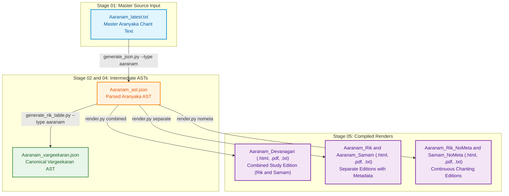

# Jaimineeya Samavedam — Traceability & Lineage Report: Aaranam

- **Corpus**: `aaranam`
- **Edition**: `1.16`
- **Generated Timestamp**: `22-10-2026 15:24:10`
- **Validation Status**: `PASSED`

---

## 1. Liturgical Invariants & Metrics
| Metric | Active Count | Baseline Invariant | Status |
| :--- | :--- | :--- | :--- |
| **Pathas (SuperSections)** | 6 | 6 | PASS |
| **Khandas (Sections)** | 25 | 25 | PASS |
| **Samas (Liturgical Chants)** | 295 | 295 | PASS |

---

## 2. End-to-End Pipeline Lineage Flowchart
The following diagram illustrates how active master inputs flow through intermediate parsed/canonical ASTs to produce each final render in `05_renders/`:



---

## 3. Direct Output-to-Source Lineage Mapping
This table directly maps each compiled file in `05_renders/` back to the active master source text in `01_input/` and intermediate AST in `02_ast/` that produced it.

| Output Render Artifact | Format | Compiled Timestamp | Purpose / Description | Master Input File (`01_input/`) | Intermediate AST (`02_ast/`) | Pipeline Generation Path |
| :--- | :--- | :--- | :--- | :--- | :--- | :--- |
| [`Aaranam_Devanagari.pdf`](../05_renders/pdf/Aaranam_Devanagari.pdf) | `PDF` | `01-10-2026 23:59:00` | Aranyaka Liturgical Chants | [`Aaranam_latest.txt`](../01_input/Aaranam_latest.txt) | `Aaranam_ast.json (Canonical: Aaranam_vargeekaran.json)` | `generate_json.py --type aaranam -> render.py --type aaranam` |
| [`Aaranam_Rik_Devanagari.pdf`](../05_renders/pdf/Aaranam_Rik_Devanagari.pdf) | `PDF` | `01-10-2026 23:59:00` | Aranyaka Liturgical Chants | [`Aaranam_latest.txt`](../01_input/Aaranam_latest.txt) | `Aaranam_ast.json (Canonical: Aaranam_vargeekaran.json)` | `generate_json.py --type aaranam -> render.py --type aaranam` |
| [`Aaranam_Rik_NoMeta_Devanagari.pdf`](../05_renders/pdf/Aaranam_Rik_NoMeta_Devanagari.pdf) | `PDF` | `01-10-2026 23:59:00` | Aranyaka Liturgical Chants | [`Aaranam_latest.txt`](../01_input/Aaranam_latest.txt) | `Aaranam_ast.json (Canonical: Aaranam_vargeekaran.json)` | `generate_json.py --type aaranam -> render.py --type aaranam` |
| [`Aaranam_Samam_Devanagari.pdf`](../05_renders/pdf/Aaranam_Samam_Devanagari.pdf) | `PDF` | `01-10-2026 23:59:00` | Aranyaka Liturgical Chants | [`Aaranam_latest.txt`](../01_input/Aaranam_latest.txt) | `Aaranam_ast.json (Canonical: Aaranam_vargeekaran.json)` | `generate_json.py --type aaranam -> render.py --type aaranam` |
| [`Aaranam_Samam_NoMeta_Devanagari.pdf`](../05_renders/pdf/Aaranam_Samam_NoMeta_Devanagari.pdf) | `PDF` | `01-10-2026 23:59:00` | Aranyaka Liturgical Chants | [`Aaranam_latest.txt`](../01_input/Aaranam_latest.txt) | `Aaranam_ast.json (Canonical: Aaranam_vargeekaran.json)` | `generate_json.py --type aaranam -> render.py --type aaranam` |
| [`Aaranam_Devanagari.html`](../05_renders/html/Aaranam_Devanagari.html) | `HTML` | `13-10-2026 12:27:04` | Aranyaka Liturgical Chants | [`Aaranam_latest.txt`](../01_input/Aaranam_latest.txt) | `Aaranam_ast.json (Canonical: Aaranam_vargeekaran.json)` | `generate_json.py --type aaranam -> render.py --type aaranam` |
| [`Aaranam_Rik_Devanagari.html`](../05_renders/html/Aaranam_Rik_Devanagari.html) | `HTML` | `13-10-2026 12:27:04` | Aranyaka Liturgical Chants | [`Aaranam_latest.txt`](../01_input/Aaranam_latest.txt) | `Aaranam_ast.json (Canonical: Aaranam_vargeekaran.json)` | `generate_json.py --type aaranam -> render.py --type aaranam` |
| [`Aaranam_Rik_NoMeta_Devanagari.html`](../05_renders/html/Aaranam_Rik_NoMeta_Devanagari.html) | `HTML` | `13-10-2026 12:27:04` | Aranyaka Liturgical Chants | [`Aaranam_latest.txt`](../01_input/Aaranam_latest.txt) | `Aaranam_ast.json (Canonical: Aaranam_vargeekaran.json)` | `generate_json.py --type aaranam -> render.py --type aaranam` |
| [`Aaranam_Samam_Devanagari.html`](../05_renders/html/Aaranam_Samam_Devanagari.html) | `HTML` | `13-10-2026 12:27:04` | Aranyaka Liturgical Chants | [`Aaranam_latest.txt`](../01_input/Aaranam_latest.txt) | `Aaranam_ast.json (Canonical: Aaranam_vargeekaran.json)` | `generate_json.py --type aaranam -> render.py --type aaranam` |
| [`Aaranam_Samam_NoMeta_Devanagari.html`](../05_renders/html/Aaranam_Samam_NoMeta_Devanagari.html) | `HTML` | `13-10-2026 12:27:05` | Aranyaka Liturgical Chants | [`Aaranam_latest.txt`](../01_input/Aaranam_latest.txt) | `Aaranam_ast.json (Canonical: Aaranam_vargeekaran.json)` | `generate_json.py --type aaranam -> render.py --type aaranam` |
| [`Aaranam_Devanagari_Unicode.txt`](../05_renders/txt/Aaranam_Devanagari_Unicode.txt) | `TXT` | `11-10-2026 15:26:18` | Aranyaka Liturgical Chants | [`Aaranam_latest.txt`](../01_input/Aaranam_latest.txt) | `Aaranam_ast.json (Canonical: Aaranam_vargeekaran.json)` | `generate_json.py --type aaranam -> render.py --type aaranam` |

---

## 4. Active Master Inputs (`01_input/`)
Only the active master source files utilized for pipeline generation are listed below:

| Active Input File | Size | SHA-256 Checksum |
| :--- | :--- | :--- |
| [`Aaranam_latest.txt`](../01_input/Aaranam_latest.txt) | 501.0 KB | `149cb2aa7070e421cd490c464fe94bb3c40acd2cb3df54761d7df6be7886681c` |

---

## 5. Intermediate ASTs & Canonical Datasets

### Parsed ASTs (`02_ast/`)
| AST File | Size | SHA-256 Checksum |
| :--- | :--- | :--- |
| [`Aaranam_ast.json`](../02_ast/Aaranam_ast.json) | 605.8 KB | `3a33fe85c94c774f5774b02447ed4ed7b299e58179214d1cc794803544377738` |

### Canonical Datasets (`04_canonical/`)
| Canonical File | Size | SHA-256 Checksum |
| :--- | :--- | :--- |
| [`Aaranam_vargeekaran.json`](../04_canonical/Aaranam_vargeekaran.json) | 745.8 KB | `e40c6712769657e7658491b1f702ee9aeca5339c2b29fc080c48bf0f8f355047` |

### Reconciliation Tables (`03_reconciliation/`)
| File Name | Size |
| :--- | :--- |
| [`Aaranam_Rik_Table.csv`](../03_reconciliation/Aaranam_Rik_Table.csv) | 96.2 KB |
| [`Aaranam_Rik_Table_Baseline.csv`](../03_reconciliation/Aaranam_Rik_Table_Baseline.csv) | 96.2 KB |
| [`Rik Reconciliation table (JSV-KSV) - Aaranam_latest.xlsx`](../03_reconciliation/Rik Reconciliation table (JSV-KSV) - Aaranam_latest.xlsx) | 71.0 KB |

---

## 6. Compiled Render Catalog (`05_renders/`)

### PDF Documents (`05_renders/pdf/`)
| File Name | Mode / Edition | Target Script | Size | SHA-256 Checksum |
| :--- | :--- | :--- | :--- | :--- |
| [`Aaranam_Devanagari.pdf`](../05_renders/pdf/Aaranam_Devanagari.pdf) | Combined (Study Edition) | Devanagari (Standard) | 525.1 KB | `7838d3f405325244ccf127eb951e7fe292ca1fd9b644e0c0677b61c9d4a641e8` |
| [`Aaranam_Rik_Devanagari.pdf`](../05_renders/pdf/Aaranam_Rik_Devanagari.pdf) | Combined (Study Edition) | Devanagari (Standard) | 130.3 KB | `6dea6f2a96117fc3d1778fa4ea6d11bf2c0938b1408e4bdc51d9645fa0939ea2` |
| [`Aaranam_Rik_NoMeta_Devanagari.pdf`](../05_renders/pdf/Aaranam_Rik_NoMeta_Devanagari.pdf) | NoMeta (Continuous Chanting) | Devanagari (Standard) | 118.4 KB | `e80a3a2f20d08d8a255519510b4c16286001b5f088d892273ab6707cdfae026a` |
| [`Aaranam_Samam_Devanagari.pdf`](../05_renders/pdf/Aaranam_Samam_Devanagari.pdf) | Combined (Study Edition) | Devanagari (Standard) | 486.8 KB | `9e8e8702e38682a0a9c421b476f19a4bef40b73208269c493a41966cc7a6eb33` |
| [`Aaranam_Samam_NoMeta_Devanagari.pdf`](../05_renders/pdf/Aaranam_Samam_NoMeta_Devanagari.pdf) | NoMeta (Continuous Chanting) | Devanagari (Standard) | 486.8 KB | `de5b8d95cdee8086d889cedf8ddb17604dad98bc04652a6ab857f433448f4ab9` |

### HTML Readers (`05_renders/html/`)
| File Name | Mode / Edition | Target Script | Size | SHA-256 Checksum |
| :--- | :--- | :--- | :--- | :--- |
| [`Aaranam_Devanagari.html`](../05_renders/html/Aaranam_Devanagari.html) | Combined (Study Edition) | Devanagari (Standard) | 7.69 MB | `751db8a6d4de14d70eab15f88b199dcf441d4d3323e962f28f71aae5cc178498` |
| [`Aaranam_Rik_Devanagari.html`](../05_renders/html/Aaranam_Rik_Devanagari.html) | Combined (Study Edition) | Devanagari (Standard) | 872.6 KB | `1ba4c2179ac22374ed8870b8db8028d54fa2f7f28afaf2caf3b8ba0de3100fda` |
| [`Aaranam_Rik_NoMeta_Devanagari.html`](../05_renders/html/Aaranam_Rik_NoMeta_Devanagari.html) | NoMeta (Continuous Chanting) | Devanagari (Standard) | 843.9 KB | `a3cb39ffd3288edf29059cc1ae0d00f74ecfadb94c131210756e6aa94c855f2e` |
| [`Aaranam_Samam_Devanagari.html`](../05_renders/html/Aaranam_Samam_Devanagari.html) | Combined (Study Edition) | Devanagari (Standard) | 5.34 MB | `ea1fbd4a06fa2d28823ca47c58f2c8497dc3732dda9a6027e742f3eb9ed498a0` |
| [`Aaranam_Samam_NoMeta_Devanagari.html`](../05_renders/html/Aaranam_Samam_NoMeta_Devanagari.html) | NoMeta (Continuous Chanting) | Devanagari (Standard) | 5.34 MB | `ea1fbd4a06fa2d28823ca47c58f2c8497dc3732dda9a6027e742f3eb9ed498a0` |

### PlainText Exports (`05_renders/txt/`)
| File Name | Mode / Edition | Target Script | Size | SHA-256 Checksum |
| :--- | :--- | :--- | :--- | :--- |
| [`Aaranam_Devanagari_Unicode.txt`](../05_renders/txt/Aaranam_Devanagari_Unicode.txt) | Combined (Study Edition) | Devanagari (Standard) | 504.1 KB | `7b978eaca0808f19924bf6977914776736ebd466069effbf1733c12112ddaab2` |

---

## 7. Audit Reports & Integrity Check

### Audit Reports (`06_reports/`)
| Report File | Size |
| :--- | :--- |
| [`Aaranam_Continuity_Report_Final.txt`](Aaranam_Continuity_Report_Final.txt) | 1.0 KB |
| [`Aaranam_vargeekaran_continuity_report.txt`](Aaranam_vargeekaran_continuity_report.txt) | 1.0 KB |

### Verification Command
To verify cryptographic and liturgical invariants against golden baselines:
```bash
python src/tools/validate_run.py aaranam
```
