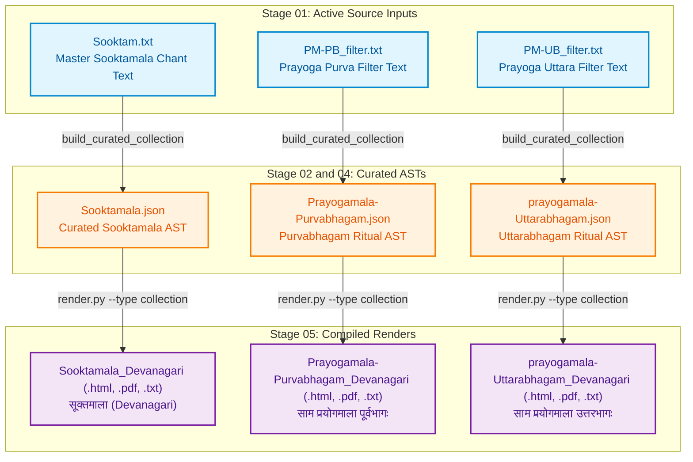

# Jaimineeya Samavedam — Traceability & Lineage Report: Collections

- **Corpus**: `collections`
- **Edition**: `2.05`
- **Generated Timestamp**: `22-10-2026 15:24:10`
- **Validation Status**: `PASSED`

---

## 1. Liturgical Invariants & Metrics
| Metric | Active Count | Baseline Invariant | Status |
| :--- | :--- | :--- | :--- |
| **Pathas (SuperSections)** | 1 | None | PASS |
| **Khandas (Sections)** | 25 | None | PASS |
| **Samas (Liturgical Chants)** | 178 | None | PASS |

---

## 2. End-to-End Pipeline Lineage Flowchart
The following diagram illustrates how active master inputs flow through intermediate parsed/canonical ASTs to produce each final render in `05_renders/`:



---

## 3. Direct Output-to-Source Lineage Mapping
This table directly maps each compiled file in `05_renders/` back to the active master source text in `01_input/` and intermediate AST in `02_ast/` that produced it.

| Output Render Artifact | Format | Compiled Timestamp | Purpose / Description | Master Input File (`01_input/`) | Intermediate AST (`02_ast/`) | Pipeline Generation Path |
| :--- | :--- | :--- | :--- | :--- | :--- | :--- |
| [`Prayogamala-Purvabhagam_Devanagari.pdf`](../05_renders/pdf/Prayogamala-Purvabhagam_Devanagari.pdf) | `PDF` | `02-10-2026 01:13:01` | Ritual Prayoga: Purvabhagam (साम प्रयोगमाला पूर्वभागः) | [`PM-PB_filter.txt`](../01_input/PM-PB_filter.txt) | `Prayogamala-Purvabhagam.json` | `build_curated_collection -> render.py` |
| [`prayogamala-Uttarabhagam_Devanagari.pdf`](../05_renders/pdf/prayogamala-Uttarabhagam_Devanagari.pdf) | `PDF` | `02-10-2026 01:13:01` | Ritual Prayoga: Uttarabhagam (साम प्रयोगमाला उत्तरभागः) | [`PM-UB_filter.txt`](../01_input/PM-UB_filter.txt) | `prayogamala-Uttarabhagam.json` | `build_curated_collection -> render.py` |
| [`Sooktamala_Devanagari.pdf`](../05_renders/pdf/Sooktamala_Devanagari.pdf) | `PDF` | `02-10-2026 01:13:01` | Curated Sooktam Collection (सूक्तमाला) | [`Sooktam.txt`](../01_input/Sooktam.txt) | `Sooktamala.json` | `build_curated_collection -> render.py` |
| [`Prayogamala-Purvabhagam_Devanagari.html`](../05_renders/html/Prayogamala-Purvabhagam_Devanagari.html) | `HTML` | `22-10-2026 15:24:03` | Ritual Prayoga: Purvabhagam (साम प्रयोगमाला पूर्वभागः) | [`PM-PB_filter.txt`](../01_input/PM-PB_filter.txt) | `Prayogamala-Purvabhagam.json` | `build_curated_collection -> render.py` |
| [`Prayogamala-Purvabhagam_Rik_Devanagari.html`](../05_renders/html/Prayogamala-Purvabhagam_Rik_Devanagari.html) | `HTML` | `22-10-2026 15:24:04` | Ritual Prayoga: Purvabhagam (साम प्रयोगमाला पूर्वभागः) | [`PM-PB_filter.txt`](../01_input/PM-PB_filter.txt) | `Prayogamala-Purvabhagam.json` | `build_curated_collection -> render.py` |
| [`Prayogamala-Purvabhagam_Rik_NoMeta_Devanagari.html`](../05_renders/html/Prayogamala-Purvabhagam_Rik_NoMeta_Devanagari.html) | `HTML` | `22-10-2026 15:24:05` | Ritual Prayoga: Purvabhagam (साम प्रयोगमाला पूर्वभागः) | [`PM-PB_filter.txt`](../01_input/PM-PB_filter.txt) | `Prayogamala-Purvabhagam.json` | `build_curated_collection -> render.py` |
| [`Prayogamala-Purvabhagam_Samam_Devanagari.html`](../05_renders/html/Prayogamala-Purvabhagam_Samam_Devanagari.html) | `HTML` | `22-10-2026 15:24:04` | Ritual Prayoga: Purvabhagam (साम प्रयोगमाला पूर्वभागः) | [`PM-PB_filter.txt`](../01_input/PM-PB_filter.txt) | `Prayogamala-Purvabhagam.json` | `build_curated_collection -> render.py` |
| [`Prayogamala-Purvabhagam_Samam_NoMeta_Devanagari.html`](../05_renders/html/Prayogamala-Purvabhagam_Samam_NoMeta_Devanagari.html) | `HTML` | `22-10-2026 15:24:06` | Ritual Prayoga: Purvabhagam (साम प्रयोगमाला पूर्वभागः) | [`PM-PB_filter.txt`](../01_input/PM-PB_filter.txt) | `Prayogamala-Purvabhagam.json` | `build_curated_collection -> render.py` |
| [`prayogamala-Uttarabhagam_Devanagari.html`](../05_renders/html/prayogamala-Uttarabhagam_Devanagari.html) | `HTML` | `22-10-2026 15:24:07` | Ritual Prayoga: Uttarabhagam (साम प्रयोगमाला उत्तरभागः) | [`PM-UB_filter.txt`](../01_input/PM-UB_filter.txt) | `prayogamala-Uttarabhagam.json` | `build_curated_collection -> render.py` |
| [`prayogamala-Uttarabhagam_Rik_Devanagari.html`](../05_renders/html/prayogamala-Uttarabhagam_Rik_Devanagari.html) | `HTML` | `22-10-2026 15:24:08` | Ritual Prayoga: Uttarabhagam (साम प्रयोगमाला उत्तरभागः) | [`PM-UB_filter.txt`](../01_input/PM-UB_filter.txt) | `prayogamala-Uttarabhagam.json` | `build_curated_collection -> render.py` |
| [`prayogamala-Uttarabhagam_Rik_NoMeta_Devanagari.html`](../05_renders/html/prayogamala-Uttarabhagam_Rik_NoMeta_Devanagari.html) | `HTML` | `22-10-2026 15:24:09` | Ritual Prayoga: Uttarabhagam (साम प्रयोगमाला उत्तरभागः) | [`PM-UB_filter.txt`](../01_input/PM-UB_filter.txt) | `prayogamala-Uttarabhagam.json` | `build_curated_collection -> render.py` |
| [`prayogamala-Uttarabhagam_Samam_Devanagari.html`](../05_renders/html/prayogamala-Uttarabhagam_Samam_Devanagari.html) | `HTML` | `22-10-2026 15:24:08` | Ritual Prayoga: Uttarabhagam (साम प्रयोगमाला उत्तरभागः) | [`PM-UB_filter.txt`](../01_input/PM-UB_filter.txt) | `prayogamala-Uttarabhagam.json` | `build_curated_collection -> render.py` |
| [`prayogamala-Uttarabhagam_Samam_NoMeta_Devanagari.html`](../05_renders/html/prayogamala-Uttarabhagam_Samam_NoMeta_Devanagari.html) | `HTML` | `22-10-2026 15:24:10` | Ritual Prayoga: Uttarabhagam (साम प्रयोगमाला उत्तरभागः) | [`PM-UB_filter.txt`](../01_input/PM-UB_filter.txt) | `prayogamala-Uttarabhagam.json` | `build_curated_collection -> render.py` |
| [`Sooktamala_Devanagari.html`](../05_renders/html/Sooktamala_Devanagari.html) | `HTML` | `22-10-2026 15:23:58` | Curated Sooktam Collection (सूक्तमाला) | [`Sooktam.txt`](../01_input/Sooktam.txt) | `Sooktamala.json` | `build_curated_collection -> render.py` |
| [`Sooktamala_Rik_Devanagari.html`](../05_renders/html/Sooktamala_Rik_Devanagari.html) | `HTML` | `22-10-2026 15:24:00` | Curated Sooktam Collection (सूक्तमाला) | [`Sooktam.txt`](../01_input/Sooktam.txt) | `Sooktamala.json` | `build_curated_collection -> render.py` |
| [`Sooktamala_Rik_NoMeta_Devanagari.html`](../05_renders/html/Sooktamala_Rik_NoMeta_Devanagari.html) | `HTML` | `22-10-2026 15:24:01` | Curated Sooktam Collection (सूक्तमाला) | [`Sooktam.txt`](../01_input/Sooktam.txt) | `Sooktamala.json` | `build_curated_collection -> render.py` |
| [`Sooktamala_Samam_Devanagari.html`](../05_renders/html/Sooktamala_Samam_Devanagari.html) | `HTML` | `22-10-2026 15:24:00` | Curated Sooktam Collection (सूक्तमाला) | [`Sooktam.txt`](../01_input/Sooktam.txt) | `Sooktamala.json` | `build_curated_collection -> render.py` |
| [`Sooktamala_Samam_NoMeta_Devanagari.html`](../05_renders/html/Sooktamala_Samam_NoMeta_Devanagari.html) | `HTML` | `22-10-2026 15:24:01` | Curated Sooktam Collection (सूक्तमाला) | [`Sooktam.txt`](../01_input/Sooktam.txt) | `Sooktamala.json` | `build_curated_collection -> render.py` |
| [`Prayogamala-Purvabhagam_Devanagari_Unicode.txt`](../05_renders/txt/Prayogamala-Purvabhagam_Devanagari_Unicode.txt) | `TXT` | `22-10-2026 15:24:02` | Ritual Prayoga: Purvabhagam (साम प्रयोगमाला पूर्वभागः) | [`PM-PB_filter.txt`](../01_input/PM-PB_filter.txt) | `Prayogamala-Purvabhagam.json` | `build_curated_collection -> render.py` |
| [`Prayogamala-Purvabhagam_Rik_Devanagari_Unicode.txt`](../05_renders/txt/Prayogamala-Purvabhagam_Rik_Devanagari_Unicode.txt) | `TXT` | `22-10-2026 15:24:04` | Ritual Prayoga: Purvabhagam (साम प्रयोगमाला पूर्वभागः) | [`PM-PB_filter.txt`](../01_input/PM-PB_filter.txt) | `Prayogamala-Purvabhagam.json` | `build_curated_collection -> render.py` |
| [`Prayogamala-Purvabhagam_Rik_NoMeta_Devanagari_Unicode.txt`](../05_renders/txt/Prayogamala-Purvabhagam_Rik_NoMeta_Devanagari_Unicode.txt) | `TXT` | `22-10-2026 15:24:05` | Ritual Prayoga: Purvabhagam (साम प्रयोगमाला पूर्वभागः) | [`PM-PB_filter.txt`](../01_input/PM-PB_filter.txt) | `Prayogamala-Purvabhagam.json` | `build_curated_collection -> render.py` |
| [`Prayogamala-Purvabhagam_Samam_Devanagari_Unicode.txt`](../05_renders/txt/Prayogamala-Purvabhagam_Samam_Devanagari_Unicode.txt) | `TXT` | `22-10-2026 15:24:04` | Ritual Prayoga: Purvabhagam (साम प्रयोगमाला पूर्वभागः) | [`PM-PB_filter.txt`](../01_input/PM-PB_filter.txt) | `Prayogamala-Purvabhagam.json` | `build_curated_collection -> render.py` |
| [`Prayogamala-Purvabhagam_Samam_NoMeta_Devanagari_Unicode.txt`](../05_renders/txt/Prayogamala-Purvabhagam_Samam_NoMeta_Devanagari_Unicode.txt) | `TXT` | `22-10-2026 15:24:06` | Ritual Prayoga: Purvabhagam (साम प्रयोगमाला पूर्वभागः) | [`PM-PB_filter.txt`](../01_input/PM-PB_filter.txt) | `Prayogamala-Purvabhagam.json` | `build_curated_collection -> render.py` |
| [`prayogamala-Uttarabhagam_Devanagari_Unicode.txt`](../05_renders/txt/prayogamala-Uttarabhagam_Devanagari_Unicode.txt) | `TXT` | `22-10-2026 15:24:07` | Ritual Prayoga: Uttarabhagam (साम प्रयोगमाला उत्तरभागः) | [`PM-UB_filter.txt`](../01_input/PM-UB_filter.txt) | `prayogamala-Uttarabhagam.json` | `build_curated_collection -> render.py` |
| [`prayogamala-Uttarabhagam_Rik_Devanagari_Unicode.txt`](../05_renders/txt/prayogamala-Uttarabhagam_Rik_Devanagari_Unicode.txt) | `TXT` | `22-10-2026 15:24:08` | Ritual Prayoga: Uttarabhagam (साम प्रयोगमाला उत्तरभागः) | [`PM-UB_filter.txt`](../01_input/PM-UB_filter.txt) | `prayogamala-Uttarabhagam.json` | `build_curated_collection -> render.py` |
| [`prayogamala-Uttarabhagam_Rik_NoMeta_Devanagari_Unicode.txt`](../05_renders/txt/prayogamala-Uttarabhagam_Rik_NoMeta_Devanagari_Unicode.txt) | `TXT` | `22-10-2026 15:24:09` | Ritual Prayoga: Uttarabhagam (साम प्रयोगमाला उत्तरभागः) | [`PM-UB_filter.txt`](../01_input/PM-UB_filter.txt) | `prayogamala-Uttarabhagam.json` | `build_curated_collection -> render.py` |
| [`prayogamala-Uttarabhagam_Samam_Devanagari_Unicode.txt`](../05_renders/txt/prayogamala-Uttarabhagam_Samam_Devanagari_Unicode.txt) | `TXT` | `22-10-2026 15:24:08` | Ritual Prayoga: Uttarabhagam (साम प्रयोगमाला उत्तरभागः) | [`PM-UB_filter.txt`](../01_input/PM-UB_filter.txt) | `prayogamala-Uttarabhagam.json` | `build_curated_collection -> render.py` |
| [`prayogamala-Uttarabhagam_Samam_NoMeta_Devanagari_Unicode.txt`](../05_renders/txt/prayogamala-Uttarabhagam_Samam_NoMeta_Devanagari_Unicode.txt) | `TXT` | `22-10-2026 15:24:09` | Ritual Prayoga: Uttarabhagam (साम प्रयोगमाला उत्तरभागः) | [`PM-UB_filter.txt`](../01_input/PM-UB_filter.txt) | `prayogamala-Uttarabhagam.json` | `build_curated_collection -> render.py` |
| [`Sooktamala_Devanagari_Unicode.txt`](../05_renders/txt/Sooktamala_Devanagari_Unicode.txt) | `TXT` | `22-10-2026 15:23:58` | Curated Sooktam Collection (सूक्तमाला) | [`Sooktam.txt`](../01_input/Sooktam.txt) | `Sooktamala.json` | `build_curated_collection -> render.py` |
| [`Sooktamala_Rik_Devanagari_Unicode.txt`](../05_renders/txt/Sooktamala_Rik_Devanagari_Unicode.txt) | `TXT` | `22-10-2026 15:24:00` | Curated Sooktam Collection (सूक्तमाला) | [`Sooktam.txt`](../01_input/Sooktam.txt) | `Sooktamala.json` | `build_curated_collection -> render.py` |
| [`Sooktamala_Rik_NoMeta_Devanagari_Unicode.txt`](../05_renders/txt/Sooktamala_Rik_NoMeta_Devanagari_Unicode.txt) | `TXT` | `22-10-2026 15:24:01` | Curated Sooktam Collection (सूक्तमाला) | [`Sooktam.txt`](../01_input/Sooktam.txt) | `Sooktamala.json` | `build_curated_collection -> render.py` |
| [`Sooktamala_Samam_Devanagari_Unicode.txt`](../05_renders/txt/Sooktamala_Samam_Devanagari_Unicode.txt) | `TXT` | `22-10-2026 15:24:00` | Curated Sooktam Collection (सूक्तमाला) | [`Sooktam.txt`](../01_input/Sooktam.txt) | `Sooktamala.json` | `build_curated_collection -> render.py` |
| [`Sooktamala_Samam_NoMeta_Devanagari_Unicode.txt`](../05_renders/txt/Sooktamala_Samam_NoMeta_Devanagari_Unicode.txt) | `TXT` | `22-10-2026 15:24:01` | Curated Sooktam Collection (सूक्तमाला) | [`Sooktam.txt`](../01_input/Sooktam.txt) | `Sooktamala.json` | `build_curated_collection -> render.py` |

---

## 4. Active Master Inputs (`01_input/`)
Only the active master source files utilized for pipeline generation are listed below:

| Active Input File | Size | SHA-256 Checksum |
| :--- | :--- | :--- |
| [`PM-PB_filter.txt`](../01_input/PM-PB_filter.txt) | 6.0 KB | `2d66508f95d9c300c546652252375c839de46c676726bd316d231ca1ef268483` |
| [`PM-UB_filter.txt`](../01_input/PM-UB_filter.txt) | 1.2 KB | `d347f51a8019b501f2a2b91224af7ababd0c69d6d02bc60ee02d88b6036fea15` |
| [`Sooktam.txt`](../01_input/Sooktam.txt) | 199.2 KB | `28b2c97dd85d20ffb09a38467ad2ae8935433775fb8ce06553bd96dfab327d49` |

---

## 5. Intermediate ASTs & Canonical Datasets

### Parsed ASTs (`02_ast/`)
| AST File | Size | SHA-256 Checksum |
| :--- | :--- | :--- |
| [`Prayogamala-Purvabhagam.json`](../02_ast/Prayogamala-Purvabhagam.json) | 358.6 KB | `20cea15e737c906eff55ab44014126d51dca2345897b20971d91b0bfe8fae85e` |
| [`prayogamala-Uttarabhagam.json`](../02_ast/prayogamala-Uttarabhagam.json) | 107.3 KB | `a53a89ed46731e782392a8ff907ba46c5a4a14ba35fb1b5dd328696d2f59230d` |
| [`Sooktamala.json`](../02_ast/Sooktamala.json) | 320.3 KB | `cd371af08e09d20f58e1b329b0be58112422ac7eb1d78cd7e6bb8795dd9ee6e9` |

### Canonical Datasets (`04_canonical/`)
| Canonical File | Size | SHA-256 Checksum |
| :--- | :--- | :--- |
| [`Prayogamala-Purvabhagam.json`](../04_canonical/Prayogamala-Purvabhagam.json) | 358.6 KB | `20cea15e737c906eff55ab44014126d51dca2345897b20971d91b0bfe8fae85e` |
| [`prayogamala-Uttarabhagam.json`](../04_canonical/prayogamala-Uttarabhagam.json) | 107.3 KB | `a53a89ed46731e782392a8ff907ba46c5a4a14ba35fb1b5dd328696d2f59230d` |
| [`Sooktamala.json`](../04_canonical/Sooktamala.json) | 320.3 KB | `cd371af08e09d20f58e1b329b0be58112422ac7eb1d78cd7e6bb8795dd9ee6e9` |

---

## 6. Compiled Render Catalog (`05_renders/`)

### PDF Documents (`05_renders/pdf/`)
| File Name | Mode / Edition | Target Script | Size | SHA-256 Checksum |
| :--- | :--- | :--- | :--- | :--- |
| [`Prayogamala-Purvabhagam_Devanagari.pdf`](../05_renders/pdf/Prayogamala-Purvabhagam_Devanagari.pdf) | Combined (Study Edition) | Devanagari (Standard) | 292.5 KB | `eedb761a6c10c12829bf0ec0246674efdadcca4739b2ff26bf71af73969678c2` |
| [`prayogamala-Uttarabhagam_Devanagari.pdf`](../05_renders/pdf/prayogamala-Uttarabhagam_Devanagari.pdf) | Standard | Devanagari (Standard) | 140.0 KB | `2d37196a29b6605320c7e342303ccebf9c793559756f887a5d0744e9584babda` |
| [`Sooktamala_Devanagari.pdf`](../05_renders/pdf/Sooktamala_Devanagari.pdf) | Combined (Study Edition) | Devanagari (Standard) | 265.3 KB | `fa2df25313c25535d57b0ad2f99f9b73a9c98f6f5e449667f9399787a5c36383` |

### HTML Readers (`05_renders/html/`)
| File Name | Mode / Edition | Target Script | Size | SHA-256 Checksum |
| :--- | :--- | :--- | :--- | :--- |
| [`Prayogamala-Purvabhagam_Devanagari.html`](../05_renders/html/Prayogamala-Purvabhagam_Devanagari.html) | Combined (Study Edition) | Devanagari (Standard) | 5.04 MB | `e43c9bd5dd135343f139310bc2bfa45f3ff8526e33618174f49aeef936c95e80` |
| [`Prayogamala-Purvabhagam_Rik_Devanagari.html`](../05_renders/html/Prayogamala-Purvabhagam_Rik_Devanagari.html) | Combined (Study Edition) | Devanagari (Standard) | 2.63 MB | `e71367c256b755d618fefe258cbe9dc001f185d7e52ac94c1bd0416c045089d2` |
| [`Prayogamala-Purvabhagam_Rik_NoMeta_Devanagari.html`](../05_renders/html/Prayogamala-Purvabhagam_Rik_NoMeta_Devanagari.html) | NoMeta (Continuous Chanting) | Devanagari (Standard) | 2.63 MB | `4f843d9747374b20fbbf3c9b2ae70a621eb0aabb551a80be6f4eac37349657fa` |
| [`Prayogamala-Purvabhagam_Samam_Devanagari.html`](../05_renders/html/Prayogamala-Purvabhagam_Samam_Devanagari.html) | Combined (Study Edition) | Devanagari (Standard) | 5.02 MB | `30e2005b486ed000ea20922f85b5c64766f08242ec792c5a08e5718ee2ff35d5` |
| [`Prayogamala-Purvabhagam_Samam_NoMeta_Devanagari.html`](../05_renders/html/Prayogamala-Purvabhagam_Samam_NoMeta_Devanagari.html) | NoMeta (Continuous Chanting) | Devanagari (Standard) | 5.02 MB | `16d5cbb2d4f834e32e067567fe03a78161a62b1da06038a9c12c8c681695e346` |
| [`prayogamala-Uttarabhagam_Devanagari.html`](../05_renders/html/prayogamala-Uttarabhagam_Devanagari.html) | Standard | Devanagari (Standard) | 3.40 MB | `df658f19f687efca6f5a5d0e5050684f37dde11b447bd7406083d0c5fdaaa9de` |
| [`prayogamala-Uttarabhagam_Rik_Devanagari.html`](../05_renders/html/prayogamala-Uttarabhagam_Rik_Devanagari.html) | Standard | Devanagari (Standard) | 2.57 MB | `c7bee77d624d2f32b3de90c22b4805fe2a7d9a5da3d886b3913584fa53a5c946` |
| [`prayogamala-Uttarabhagam_Rik_NoMeta_Devanagari.html`](../05_renders/html/prayogamala-Uttarabhagam_Rik_NoMeta_Devanagari.html) | NoMeta (Continuous Chanting) | Devanagari (Standard) | 2.57 MB | `0033c5da86823f50e0ea3e5a66885d976befb670bc6b3473377ac6339be43fee` |
| [`prayogamala-Uttarabhagam_Samam_Devanagari.html`](../05_renders/html/prayogamala-Uttarabhagam_Samam_Devanagari.html) | Standard | Devanagari (Standard) | 3.40 MB | `84e5f833726831352ee3342216aec5bc770b2b19ac80913ed824434fae97ba90` |
| [`prayogamala-Uttarabhagam_Samam_NoMeta_Devanagari.html`](../05_renders/html/prayogamala-Uttarabhagam_Samam_NoMeta_Devanagari.html) | NoMeta (Continuous Chanting) | Devanagari (Standard) | 3.40 MB | `0dc5636af1ce90dfeadafdbc3e6e721d601a79f20017ee375a65735cbabb12fc` |
| [`Sooktamala_Devanagari.html`](../05_renders/html/Sooktamala_Devanagari.html) | Combined (Study Edition) | Devanagari (Standard) | 4.54 MB | `4442fab8f8d77dd93947f224d2718df7df47c0dc0fdd363cb64e260567244974` |
| [`Sooktamala_Rik_Devanagari.html`](../05_renders/html/Sooktamala_Rik_Devanagari.html) | Combined (Study Edition) | Devanagari (Standard) | 2.67 MB | `333c67c28e5d91a87d1aad46bd3f5be54e5d69519f83d926b73ae1f565e7c919` |
| [`Sooktamala_Rik_NoMeta_Devanagari.html`](../05_renders/html/Sooktamala_Rik_NoMeta_Devanagari.html) | NoMeta (Continuous Chanting) | Devanagari (Standard) | 2.66 MB | `108e9f465bafae42efe6fb2ecc33c28bf991243c88e38219d65f073a9aae2f29` |
| [`Sooktamala_Samam_Devanagari.html`](../05_renders/html/Sooktamala_Samam_Devanagari.html) | Combined (Study Edition) | Devanagari (Standard) | 4.50 MB | `f4a20c01091d2fe204e16dc98d98507515c5c40d180e9b703aa66c8778a01284` |
| [`Sooktamala_Samam_NoMeta_Devanagari.html`](../05_renders/html/Sooktamala_Samam_NoMeta_Devanagari.html) | NoMeta (Continuous Chanting) | Devanagari (Standard) | 4.50 MB | `378a8c2c5155edbfb5cc0219ee6be54493c727b45c92a4ee4aca678564095e69` |

### PlainText Exports (`05_renders/txt/`)
| File Name | Mode / Edition | Target Script | Size | SHA-256 Checksum |
| :--- | :--- | :--- | :--- | :--- |
| [`Prayogamala-Purvabhagam_Devanagari_Unicode.txt`](../05_renders/txt/Prayogamala-Purvabhagam_Devanagari_Unicode.txt) | Combined (Study Edition) | Devanagari (Standard) | 232.5 KB | `ad5f75f9ba63e53afd09b037c451536cfe1db0c8454c9b4fe3ab095f8fdf7676` |
| [`Prayogamala-Purvabhagam_Rik_Devanagari_Unicode.txt`](../05_renders/txt/Prayogamala-Purvabhagam_Rik_Devanagari_Unicode.txt) | Combined (Study Edition) | Devanagari (Standard) | 9.7 KB | `c51e4f7958b9c5101efb562bf12cfa6a40b0d8718214dd11d29978eaab97efef` |
| [`Prayogamala-Purvabhagam_Rik_NoMeta_Devanagari_Unicode.txt`](../05_renders/txt/Prayogamala-Purvabhagam_Rik_NoMeta_Devanagari_Unicode.txt) | NoMeta (Continuous Chanting) | Devanagari (Standard) | 9.8 KB | `647c0174c32cabccbf22aeddb6ba508cdaeafda119916e7907ee04283a43415a` |
| [`Prayogamala-Purvabhagam_Samam_Devanagari_Unicode.txt`](../05_renders/txt/Prayogamala-Purvabhagam_Samam_Devanagari_Unicode.txt) | Combined (Study Edition) | Devanagari (Standard) | 228.6 KB | `31b63590d3b356d2d6d55eb9925e58c317708e0ec1dd63a1c36f98bf3325678e` |
| [`Prayogamala-Purvabhagam_Samam_NoMeta_Devanagari_Unicode.txt`](../05_renders/txt/Prayogamala-Purvabhagam_Samam_NoMeta_Devanagari_Unicode.txt) | NoMeta (Continuous Chanting) | Devanagari (Standard) | 221.7 KB | `99f5c4a21b47e3852a46f62a61103ae2983d6cf006dda98367157680f4ee7747` |
| [`prayogamala-Uttarabhagam_Devanagari_Unicode.txt`](../05_renders/txt/prayogamala-Uttarabhagam_Devanagari_Unicode.txt) | Standard | Devanagari (Standard) | 72.4 KB | `89e52a234e800725a1f052a9d71b7f3deed22edc6a3c349ab28d9dea0d552cbd` |
| [`prayogamala-Uttarabhagam_Rik_Devanagari_Unicode.txt`](../05_renders/txt/prayogamala-Uttarabhagam_Rik_Devanagari_Unicode.txt) | Standard | Devanagari (Standard) | 1.3 KB | `f40a47b9545f1bd68c9ecb92863e3d03c62bce92ca41654d7a058750a4fe4fab` |
| [`prayogamala-Uttarabhagam_Rik_NoMeta_Devanagari_Unicode.txt`](../05_renders/txt/prayogamala-Uttarabhagam_Rik_NoMeta_Devanagari_Unicode.txt) | NoMeta (Continuous Chanting) | Devanagari (Standard) | 1.3 KB | `271662fb37730f4d45ed00e1854d3686e478be4ad658b7a576460d55b5f63967` |
| [`prayogamala-Uttarabhagam_Samam_Devanagari_Unicode.txt`](../05_renders/txt/prayogamala-Uttarabhagam_Samam_Devanagari_Unicode.txt) | Standard | Devanagari (Standard) | 72.2 KB | `c3324defa193dd0b4843b493f29ff5127e25e275a1316ec6966d5eac14bc33b1` |
| [`prayogamala-Uttarabhagam_Samam_NoMeta_Devanagari_Unicode.txt`](../05_renders/txt/prayogamala-Uttarabhagam_Samam_NoMeta_Devanagari_Unicode.txt) | NoMeta (Continuous Chanting) | Devanagari (Standard) | 72.2 KB | `e0b8b4b131ac5fb5e27381e07b1ad3e987480c87a6d26cc03968e34d81f1ac9f` |
| [`Sooktamala_Devanagari_Unicode.txt`](../05_renders/txt/Sooktamala_Devanagari_Unicode.txt) | Combined (Study Edition) | Devanagari (Standard) | 206.3 KB | `7de094a868fc126cc3966d1663514964afe1933493e341d0c4af3ec6d5a3fa44` |
| [`Sooktamala_Rik_Devanagari_Unicode.txt`](../05_renders/txt/Sooktamala_Rik_Devanagari_Unicode.txt) | Combined (Study Edition) | Devanagari (Standard) | 18.9 KB | `1a8242ddba9e48a5459cd8e0ba9434a70448f3ee46896047f13879af2fa4f114` |
| [`Sooktamala_Rik_NoMeta_Devanagari_Unicode.txt`](../05_renders/txt/Sooktamala_Rik_NoMeta_Devanagari_Unicode.txt) | NoMeta (Continuous Chanting) | Devanagari (Standard) | 18.0 KB | `c1d10998e54f1e1fa0001db52530ee6a6186a4a6976b9f3e7043f3f516163bcb` |
| [`Sooktamala_Samam_Devanagari_Unicode.txt`](../05_renders/txt/Sooktamala_Samam_Devanagari_Unicode.txt) | Combined (Study Edition) | Devanagari (Standard) | 183.5 KB | `836efc24263dafc60887d962d61b5fb89cc0f8f43bf313f413608d98991b861e` |
| [`Sooktamala_Samam_NoMeta_Devanagari_Unicode.txt`](../05_renders/txt/Sooktamala_Samam_NoMeta_Devanagari_Unicode.txt) | NoMeta (Continuous Chanting) | Devanagari (Standard) | 183.5 KB | `4efb655d84bafaf0efb5c8612f772b05c5719a42d7b7f52de09b6cf037f67763` |

---

## 7. Audit Reports & Integrity Check

### Audit Reports (`06_reports/`)
| Report File | Size |
| :--- | :--- |

### Verification Command
To verify cryptographic and liturgical invariants against golden baselines:
```bash
python src/tools/validate_run.py collections
```
