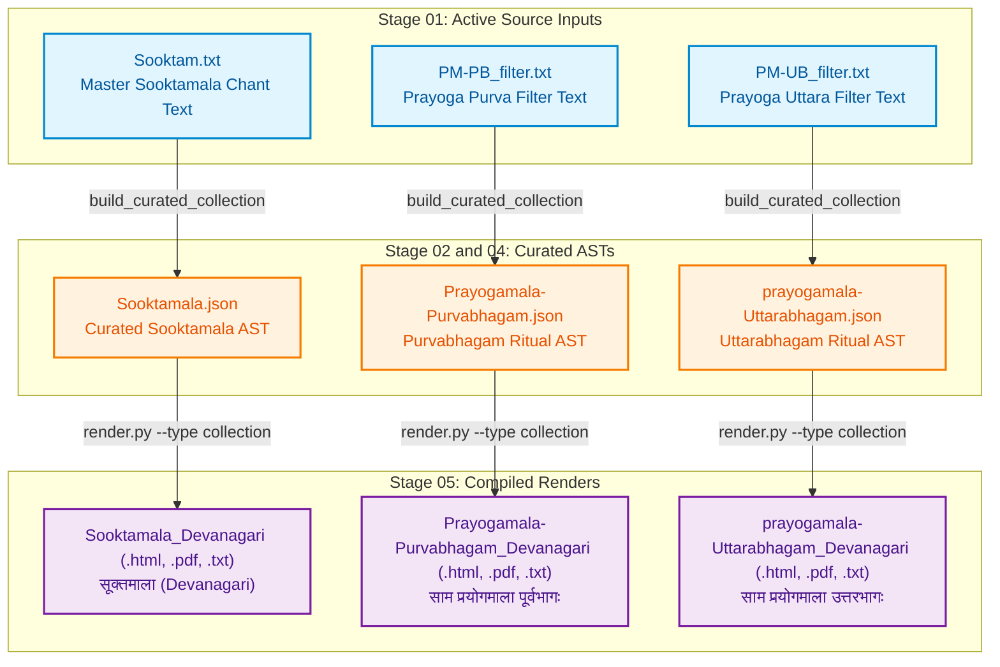

# Jaimineeya Samavedam — Traceability & Lineage Report: Collections

- **Corpus**: `collections`
- **Edition**: `2.05`
- **Generated Timestamp**: `12-10-2026 15:55:28`
- **Validation Status**: `PASSED`

---

## 1. Liturgical Invariants & Metrics
| Metric | Active Count | Baseline Invariant | Status |
| :--- | :--- | :--- | :--- |
| **Pathas (SuperSections)** | 1 | None | PASS |
| **Khandas (Sections)** | 25 | None | PASS |
| **Samas (Liturgical Chants)** | 178 | None | PASS |

---

## 2. End-to-End Pipeline Lineage Flowchart
The following diagram illustrates how active master inputs flow through intermediate parsed/canonical ASTs to produce each final render in `05_renders/`:



---

## 3. Direct Output-to-Source Lineage Mapping
This table directly maps each compiled file in `05_renders/` back to the active master source text in `01_input/` and intermediate AST in `02_ast/` that produced it.

| Output Render Artifact | Format | Compiled Timestamp | Purpose / Description | Master Input File (`01_input/`) | Intermediate AST (`02_ast/`) | Pipeline Generation Path |
| :--- | :--- | :--- | :--- | :--- | :--- | :--- |
| [`Prayogamala-Purvabhagam_Devanagari.pdf`](../05_renders/pdf/Prayogamala-Purvabhagam_Devanagari.pdf) | `PDF` | `02-10-2026 01:13:01` | Ritual Prayoga: Purvabhagam (साम प्रयोगमाला पूर्वभागः) | [`PM-PB_filter.txt`](../01_input/PM-PB_filter.txt) | `Prayogamala-Purvabhagam.json` | `build_curated_collection -> render.py` |
| [`prayogamala-Uttarabhagam_Devanagari.pdf`](../05_renders/pdf/prayogamala-Uttarabhagam_Devanagari.pdf) | `PDF` | `02-10-2026 01:13:01` | Ritual Prayoga: Uttarabhagam (साम प्रयोगमाला उत्तरभागः) | [`PM-UB_filter.txt`](../01_input/PM-UB_filter.txt) | `prayogamala-Uttarabhagam.json` | `build_curated_collection -> render.py` |
| [`Sooktamala_Devanagari.pdf`](../05_renders/pdf/Sooktamala_Devanagari.pdf) | `PDF` | `02-10-2026 01:13:01` | Curated Sooktam Collection (सूक्तमाला) | [`Sooktam.txt`](../01_input/Sooktam.txt) | `Sooktamala.json` | `build_curated_collection -> render.py` |
| [`Prayogamala-Purvabhagam_Devanagari.html`](../05_renders/html/Prayogamala-Purvabhagam_Devanagari.html) | `HTML` | `11-10-2026 15:26:20` | Ritual Prayoga: Purvabhagam (साम प्रयोगमाला पूर्वभागः) | [`PM-PB_filter.txt`](../01_input/PM-PB_filter.txt) | `Prayogamala-Purvabhagam.json` | `build_curated_collection -> render.py` |
| [`prayogamala-Uttarabhagam_Devanagari.html`](../05_renders/html/prayogamala-Uttarabhagam_Devanagari.html) | `HTML` | `11-10-2026 15:26:21` | Ritual Prayoga: Uttarabhagam (साम प्रयोगमाला उत्तरभागः) | [`PM-UB_filter.txt`](../01_input/PM-UB_filter.txt) | `prayogamala-Uttarabhagam.json` | `build_curated_collection -> render.py` |
| [`Sooktamala_Devanagari.html`](../05_renders/html/Sooktamala_Devanagari.html) | `HTML` | `11-10-2026 15:26:19` | Curated Sooktam Collection (सूक्तमाला) | [`Sooktam.txt`](../01_input/Sooktam.txt) | `Sooktamala.json` | `build_curated_collection -> render.py` |
| [`Prayogamala-Purvabhagam_Devanagari_Unicode.txt`](../05_renders/txt/Prayogamala-Purvabhagam_Devanagari_Unicode.txt) | `TXT` | `11-10-2026 15:26:20` | Ritual Prayoga: Purvabhagam (साम प्रयोगमाला पूर्वभागः) | [`PM-PB_filter.txt`](../01_input/PM-PB_filter.txt) | `Prayogamala-Purvabhagam.json` | `build_curated_collection -> render.py` |
| [`prayogamala-Uttarabhagam_Devanagari_Unicode.txt`](../05_renders/txt/prayogamala-Uttarabhagam_Devanagari_Unicode.txt) | `TXT` | `11-10-2026 15:26:21` | Ritual Prayoga: Uttarabhagam (साम प्रयोगमाला उत्तरभागः) | [`PM-UB_filter.txt`](../01_input/PM-UB_filter.txt) | `prayogamala-Uttarabhagam.json` | `build_curated_collection -> render.py` |
| [`Sooktamala_Devanagari_Unicode.txt`](../05_renders/txt/Sooktamala_Devanagari_Unicode.txt) | `TXT` | `11-10-2026 15:26:19` | Curated Sooktam Collection (सूक्तमाला) | [`Sooktam.txt`](../01_input/Sooktam.txt) | `Sooktamala.json` | `build_curated_collection -> render.py` |

---

## 4. Active Master Inputs (`01_input/`)
Only the active master source files utilized for pipeline generation are listed below:

| Active Input File | Size | SHA-256 Checksum |
| :--- | :--- | :--- |
| [`PM-PB_filter.txt`](../01_input/PM-PB_filter.txt) | 6.0 KB | `2d66508f95d9c300c546652252375c839de46c676726bd316d231ca1ef268483` |
| [`PM-UB_filter.txt`](../01_input/PM-UB_filter.txt) | 1.2 KB | `d347f51a8019b501f2a2b91224af7ababd0c69d6d02bc60ee02d88b6036fea15` |
| [`Sooktam.txt`](../01_input/Sooktam.txt) | 199.2 KB | `28b2c97dd85d20ffb09a38467ad2ae8935433775fb8ce06553bd96dfab327d49` |

---

## 5. Intermediate ASTs & Canonical Datasets

### Parsed ASTs (`02_ast/`)
| AST File | Size | SHA-256 Checksum |
| :--- | :--- | :--- |
| [`Prayogamala-Purvabhagam.json`](../02_ast/Prayogamala-Purvabhagam.json) | 358.6 KB | `20cea15e737c906eff55ab44014126d51dca2345897b20971d91b0bfe8fae85e` |
| [`prayogamala-Uttarabhagam.json`](../02_ast/prayogamala-Uttarabhagam.json) | 107.3 KB | `a53a89ed46731e782392a8ff907ba46c5a4a14ba35fb1b5dd328696d2f59230d` |
| [`Sooktamala.json`](../02_ast/Sooktamala.json) | 320.3 KB | `cd371af08e09d20f58e1b329b0be58112422ac7eb1d78cd7e6bb8795dd9ee6e9` |

### Canonical Datasets (`04_canonical/`)
| Canonical File | Size | SHA-256 Checksum |
| :--- | :--- | :--- |
| [`Prayogamala-Purvabhagam.json`](../04_canonical/Prayogamala-Purvabhagam.json) | 358.6 KB | `20cea15e737c906eff55ab44014126d51dca2345897b20971d91b0bfe8fae85e` |
| [`prayogamala-Uttarabhagam.json`](../04_canonical/prayogamala-Uttarabhagam.json) | 107.3 KB | `a53a89ed46731e782392a8ff907ba46c5a4a14ba35fb1b5dd328696d2f59230d` |
| [`Sooktamala.json`](../04_canonical/Sooktamala.json) | 320.3 KB | `cd371af08e09d20f58e1b329b0be58112422ac7eb1d78cd7e6bb8795dd9ee6e9` |

---

## 6. Compiled Render Catalog (`05_renders/`)

### PDF Documents (`05_renders/pdf/`)
| File Name | Mode / Edition | Target Script | Size | SHA-256 Checksum |
| :--- | :--- | :--- | :--- | :--- |
| [`Prayogamala-Purvabhagam_Devanagari.pdf`](../05_renders/pdf/Prayogamala-Purvabhagam_Devanagari.pdf) | Combined (Study Edition) | Devanagari (Standard) | 292.5 KB | `eedb761a6c10c12829bf0ec0246674efdadcca4739b2ff26bf71af73969678c2` |
| [`prayogamala-Uttarabhagam_Devanagari.pdf`](../05_renders/pdf/prayogamala-Uttarabhagam_Devanagari.pdf) | Standard | Devanagari (Standard) | 140.0 KB | `2d37196a29b6605320c7e342303ccebf9c793559756f887a5d0744e9584babda` |
| [`Sooktamala_Devanagari.pdf`](../05_renders/pdf/Sooktamala_Devanagari.pdf) | Combined (Study Edition) | Devanagari (Standard) | 265.3 KB | `fa2df25313c25535d57b0ad2f99f9b73a9c98f6f5e449667f9399787a5c36383` |

### HTML Readers (`05_renders/html/`)
| File Name | Mode / Edition | Target Script | Size | SHA-256 Checksum |
| :--- | :--- | :--- | :--- | :--- |
| [`Prayogamala-Purvabhagam_Devanagari.html`](../05_renders/html/Prayogamala-Purvabhagam_Devanagari.html) | Combined (Study Edition) | Devanagari (Standard) | 5.04 MB | `03da3f71ac21cbe446900be1880680744adaf1be57788f403edc4da87fa4cc42` |
| [`prayogamala-Uttarabhagam_Devanagari.html`](../05_renders/html/prayogamala-Uttarabhagam_Devanagari.html) | Standard | Devanagari (Standard) | 3.40 MB | `d6a9fec71131733b2cb33e13264cfd1b6d4e58ceacca7221c814bee8cd50306a` |
| [`Sooktamala_Devanagari.html`](../05_renders/html/Sooktamala_Devanagari.html) | Combined (Study Edition) | Devanagari (Standard) | 4.54 MB | `d849e3c08164dfcbffb40b2be892ad5654d7333d52220a818b8c461413700017` |

### PlainText Exports (`05_renders/txt/`)
| File Name | Mode / Edition | Target Script | Size | SHA-256 Checksum |
| :--- | :--- | :--- | :--- | :--- |
| [`Prayogamala-Purvabhagam_Devanagari_Unicode.txt`](../05_renders/txt/Prayogamala-Purvabhagam_Devanagari_Unicode.txt) | Combined (Study Edition) | Devanagari (Standard) | 232.5 KB | `50c7dbb9943c59ad234ba0e9eb12f7155af5646f27795ab2a75ddca69a485abe` |
| [`prayogamala-Uttarabhagam_Devanagari_Unicode.txt`](../05_renders/txt/prayogamala-Uttarabhagam_Devanagari_Unicode.txt) | Standard | Devanagari (Standard) | 72.4 KB | `a122c6db2d4914025b22a0411b4fb494a770be6a42bd0f73de75a5e5b1c2f663` |
| [`Sooktamala_Devanagari_Unicode.txt`](../05_renders/txt/Sooktamala_Devanagari_Unicode.txt) | Combined (Study Edition) | Devanagari (Standard) | 206.3 KB | `0d9fda5e4b12c1fd3b455ad0b2b895677c137f87b73076edee35e185ea29bff2` |

---

## 7. Audit Reports & Integrity Check

### Audit Reports (`06_reports/`)
| Report File | Size |
| :--- | :--- |

### Verification Command
To verify cryptographic and liturgical invariants against golden baselines:
```bash
python src/tools/validate_run.py collections
```
