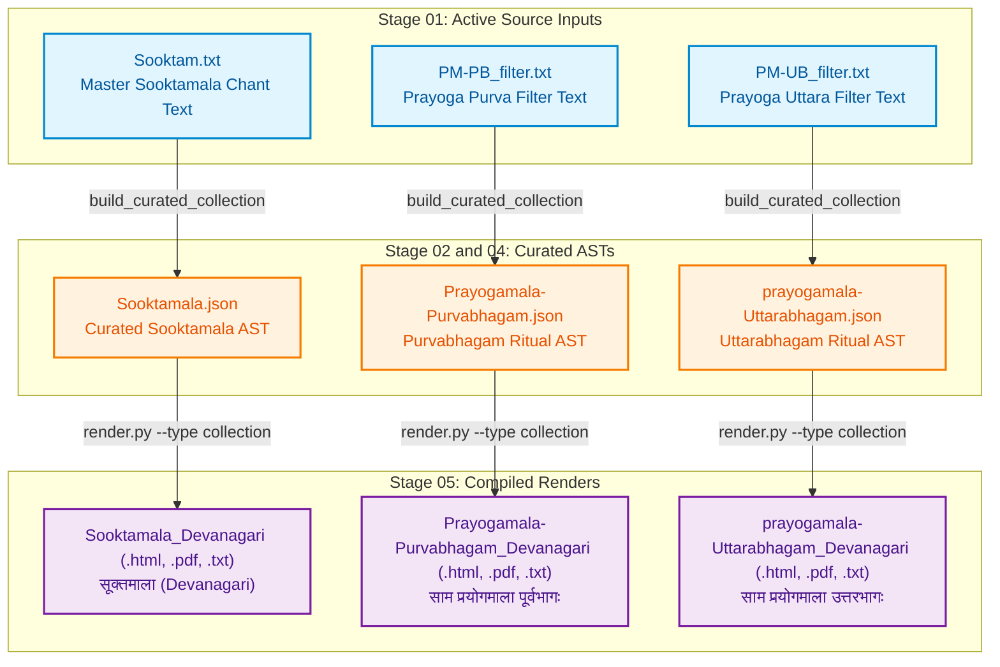

# Jaimineeya Samavedam — Traceability & Lineage Report: Collections

- **Corpus**: `collections`
- **Edition**: `2.05`
- **Generated Timestamp**: `22-10-2026 15:45:24`
- **Validation Status**: `PASSED`

---

## 1. Liturgical Invariants & Metrics
| Metric | Active Count | Baseline Invariant | Status |
| :--- | :--- | :--- | :--- |
| **Pathas (SuperSections)** | 1 | None | PASS |
| **Khandas (Sections)** | 25 | None | PASS |
| **Samas (Liturgical Chants)** | 178 | None | PASS |

---

## 2. End-to-End Pipeline Lineage Flowchart
The following diagram illustrates how active master inputs flow through intermediate parsed/canonical ASTs to produce each final render in `05_renders/`:



---

## 3. Direct Output-to-Source Lineage Mapping
This table directly maps each compiled file in `05_renders/` back to the active master source text in `01_input/` and intermediate AST in `02_ast/` that produced it.

| Output Render Artifact | Format | Compiled Timestamp | Purpose / Description | Master Input File (`01_input/`) | Intermediate AST (`02_ast/`) | Pipeline Generation Path |
| :--- | :--- | :--- | :--- | :--- | :--- | :--- |
| [`Prayogamala-Purvabhagam_Devanagari.pdf`](../05_renders/pdf/Prayogamala-Purvabhagam_Devanagari.pdf) | `PDF` | `02-10-2026 01:13:01` | Ritual Prayoga: Purvabhagam (साम प्रयोगमाला पूर्वभागः) | [`PM-PB_filter.txt`](../01_input/PM-PB_filter.txt) | `Prayogamala-Purvabhagam.json` | `build_curated_collection -> render.py` |
| [`prayogamala-Uttarabhagam_Devanagari.pdf`](../05_renders/pdf/prayogamala-Uttarabhagam_Devanagari.pdf) | `PDF` | `02-10-2026 01:13:01` | Ritual Prayoga: Uttarabhagam (साम प्रयोगमाला उत्तरभागः) | [`PM-UB_filter.txt`](../01_input/PM-UB_filter.txt) | `prayogamala-Uttarabhagam.json` | `build_curated_collection -> render.py` |
| [`Sooktamala_Devanagari.pdf`](../05_renders/pdf/Sooktamala_Devanagari.pdf) | `PDF` | `02-10-2026 01:13:01` | Curated Sooktam Collection (सूक्तमाला) | [`Sooktam.txt`](../01_input/Sooktam.txt) | `Sooktamala.json` | `build_curated_collection -> render.py` |
| [`Prayogamala-Purvabhagam_Devanagari.html`](../05_renders/html/Prayogamala-Purvabhagam_Devanagari.html) | `HTML` | `22-10-2026 15:45:17` | Ritual Prayoga: Purvabhagam (साम प्रयोगमाला पूर्वभागः) | [`PM-PB_filter.txt`](../01_input/PM-PB_filter.txt) | `Prayogamala-Purvabhagam.json` | `build_curated_collection -> render.py` |
| [`Prayogamala-Purvabhagam_Rik_Devanagari.html`](../05_renders/html/Prayogamala-Purvabhagam_Rik_Devanagari.html) | `HTML` | `22-10-2026 15:45:18` | Ritual Prayoga: Purvabhagam (साम प्रयोगमाला पूर्वभागः) | [`PM-PB_filter.txt`](../01_input/PM-PB_filter.txt) | `Prayogamala-Purvabhagam.json` | `build_curated_collection -> render.py` |
| [`Prayogamala-Purvabhagam_Rik_NoMeta_Devanagari.html`](../05_renders/html/Prayogamala-Purvabhagam_Rik_NoMeta_Devanagari.html) | `HTML` | `22-10-2026 15:45:20` | Ritual Prayoga: Purvabhagam (साम प्रयोगमाला पूर्वभागः) | [`PM-PB_filter.txt`](../01_input/PM-PB_filter.txt) | `Prayogamala-Purvabhagam.json` | `build_curated_collection -> render.py` |
| [`Prayogamala-Purvabhagam_Samam_Devanagari.html`](../05_renders/html/Prayogamala-Purvabhagam_Samam_Devanagari.html) | `HTML` | `22-10-2026 15:45:19` | Ritual Prayoga: Purvabhagam (साम प्रयोगमाला पूर्वभागः) | [`PM-PB_filter.txt`](../01_input/PM-PB_filter.txt) | `Prayogamala-Purvabhagam.json` | `build_curated_collection -> render.py` |
| [`Prayogamala-Purvabhagam_Samam_NoMeta_Devanagari.html`](../05_renders/html/Prayogamala-Purvabhagam_Samam_NoMeta_Devanagari.html) | `HTML` | `22-10-2026 15:45:20` | Ritual Prayoga: Purvabhagam (साम प्रयोगमाला पूर्वभागः) | [`PM-PB_filter.txt`](../01_input/PM-PB_filter.txt) | `Prayogamala-Purvabhagam.json` | `build_curated_collection -> render.py` |
| [`prayogamala-Uttarabhagam_Devanagari.html`](../05_renders/html/prayogamala-Uttarabhagam_Devanagari.html) | `HTML` | `22-10-2026 15:45:21` | Ritual Prayoga: Uttarabhagam (साम प्रयोगमाला उत्तरभागः) | [`PM-UB_filter.txt`](../01_input/PM-UB_filter.txt) | `prayogamala-Uttarabhagam.json` | `build_curated_collection -> render.py` |
| [`prayogamala-Uttarabhagam_Rik_Devanagari.html`](../05_renders/html/prayogamala-Uttarabhagam_Rik_Devanagari.html) | `HTML` | `22-10-2026 15:45:22` | Ritual Prayoga: Uttarabhagam (साम प्रयोगमाला उत्तरभागः) | [`PM-UB_filter.txt`](../01_input/PM-UB_filter.txt) | `prayogamala-Uttarabhagam.json` | `build_curated_collection -> render.py` |
| [`prayogamala-Uttarabhagam_Rik_NoMeta_Devanagari.html`](../05_renders/html/prayogamala-Uttarabhagam_Rik_NoMeta_Devanagari.html) | `HTML` | `22-10-2026 15:45:23` | Ritual Prayoga: Uttarabhagam (साम प्रयोगमाला उत्तरभागः) | [`PM-UB_filter.txt`](../01_input/PM-UB_filter.txt) | `prayogamala-Uttarabhagam.json` | `build_curated_collection -> render.py` |
| [`prayogamala-Uttarabhagam_Samam_Devanagari.html`](../05_renders/html/prayogamala-Uttarabhagam_Samam_Devanagari.html) | `HTML` | `22-10-2026 15:45:22` | Ritual Prayoga: Uttarabhagam (साम प्रयोगमाला उत्तरभागः) | [`PM-UB_filter.txt`](../01_input/PM-UB_filter.txt) | `prayogamala-Uttarabhagam.json` | `build_curated_collection -> render.py` |
| [`prayogamala-Uttarabhagam_Samam_NoMeta_Devanagari.html`](../05_renders/html/prayogamala-Uttarabhagam_Samam_NoMeta_Devanagari.html) | `HTML` | `22-10-2026 15:45:23` | Ritual Prayoga: Uttarabhagam (साम प्रयोगमाला उत्तरभागः) | [`PM-UB_filter.txt`](../01_input/PM-UB_filter.txt) | `prayogamala-Uttarabhagam.json` | `build_curated_collection -> render.py` |
| [`Sooktamala_Devanagari.html`](../05_renders/html/Sooktamala_Devanagari.html) | `HTML` | `22-10-2026 15:45:13` | Curated Sooktam Collection (सूक्तमाला) | [`Sooktam.txt`](../01_input/Sooktam.txt) | `Sooktamala.json` | `build_curated_collection -> render.py` |
| [`Sooktamala_Rik_Devanagari.html`](../05_renders/html/Sooktamala_Rik_Devanagari.html) | `HTML` | `22-10-2026 15:45:14` | Curated Sooktam Collection (सूक्तमाला) | [`Sooktam.txt`](../01_input/Sooktam.txt) | `Sooktamala.json` | `build_curated_collection -> render.py` |
| [`Sooktamala_Rik_NoMeta_Devanagari.html`](../05_renders/html/Sooktamala_Rik_NoMeta_Devanagari.html) | `HTML` | `22-10-2026 15:45:16` | Curated Sooktam Collection (सूक्तमाला) | [`Sooktam.txt`](../01_input/Sooktam.txt) | `Sooktamala.json` | `build_curated_collection -> render.py` |
| [`Sooktamala_Samam_Devanagari.html`](../05_renders/html/Sooktamala_Samam_Devanagari.html) | `HTML` | `22-10-2026 15:45:15` | Curated Sooktam Collection (सूक्तमाला) | [`Sooktam.txt`](../01_input/Sooktam.txt) | `Sooktamala.json` | `build_curated_collection -> render.py` |
| [`Sooktamala_Samam_NoMeta_Devanagari.html`](../05_renders/html/Sooktamala_Samam_NoMeta_Devanagari.html) | `HTML` | `22-10-2026 15:45:16` | Curated Sooktam Collection (सूक्तमाला) | [`Sooktam.txt`](../01_input/Sooktam.txt) | `Sooktamala.json` | `build_curated_collection -> render.py` |
| [`Prayogamala-Purvabhagam_Devanagari_Unicode.txt`](../05_renders/txt/Prayogamala-Purvabhagam_Devanagari_Unicode.txt) | `TXT` | `22-10-2026 15:45:17` | Ritual Prayoga: Purvabhagam (साम प्रयोगमाला पूर्वभागः) | [`PM-PB_filter.txt`](../01_input/PM-PB_filter.txt) | `Prayogamala-Purvabhagam.json` | `build_curated_collection -> render.py` |
| [`Prayogamala-Purvabhagam_Rik_Devanagari_Unicode.txt`](../05_renders/txt/Prayogamala-Purvabhagam_Rik_Devanagari_Unicode.txt) | `TXT` | `22-10-2026 15:45:18` | Ritual Prayoga: Purvabhagam (साम प्रयोगमाला पूर्वभागः) | [`PM-PB_filter.txt`](../01_input/PM-PB_filter.txt) | `Prayogamala-Purvabhagam.json` | `build_curated_collection -> render.py` |
| [`Prayogamala-Purvabhagam_Rik_NoMeta_Devanagari_Unicode.txt`](../05_renders/txt/Prayogamala-Purvabhagam_Rik_NoMeta_Devanagari_Unicode.txt) | `TXT` | `22-10-2026 15:45:20` | Ritual Prayoga: Purvabhagam (साम प्रयोगमाला पूर्वभागः) | [`PM-PB_filter.txt`](../01_input/PM-PB_filter.txt) | `Prayogamala-Purvabhagam.json` | `build_curated_collection -> render.py` |
| [`Prayogamala-Purvabhagam_Samam_Devanagari_Unicode.txt`](../05_renders/txt/Prayogamala-Purvabhagam_Samam_Devanagari_Unicode.txt) | `TXT` | `22-10-2026 15:45:18` | Ritual Prayoga: Purvabhagam (साम प्रयोगमाला पूर्वभागः) | [`PM-PB_filter.txt`](../01_input/PM-PB_filter.txt) | `Prayogamala-Purvabhagam.json` | `build_curated_collection -> render.py` |
| [`Prayogamala-Purvabhagam_Samam_NoMeta_Devanagari_Unicode.txt`](../05_renders/txt/Prayogamala-Purvabhagam_Samam_NoMeta_Devanagari_Unicode.txt) | `TXT` | `22-10-2026 15:45:20` | Ritual Prayoga: Purvabhagam (साम प्रयोगमाला पूर्वभागः) | [`PM-PB_filter.txt`](../01_input/PM-PB_filter.txt) | `Prayogamala-Purvabhagam.json` | `build_curated_collection -> render.py` |
| [`prayogamala-Uttarabhagam_Devanagari_Unicode.txt`](../05_renders/txt/prayogamala-Uttarabhagam_Devanagari_Unicode.txt) | `TXT` | `22-10-2026 15:45:21` | Ritual Prayoga: Uttarabhagam (साम प्रयोगमाला उत्तरभागः) | [`PM-UB_filter.txt`](../01_input/PM-UB_filter.txt) | `prayogamala-Uttarabhagam.json` | `build_curated_collection -> render.py` |
| [`prayogamala-Uttarabhagam_Rik_Devanagari_Unicode.txt`](../05_renders/txt/prayogamala-Uttarabhagam_Rik_Devanagari_Unicode.txt) | `TXT` | `22-10-2026 15:45:22` | Ritual Prayoga: Uttarabhagam (साम प्रयोगमाला उत्तरभागः) | [`PM-UB_filter.txt`](../01_input/PM-UB_filter.txt) | `prayogamala-Uttarabhagam.json` | `build_curated_collection -> render.py` |
| [`prayogamala-Uttarabhagam_Rik_NoMeta_Devanagari_Unicode.txt`](../05_renders/txt/prayogamala-Uttarabhagam_Rik_NoMeta_Devanagari_Unicode.txt) | `TXT` | `22-10-2026 15:45:23` | Ritual Prayoga: Uttarabhagam (साम प्रयोगमाला उत्तरभागः) | [`PM-UB_filter.txt`](../01_input/PM-UB_filter.txt) | `prayogamala-Uttarabhagam.json` | `build_curated_collection -> render.py` |
| [`prayogamala-Uttarabhagam_Samam_Devanagari_Unicode.txt`](../05_renders/txt/prayogamala-Uttarabhagam_Samam_Devanagari_Unicode.txt) | `TXT` | `22-10-2026 15:45:22` | Ritual Prayoga: Uttarabhagam (साम प्रयोगमाला उत्तरभागः) | [`PM-UB_filter.txt`](../01_input/PM-UB_filter.txt) | `prayogamala-Uttarabhagam.json` | `build_curated_collection -> render.py` |
| [`prayogamala-Uttarabhagam_Samam_NoMeta_Devanagari_Unicode.txt`](../05_renders/txt/prayogamala-Uttarabhagam_Samam_NoMeta_Devanagari_Unicode.txt) | `TXT` | `22-10-2026 15:45:23` | Ritual Prayoga: Uttarabhagam (साम प्रयोगमाला उत्तरभागः) | [`PM-UB_filter.txt`](../01_input/PM-UB_filter.txt) | `prayogamala-Uttarabhagam.json` | `build_curated_collection -> render.py` |
| [`Sooktamala_Devanagari_Unicode.txt`](../05_renders/txt/Sooktamala_Devanagari_Unicode.txt) | `TXT` | `22-10-2026 15:45:13` | Curated Sooktam Collection (सूक्तमाला) | [`Sooktam.txt`](../01_input/Sooktam.txt) | `Sooktamala.json` | `build_curated_collection -> render.py` |
| [`Sooktamala_Rik_Devanagari_Unicode.txt`](../05_renders/txt/Sooktamala_Rik_Devanagari_Unicode.txt) | `TXT` | `22-10-2026 15:45:14` | Curated Sooktam Collection (सूक्तमाला) | [`Sooktam.txt`](../01_input/Sooktam.txt) | `Sooktamala.json` | `build_curated_collection -> render.py` |
| [`Sooktamala_Rik_NoMeta_Devanagari_Unicode.txt`](../05_renders/txt/Sooktamala_Rik_NoMeta_Devanagari_Unicode.txt) | `TXT` | `22-10-2026 15:45:16` | Curated Sooktam Collection (सूक्तमाला) | [`Sooktam.txt`](../01_input/Sooktam.txt) | `Sooktamala.json` | `build_curated_collection -> render.py` |
| [`Sooktamala_Samam_Devanagari_Unicode.txt`](../05_renders/txt/Sooktamala_Samam_Devanagari_Unicode.txt) | `TXT` | `22-10-2026 15:45:14` | Curated Sooktam Collection (सूक्तमाला) | [`Sooktam.txt`](../01_input/Sooktam.txt) | `Sooktamala.json` | `build_curated_collection -> render.py` |
| [`Sooktamala_Samam_NoMeta_Devanagari_Unicode.txt`](../05_renders/txt/Sooktamala_Samam_NoMeta_Devanagari_Unicode.txt) | `TXT` | `22-10-2026 15:45:16` | Curated Sooktam Collection (सूक्तमाला) | [`Sooktam.txt`](../01_input/Sooktam.txt) | `Sooktamala.json` | `build_curated_collection -> render.py` |

---

## 4. Active Master Inputs (`01_input/`)
Only the active master source files utilized for pipeline generation are listed below:

| Active Input File | Size | SHA-256 Checksum |
| :--- | :--- | :--- |
| [`PM-PB_filter.txt`](../01_input/PM-PB_filter.txt) | 6.0 KB | `2d66508f95d9c300c546652252375c839de46c676726bd316d231ca1ef268483` |
| [`PM-UB_filter.txt`](../01_input/PM-UB_filter.txt) | 1.2 KB | `d347f51a8019b501f2a2b91224af7ababd0c69d6d02bc60ee02d88b6036fea15` |
| [`Sooktam.txt`](../01_input/Sooktam.txt) | 199.2 KB | `28b2c97dd85d20ffb09a38467ad2ae8935433775fb8ce06553bd96dfab327d49` |

---

## 5. Intermediate ASTs & Canonical Datasets

### Parsed ASTs (`02_ast/`)
| AST File | Size | SHA-256 Checksum |
| :--- | :--- | :--- |
| [`Prayogamala-Purvabhagam.json`](../02_ast/Prayogamala-Purvabhagam.json) | 358.6 KB | `20cea15e737c906eff55ab44014126d51dca2345897b20971d91b0bfe8fae85e` |
| [`prayogamala-Uttarabhagam.json`](../02_ast/prayogamala-Uttarabhagam.json) | 107.3 KB | `a53a89ed46731e782392a8ff907ba46c5a4a14ba35fb1b5dd328696d2f59230d` |
| [`Sooktamala.json`](../02_ast/Sooktamala.json) | 320.3 KB | `cd371af08e09d20f58e1b329b0be58112422ac7eb1d78cd7e6bb8795dd9ee6e9` |

### Canonical Datasets (`04_canonical/`)
| Canonical File | Size | SHA-256 Checksum |
| :--- | :--- | :--- |
| [`Prayogamala-Purvabhagam.json`](../04_canonical/Prayogamala-Purvabhagam.json) | 358.6 KB | `20cea15e737c906eff55ab44014126d51dca2345897b20971d91b0bfe8fae85e` |
| [`prayogamala-Uttarabhagam.json`](../04_canonical/prayogamala-Uttarabhagam.json) | 107.3 KB | `a53a89ed46731e782392a8ff907ba46c5a4a14ba35fb1b5dd328696d2f59230d` |
| [`Sooktamala.json`](../04_canonical/Sooktamala.json) | 320.3 KB | `cd371af08e09d20f58e1b329b0be58112422ac7eb1d78cd7e6bb8795dd9ee6e9` |

---

## 6. Compiled Render Catalog (`05_renders/`)

### PDF Documents (`05_renders/pdf/`)
| File Name | Mode / Edition | Target Script | Size | SHA-256 Checksum |
| :--- | :--- | :--- | :--- | :--- |
| [`Prayogamala-Purvabhagam_Devanagari.pdf`](../05_renders/pdf/Prayogamala-Purvabhagam_Devanagari.pdf) | Combined (Study Edition) | Devanagari (Standard) | 292.5 KB | `eedb761a6c10c12829bf0ec0246674efdadcca4739b2ff26bf71af73969678c2` |
| [`prayogamala-Uttarabhagam_Devanagari.pdf`](../05_renders/pdf/prayogamala-Uttarabhagam_Devanagari.pdf) | Standard | Devanagari (Standard) | 140.0 KB | `2d37196a29b6605320c7e342303ccebf9c793559756f887a5d0744e9584babda` |
| [`Sooktamala_Devanagari.pdf`](../05_renders/pdf/Sooktamala_Devanagari.pdf) | Combined (Study Edition) | Devanagari (Standard) | 265.3 KB | `fa2df25313c25535d57b0ad2f99f9b73a9c98f6f5e449667f9399787a5c36383` |

### HTML Readers (`05_renders/html/`)
| File Name | Mode / Edition | Target Script | Size | SHA-256 Checksum |
| :--- | :--- | :--- | :--- | :--- |
| [`Prayogamala-Purvabhagam_Devanagari.html`](../05_renders/html/Prayogamala-Purvabhagam_Devanagari.html) | Combined (Study Edition) | Devanagari (Standard) | 5.04 MB | `4f504ebee95eaf7f8132028984d36c8f28d734f95b30b5a5afa5322277bca23f` |
| [`Prayogamala-Purvabhagam_Rik_Devanagari.html`](../05_renders/html/Prayogamala-Purvabhagam_Rik_Devanagari.html) | Combined (Study Edition) | Devanagari (Standard) | 2.63 MB | `c24c462a9de467f1730c6a3b94c486392438764eab3aab4719ec710ce88a9968` |
| [`Prayogamala-Purvabhagam_Rik_NoMeta_Devanagari.html`](../05_renders/html/Prayogamala-Purvabhagam_Rik_NoMeta_Devanagari.html) | NoMeta (Continuous Chanting) | Devanagari (Standard) | 2.63 MB | `01c614f668388ea7b73f353dea52373243f755be24e87af6d6f40cc304a03fe8` |
| [`Prayogamala-Purvabhagam_Samam_Devanagari.html`](../05_renders/html/Prayogamala-Purvabhagam_Samam_Devanagari.html) | Combined (Study Edition) | Devanagari (Standard) | 5.02 MB | `ff943ee31d018f55ce58e39a693b4a45284495534225fc1289bcf629764c1270` |
| [`Prayogamala-Purvabhagam_Samam_NoMeta_Devanagari.html`](../05_renders/html/Prayogamala-Purvabhagam_Samam_NoMeta_Devanagari.html) | NoMeta (Continuous Chanting) | Devanagari (Standard) | 5.02 MB | `430cac8a98b042a95965e68a8b4d8a2da5602929c9b1d433aaf230b181f40556` |
| [`prayogamala-Uttarabhagam_Devanagari.html`](../05_renders/html/prayogamala-Uttarabhagam_Devanagari.html) | Standard | Devanagari (Standard) | 3.40 MB | `97fe2ce8664cae892042e222528e93fa454f4052008503bacf17a109b868f689` |
| [`prayogamala-Uttarabhagam_Rik_Devanagari.html`](../05_renders/html/prayogamala-Uttarabhagam_Rik_Devanagari.html) | Standard | Devanagari (Standard) | 2.57 MB | `c2e7d2648f8576865a9966641f4b83486de53b25f9c184d307b43fb0c552581d` |
| [`prayogamala-Uttarabhagam_Rik_NoMeta_Devanagari.html`](../05_renders/html/prayogamala-Uttarabhagam_Rik_NoMeta_Devanagari.html) | NoMeta (Continuous Chanting) | Devanagari (Standard) | 2.57 MB | `59950a9b44f0c0acaef1842078a3ebdbdb6301c9626249c264ad4aeb53480940` |
| [`prayogamala-Uttarabhagam_Samam_Devanagari.html`](../05_renders/html/prayogamala-Uttarabhagam_Samam_Devanagari.html) | Standard | Devanagari (Standard) | 3.40 MB | `f17f620d908906d688493c78353aa06911629270f8d4ccbbc0ee536d24450261` |
| [`prayogamala-Uttarabhagam_Samam_NoMeta_Devanagari.html`](../05_renders/html/prayogamala-Uttarabhagam_Samam_NoMeta_Devanagari.html) | NoMeta (Continuous Chanting) | Devanagari (Standard) | 3.40 MB | `a866178b428e5659f2937befe444256df5f9587bc3f426e495595c32b58c4ea4` |
| [`Sooktamala_Devanagari.html`](../05_renders/html/Sooktamala_Devanagari.html) | Combined (Study Edition) | Devanagari (Standard) | 4.54 MB | `6b27a9912d2941e5f2f65aedbacce6d2fa9e3f688b97720f70e02893f8967237` |
| [`Sooktamala_Rik_Devanagari.html`](../05_renders/html/Sooktamala_Rik_Devanagari.html) | Combined (Study Edition) | Devanagari (Standard) | 2.67 MB | `a43b0cade0ff2a4a48d26657cd60b28400dc613b34776fad2ee7ea818090d7ca` |
| [`Sooktamala_Rik_NoMeta_Devanagari.html`](../05_renders/html/Sooktamala_Rik_NoMeta_Devanagari.html) | NoMeta (Continuous Chanting) | Devanagari (Standard) | 2.66 MB | `a117affd173fee0c82d245f6d3b96e7fffbda2352030be873903614e97fb9033` |
| [`Sooktamala_Samam_Devanagari.html`](../05_renders/html/Sooktamala_Samam_Devanagari.html) | Combined (Study Edition) | Devanagari (Standard) | 4.50 MB | `7eb6565ae9c98146e1f933524701cc2d4331bcfbb2c752988bdbf1f00986eb2f` |
| [`Sooktamala_Samam_NoMeta_Devanagari.html`](../05_renders/html/Sooktamala_Samam_NoMeta_Devanagari.html) | NoMeta (Continuous Chanting) | Devanagari (Standard) | 4.50 MB | `b58e809cd5575fb1f3d2da8aed4b5bf6c7d7d2f2b08d057daefc0da6c484031a` |

### PlainText Exports (`05_renders/txt/`)
| File Name | Mode / Edition | Target Script | Size | SHA-256 Checksum |
| :--- | :--- | :--- | :--- | :--- |
| [`Prayogamala-Purvabhagam_Devanagari_Unicode.txt`](../05_renders/txt/Prayogamala-Purvabhagam_Devanagari_Unicode.txt) | Combined (Study Edition) | Devanagari (Standard) | 232.5 KB | `e333d3d81f403f74f5d20d307e2a87d8af343037c28ffd549efdb648f8a7b12b` |
| [`Prayogamala-Purvabhagam_Rik_Devanagari_Unicode.txt`](../05_renders/txt/Prayogamala-Purvabhagam_Rik_Devanagari_Unicode.txt) | Combined (Study Edition) | Devanagari (Standard) | 9.7 KB | `4c4eb978593bc698ac1cee668483091c402f3b361f4b475c835743f022817ade` |
| [`Prayogamala-Purvabhagam_Rik_NoMeta_Devanagari_Unicode.txt`](../05_renders/txt/Prayogamala-Purvabhagam_Rik_NoMeta_Devanagari_Unicode.txt) | NoMeta (Continuous Chanting) | Devanagari (Standard) | 9.8 KB | `9773eeae97602b6b89ca2f01dcc4d33df88db96b9943c877fc3fd86a8743a272` |
| [`Prayogamala-Purvabhagam_Samam_Devanagari_Unicode.txt`](../05_renders/txt/Prayogamala-Purvabhagam_Samam_Devanagari_Unicode.txt) | Combined (Study Edition) | Devanagari (Standard) | 228.6 KB | `6943332f07c787c807e6105e31ca32b3250aa0f2c4d0cc1021f4571021637037` |
| [`Prayogamala-Purvabhagam_Samam_NoMeta_Devanagari_Unicode.txt`](../05_renders/txt/Prayogamala-Purvabhagam_Samam_NoMeta_Devanagari_Unicode.txt) | NoMeta (Continuous Chanting) | Devanagari (Standard) | 221.7 KB | `ff2dc8863976ab58b81d405f10332a7bc0c982efb0f72a97da73ef180988b4a6` |
| [`prayogamala-Uttarabhagam_Devanagari_Unicode.txt`](../05_renders/txt/prayogamala-Uttarabhagam_Devanagari_Unicode.txt) | Standard | Devanagari (Standard) | 72.4 KB | `7c98c1427741cedafa7594906fc033fb2c12a631166276fada41ae8278b9c8de` |
| [`prayogamala-Uttarabhagam_Rik_Devanagari_Unicode.txt`](../05_renders/txt/prayogamala-Uttarabhagam_Rik_Devanagari_Unicode.txt) | Standard | Devanagari (Standard) | 1.3 KB | `a8d0153d1d8477ff44c3751baca225561614aa878ed81cf39f858726ba49de64` |
| [`prayogamala-Uttarabhagam_Rik_NoMeta_Devanagari_Unicode.txt`](../05_renders/txt/prayogamala-Uttarabhagam_Rik_NoMeta_Devanagari_Unicode.txt) | NoMeta (Continuous Chanting) | Devanagari (Standard) | 1.3 KB | `4109bcc35f06b8547019892593dbe68fbea2df8c4fc4f66ed9b5dfd8a31334dd` |
| [`prayogamala-Uttarabhagam_Samam_Devanagari_Unicode.txt`](../05_renders/txt/prayogamala-Uttarabhagam_Samam_Devanagari_Unicode.txt) | Standard | Devanagari (Standard) | 72.2 KB | `468d7f253ecc561f475f9cfce8c59518e6bbfd80b073057b80426e6c387d668e` |
| [`prayogamala-Uttarabhagam_Samam_NoMeta_Devanagari_Unicode.txt`](../05_renders/txt/prayogamala-Uttarabhagam_Samam_NoMeta_Devanagari_Unicode.txt) | NoMeta (Continuous Chanting) | Devanagari (Standard) | 72.2 KB | `a5744e8f3c7d0cde83d73c82e148fe590fb9c18fa1514328e728eaa6a41ecdcd` |
| [`Sooktamala_Devanagari_Unicode.txt`](../05_renders/txt/Sooktamala_Devanagari_Unicode.txt) | Combined (Study Edition) | Devanagari (Standard) | 206.3 KB | `29d4ea24b8f581faa541edb30f6b9e5914dcbae5b72e4f0c383114d067d1a267` |
| [`Sooktamala_Rik_Devanagari_Unicode.txt`](../05_renders/txt/Sooktamala_Rik_Devanagari_Unicode.txt) | Combined (Study Edition) | Devanagari (Standard) | 18.9 KB | `04c952ffce0f1ef3faba8698cf64c4c881c1d908834566952bc43e0d74132d8a` |
| [`Sooktamala_Rik_NoMeta_Devanagari_Unicode.txt`](../05_renders/txt/Sooktamala_Rik_NoMeta_Devanagari_Unicode.txt) | NoMeta (Continuous Chanting) | Devanagari (Standard) | 18.0 KB | `ccacc386952d7fe5799732d502e01f5e60cdd95b4f5826c5ab5522219c88f061` |
| [`Sooktamala_Samam_Devanagari_Unicode.txt`](../05_renders/txt/Sooktamala_Samam_Devanagari_Unicode.txt) | Combined (Study Edition) | Devanagari (Standard) | 183.5 KB | `9881cb39a6625561aad7cabe619e4f6aa151efa25db26b77e11867b2d6817f95` |
| [`Sooktamala_Samam_NoMeta_Devanagari_Unicode.txt`](../05_renders/txt/Sooktamala_Samam_NoMeta_Devanagari_Unicode.txt) | NoMeta (Continuous Chanting) | Devanagari (Standard) | 183.5 KB | `bc805f21273af759555a5c78af6fac0c19902e7b745b008955c093b92bbe5d0a` |

---

## 7. Audit Reports & Integrity Check

### Audit Reports (`06_reports/`)
| Report File | Size |
| :--- | :--- |

### Verification Command
To verify cryptographic and liturgical invariants against golden baselines:
```bash
python src/tools/validate_run.py collections
```
