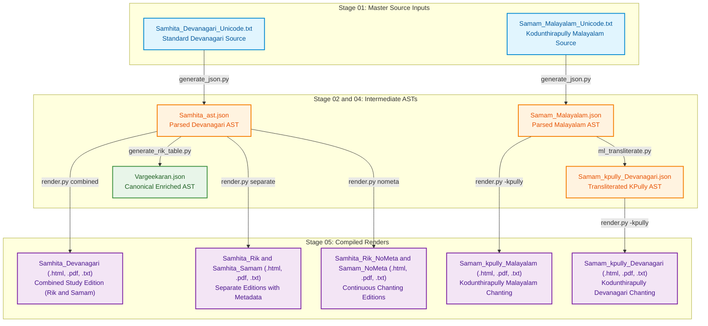

# Jaimineeya Samavedam — Traceability & Lineage Report: Samhita

- **Corpus**: `samhita`
- **Edition**: `3.30`
- **Generated Timestamp**: `22-10-2026 15:45:24`
- **Validation Status**: `PASSED`

---

## 1. Liturgical Invariants & Metrics
| Metric | Active Count | Baseline Invariant | Status |
| :--- | :--- | :--- | :--- |
| **Pathas (SuperSections)** | 6 | 6 | PASS |
| **Khandas (Sections)** | 59 | 59 | PASS |
| **Samas (Liturgical Chants)** | 1226 | 1226 | PASS |

---

## 2. End-to-End Pipeline Lineage Flowchart
The following diagram illustrates how active master inputs flow through intermediate parsed/canonical ASTs to produce each final render in `05_renders/`:



---

## 3. Direct Output-to-Source Lineage Mapping
This table directly maps each compiled file in `05_renders/` back to the active master source text in `01_input/` and intermediate AST in `02_ast/` that produced it.

| Output Render Artifact | Format | Compiled Timestamp | Purpose / Description | Master Input File (`01_input/`) | Intermediate AST (`02_ast/`) | Pipeline Generation Path |
| :--- | :--- | :--- | :--- | :--- | :--- | :--- |
| [`Samam_kpully_Devanagari.pdf`](../05_renders/pdf/Samam_kpully_Devanagari.pdf) | `PDF` | `22-10-2026 14:33:50` | Kodunthirapully Chanting (Devanagari) | [`Samam_Malayalam_Unicode.txt`](../01_input/Samam_Malayalam_Unicode.txt) | `Samam_Malayalam.json -> Samam_kpully_Devanagari.json` | `generate_json.py -> ml_transliterate.py -> render.py (-kpully)` |
| [`Samam_kpully_Devanagari_Samam.pdf`](../05_renders/pdf/Samam_kpully_Devanagari_Samam.pdf) | `PDF` | `22-10-2026 14:33:50` | Kodunthirapully Chanting (Devanagari) | [`Samam_Malayalam_Unicode.txt`](../01_input/Samam_Malayalam_Unicode.txt) | `Samam_Malayalam.json -> Samam_kpully_Devanagari.json` | `generate_json.py -> ml_transliterate.py -> render.py (-kpully)` |
| [`Samam_kpully_Malayalam.pdf`](../05_renders/pdf/Samam_kpully_Malayalam.pdf) | `PDF` | `01-10-2026 23:59:01` | Kodunthirapully Chanting (Malayalam) | [`Samam_Malayalam_Unicode.txt`](../01_input/Samam_Malayalam_Unicode.txt) | `Samam_Malayalam.json` | `generate_json.py -> render.py (-kpully)` |
| [`Samam_kpully_Malayalam_Samam.pdf`](../05_renders/pdf/Samam_kpully_Malayalam_Samam.pdf) | `PDF` | `22-10-2026 13:47:08` | Kodunthirapully Chanting (Malayalam) | [`Samam_Malayalam_Unicode.txt`](../01_input/Samam_Malayalam_Unicode.txt) | `Samam_Malayalam.json` | `generate_json.py -> render.py (-kpully)` |
| [`Samam_Malayalam_Samam.pdf`](../05_renders/pdf/Samam_Malayalam_Samam.pdf) | `PDF` | `22-10-2026 13:46:51` | Standard Samhita Text | [`Samhita_Devanagari_Unicode.txt`](../01_input/Samhita_Devanagari_Unicode.txt) | `Samhita_ast.json (Canonical: Vargeekaran.json)` | `generate_json.py -> render.py` |
| [`Samhita_Devanagari.pdf`](../05_renders/pdf/Samhita_Devanagari.pdf) | `PDF` | `07-10-2026 08:08:15` | Standard Samhita Text | [`Samhita_Devanagari_Unicode.txt`](../01_input/Samhita_Devanagari_Unicode.txt) | `Samhita_ast.json (Canonical: Vargeekaran.json)` | `generate_json.py -> render.py` |
| [`Samhita_kpully_Devanagari.pdf`](../05_renders/pdf/Samhita_kpully_Devanagari.pdf) | `PDF` | `01-10-2026 23:59:01` | Kodunthirapully Chanting (Devanagari) | [`Samam_Malayalam_Unicode.txt`](../01_input/Samam_Malayalam_Unicode.txt) | `Samam_Malayalam.json -> Samam_kpully_Devanagari.json` | `generate_json.py -> ml_transliterate.py -> render.py (-kpully)` |
| [`Samhita_kpully_Devanagari_Samam.pdf`](../05_renders/pdf/Samhita_kpully_Devanagari_Samam.pdf) | `PDF` | `22-10-2026 13:47:23` | Kodunthirapully Chanting (Devanagari) | [`Samam_Malayalam_Unicode.txt`](../01_input/Samam_Malayalam_Unicode.txt) | `Samam_Malayalam.json -> Samam_kpully_Devanagari.json` | `generate_json.py -> ml_transliterate.py -> render.py (-kpully)` |
| [`Samhita_Malayalam.pdf`](../05_renders/pdf/Samhita_Malayalam.pdf) | `PDF` | `01-10-2026 23:59:01` | Standard Samhita Text | [`Samhita_Devanagari_Unicode.txt`](../01_input/Samhita_Devanagari_Unicode.txt) | `Samhita_ast.json (Canonical: Vargeekaran.json)` | `generate_json.py -> render.py` |
| [`Samhita_Rik_Devanagari.pdf`](../05_renders/pdf/Samhita_Rik_Devanagari.pdf) | `PDF` | `01-10-2026 23:59:01` | Standard Samhita Text | [`Samhita_Devanagari_Unicode.txt`](../01_input/Samhita_Devanagari_Unicode.txt) | `Samhita_ast.json (Canonical: Vargeekaran.json)` | `generate_json.py -> render.py` |
| [`Samhita_Rik_NoMeta_Devanagari.pdf`](../05_renders/pdf/Samhita_Rik_NoMeta_Devanagari.pdf) | `PDF` | `01-10-2026 23:59:01` | Standard Samhita Text | [`Samhita_Devanagari_Unicode.txt`](../01_input/Samhita_Devanagari_Unicode.txt) | `Samhita_ast.json (Canonical: Vargeekaran.json)` | `generate_json.py -> render.py` |
| [`Samhita_Samam_Devanagari.pdf`](../05_renders/pdf/Samhita_Samam_Devanagari.pdf) | `PDF` | `01-10-2026 23:59:01` | Standard Samhita Text | [`Samhita_Devanagari_Unicode.txt`](../01_input/Samhita_Devanagari_Unicode.txt) | `Samhita_ast.json (Canonical: Vargeekaran.json)` | `generate_json.py -> render.py` |
| [`Samhita_Samam_NoMeta_Devanagari.pdf`](../05_renders/pdf/Samhita_Samam_NoMeta_Devanagari.pdf) | `PDF` | `01-10-2026 23:59:01` | Standard Samhita Text | [`Samhita_Devanagari_Unicode.txt`](../01_input/Samhita_Devanagari_Unicode.txt) | `Samhita_ast.json (Canonical: Vargeekaran.json)` | `generate_json.py -> render.py` |
| [`Samam_kpully_Devanagari.html`](../05_renders/html/Samam_kpully_Devanagari.html) | `HTML` | `22-10-2026 14:33:51` | Kodunthirapully Chanting (Devanagari) | [`Samam_Malayalam_Unicode.txt`](../01_input/Samam_Malayalam_Unicode.txt) | `Samam_Malayalam.json -> Samam_kpully_Devanagari.json` | `generate_json.py -> ml_transliterate.py -> render.py (-kpully)` |
| [`Samam_kpully_Devanagari_Samam.html`](../05_renders/html/Samam_kpully_Devanagari_Samam.html) | `HTML` | `22-10-2026 15:40:00` | Kodunthirapully Chanting (Devanagari) | [`Samam_Malayalam_Unicode.txt`](../01_input/Samam_Malayalam_Unicode.txt) | `Samam_Malayalam.json -> Samam_kpully_Devanagari.json` | `generate_json.py -> ml_transliterate.py -> render.py (-kpully)` |
| [`Samam_kpully_Devanagari_Samam_NoMeta.html`](../05_renders/html/Samam_kpully_Devanagari_Samam_NoMeta.html) | `HTML` | `22-10-2026 15:45:12` | Kodunthirapully Chanting (Devanagari) | [`Samam_Malayalam_Unicode.txt`](../01_input/Samam_Malayalam_Unicode.txt) | `Samam_Malayalam.json -> Samam_kpully_Devanagari.json` | `generate_json.py -> ml_transliterate.py -> render.py (-kpully)` |
| [`Samam_kpully_Malayalam.html`](../05_renders/html/Samam_kpully_Malayalam.html) | `HTML` | `13-10-2026 12:27:05` | Kodunthirapully Chanting (Malayalam) | [`Samam_Malayalam_Unicode.txt`](../01_input/Samam_Malayalam_Unicode.txt) | `Samam_Malayalam.json` | `generate_json.py -> render.py (-kpully)` |
| [`Samam_kpully_Malayalam_Samam.html`](../05_renders/html/Samam_kpully_Malayalam_Samam.html) | `HTML` | `22-10-2026 15:39:57` | Kodunthirapully Chanting (Malayalam) | [`Samam_Malayalam_Unicode.txt`](../01_input/Samam_Malayalam_Unicode.txt) | `Samam_Malayalam.json` | `generate_json.py -> render.py (-kpully)` |
| [`Samam_kpully_Malayalam_Samam_NoMeta.html`](../05_renders/html/Samam_kpully_Malayalam_Samam_NoMeta.html) | `HTML` | `22-10-2026 15:45:09` | Kodunthirapully Chanting (Malayalam) | [`Samam_Malayalam_Unicode.txt`](../01_input/Samam_Malayalam_Unicode.txt) | `Samam_Malayalam.json` | `generate_json.py -> render.py (-kpully)` |
| [`Samam_Malayalam_Samam.html`](../05_renders/html/Samam_Malayalam_Samam.html) | `HTML` | `22-10-2026 13:46:54` | Standard Samhita Text | [`Samhita_Devanagari_Unicode.txt`](../01_input/Samhita_Devanagari_Unicode.txt) | `Samhita_ast.json (Canonical: Vargeekaran.json)` | `generate_json.py -> render.py` |
| [`Samhita_Devanagari.html`](../05_renders/html/Samhita_Devanagari.html) | `HTML` | `22-10-2026 15:45:00` | Standard Samhita Text | [`Samhita_Devanagari_Unicode.txt`](../01_input/Samhita_Devanagari_Unicode.txt) | `Samhita_ast.json (Canonical: Vargeekaran.json)` | `generate_json.py -> render.py` |
| [`Samhita_kpully_Devanagari.html`](../05_renders/html/Samhita_kpully_Devanagari.html) | `HTML` | `13-10-2026 12:27:06` | Kodunthirapully Chanting (Devanagari) | [`Samam_Malayalam_Unicode.txt`](../01_input/Samam_Malayalam_Unicode.txt) | `Samam_Malayalam.json -> Samam_kpully_Devanagari.json` | `generate_json.py -> ml_transliterate.py -> render.py (-kpully)` |
| [`Samhita_kpully_Devanagari_Samam.html`](../05_renders/html/Samhita_kpully_Devanagari_Samam.html) | `HTML` | `22-10-2026 13:47:23` | Kodunthirapully Chanting (Devanagari) | [`Samam_Malayalam_Unicode.txt`](../01_input/Samam_Malayalam_Unicode.txt) | `Samam_Malayalam.json -> Samam_kpully_Devanagari.json` | `generate_json.py -> ml_transliterate.py -> render.py (-kpully)` |
| [`Samhita_Malayalam.html`](../05_renders/html/Samhita_Malayalam.html) | `HTML` | `13-10-2026 12:27:05` | Standard Samhita Text | [`Samhita_Devanagari_Unicode.txt`](../01_input/Samhita_Devanagari_Unicode.txt) | `Samhita_ast.json (Canonical: Vargeekaran.json)` | `generate_json.py -> render.py` |
| [`Samhita_Rik_Devanagari.html`](../05_renders/html/Samhita_Rik_Devanagari.html) | `HTML` | `22-10-2026 15:45:01` | Standard Samhita Text | [`Samhita_Devanagari_Unicode.txt`](../01_input/Samhita_Devanagari_Unicode.txt) | `Samhita_ast.json (Canonical: Vargeekaran.json)` | `generate_json.py -> render.py` |
| [`Samhita_Rik_NoMeta_Devanagari.html`](../05_renders/html/Samhita_Rik_NoMeta_Devanagari.html) | `HTML` | `22-10-2026 15:45:04` | Standard Samhita Text | [`Samhita_Devanagari_Unicode.txt`](../01_input/Samhita_Devanagari_Unicode.txt) | `Samhita_ast.json (Canonical: Vargeekaran.json)` | `generate_json.py -> render.py` |
| [`Samhita_Samam_Devanagari.html`](../05_renders/html/Samhita_Samam_Devanagari.html) | `HTML` | `22-10-2026 15:45:03` | Standard Samhita Text | [`Samhita_Devanagari_Unicode.txt`](../01_input/Samhita_Devanagari_Unicode.txt) | `Samhita_ast.json (Canonical: Vargeekaran.json)` | `generate_json.py -> render.py` |
| [`Samhita_Samam_NoMeta_Devanagari.html`](../05_renders/html/Samhita_Samam_NoMeta_Devanagari.html) | `HTML` | `22-10-2026 15:45:05` | Standard Samhita Text | [`Samhita_Devanagari_Unicode.txt`](../01_input/Samhita_Devanagari_Unicode.txt) | `Samhita_ast.json (Canonical: Vargeekaran.json)` | `generate_json.py -> render.py` |
| [`Samam_kpully_Devanagari_Samam_NoMeta_Unicode.txt`](../05_renders/txt/Samam_kpully_Devanagari_Samam_NoMeta_Unicode.txt) | `TXT` | `22-10-2026 15:45:12` | Kodunthirapully Chanting (Devanagari) | [`Samam_Malayalam_Unicode.txt`](../01_input/Samam_Malayalam_Unicode.txt) | `Samam_Malayalam.json -> Samam_kpully_Devanagari.json` | `generate_json.py -> ml_transliterate.py -> render.py (-kpully)` |
| [`Samam_kpully_Devanagari_Samam_Unicode.txt`](../05_renders/txt/Samam_kpully_Devanagari_Samam_Unicode.txt) | `TXT` | `22-10-2026 15:40:00` | Kodunthirapully Chanting (Devanagari) | [`Samam_Malayalam_Unicode.txt`](../01_input/Samam_Malayalam_Unicode.txt) | `Samam_Malayalam.json -> Samam_kpully_Devanagari.json` | `generate_json.py -> ml_transliterate.py -> render.py (-kpully)` |
| [`Samam_kpully_Devanagari_Unicode.txt`](../05_renders/txt/Samam_kpully_Devanagari_Unicode.txt) | `TXT` | `22-10-2026 14:33:50` | Kodunthirapully Chanting (Devanagari) | [`Samam_Malayalam_Unicode.txt`](../01_input/Samam_Malayalam_Unicode.txt) | `Samam_Malayalam.json -> Samam_kpully_Devanagari.json` | `generate_json.py -> ml_transliterate.py -> render.py (-kpully)` |
| [`Samam_kpully_Malayalam_Devanagari_Unicode.txt`](../05_renders/txt/Samam_kpully_Malayalam_Devanagari_Unicode.txt) | `TXT` | `01-10-2026 23:59:01` | Kodunthirapully Chanting (Malayalam) | [`Samam_Malayalam_Unicode.txt`](../01_input/Samam_Malayalam_Unicode.txt) | `Samam_Malayalam.json` | `generate_json.py -> render.py (-kpully)` |
| [`Samam_kpully_Malayalam_Samam_Devanagari_Unicode.txt`](../05_renders/txt/Samam_kpully_Malayalam_Samam_Devanagari_Unicode.txt) | `TXT` | `22-10-2026 15:39:56` | Kodunthirapully Chanting (Malayalam) | [`Samam_Malayalam_Unicode.txt`](../01_input/Samam_Malayalam_Unicode.txt) | `Samam_Malayalam.json` | `generate_json.py -> render.py (-kpully)` |
| [`Samam_kpully_Malayalam_Samam_NoMeta_Devanagari_Unicode.txt`](../05_renders/txt/Samam_kpully_Malayalam_Samam_NoMeta_Devanagari_Unicode.txt) | `TXT` | `22-10-2026 15:45:08` | Kodunthirapully Chanting (Malayalam) | [`Samam_Malayalam_Unicode.txt`](../01_input/Samam_Malayalam_Unicode.txt) | `Samam_Malayalam.json` | `generate_json.py -> render.py (-kpully)` |
| [`Samam_kpully_Malayalam_Samam_NoMeta_Unicode.txt`](../05_renders/txt/Samam_kpully_Malayalam_Samam_NoMeta_Unicode.txt) | `TXT` | `22-10-2026 15:45:06` | Kodunthirapully Chanting (Malayalam) | [`Samam_Malayalam_Unicode.txt`](../01_input/Samam_Malayalam_Unicode.txt) | `Samam_Malayalam.json` | `generate_json.py -> render.py (-kpully)` |
| [`Samam_kpully_Malayalam_Samam_Unicode.txt`](../05_renders/txt/Samam_kpully_Malayalam_Samam_Unicode.txt) | `TXT` | `22-10-2026 15:39:55` | Kodunthirapully Chanting (Malayalam) | [`Samam_Malayalam_Unicode.txt`](../01_input/Samam_Malayalam_Unicode.txt) | `Samam_Malayalam.json` | `generate_json.py -> render.py (-kpully)` |
| [`Samam_kpully_Malayalam_Unicode.txt`](../05_renders/txt/Samam_kpully_Malayalam_Unicode.txt) | `TXT` | `01-10-2026 23:59:01` | Kodunthirapully Chanting (Malayalam) | [`Samam_Malayalam_Unicode.txt`](../01_input/Samam_Malayalam_Unicode.txt) | `Samam_Malayalam.json` | `generate_json.py -> render.py (-kpully)` |
| [`Samam_Malayalam_Samam_Devanagari_Unicode.txt`](../05_renders/txt/Samam_Malayalam_Samam_Devanagari_Unicode.txt) | `TXT` | `22-10-2026 13:46:53` | Standard Samhita Text | [`Samhita_Devanagari_Unicode.txt`](../01_input/Samhita_Devanagari_Unicode.txt) | `Samhita_ast.json (Canonical: Vargeekaran.json)` | `generate_json.py -> render.py` |
| [`Samam_Malayalam_Samam_Unicode.txt`](../05_renders/txt/Samam_Malayalam_Samam_Unicode.txt) | `TXT` | `22-10-2026 13:46:51` | Standard Samhita Text | [`Samhita_Devanagari_Unicode.txt`](../01_input/Samhita_Devanagari_Unicode.txt) | `Samhita_ast.json (Canonical: Vargeekaran.json)` | `generate_json.py -> render.py` |
| [`Samhita_Devanagari_Unicode.txt`](../05_renders/txt/Samhita_Devanagari_Unicode.txt) | `TXT` | `22-10-2026 15:44:59` | Standard Samhita Text | [`Samhita_Devanagari_Unicode.txt`](../01_input/Samhita_Devanagari_Unicode.txt) | `Samhita_ast.json (Canonical: Vargeekaran.json)` | `generate_json.py -> render.py` |
| [`Samhita_kpully_Devanagari_Samam_Unicode.txt`](../05_renders/txt/Samhita_kpully_Devanagari_Samam_Unicode.txt) | `TXT` | `22-10-2026 13:47:23` | Kodunthirapully Chanting (Devanagari) | [`Samam_Malayalam_Unicode.txt`](../01_input/Samam_Malayalam_Unicode.txt) | `Samam_Malayalam.json -> Samam_kpully_Devanagari.json` | `generate_json.py -> ml_transliterate.py -> render.py (-kpully)` |
| [`Samhita_kpully_Devanagari_Unicode.txt`](../05_renders/txt/Samhita_kpully_Devanagari_Unicode.txt) | `TXT` | `01-10-2026 23:59:01` | Kodunthirapully Chanting (Devanagari) | [`Samam_Malayalam_Unicode.txt`](../01_input/Samam_Malayalam_Unicode.txt) | `Samam_Malayalam.json -> Samam_kpully_Devanagari.json` | `generate_json.py -> ml_transliterate.py -> render.py (-kpully)` |
| [`Samhita_Malayalam_Unicode.txt`](../05_renders/txt/Samhita_Malayalam_Unicode.txt) | `TXT` | `01-10-2026 23:59:01` | Standard Samhita Text | [`Samhita_Devanagari_Unicode.txt`](../01_input/Samhita_Devanagari_Unicode.txt) | `Samhita_ast.json (Canonical: Vargeekaran.json)` | `generate_json.py -> render.py` |
| [`Samhita_Rik_Devanagari_Unicode.txt`](../05_renders/txt/Samhita_Rik_Devanagari_Unicode.txt) | `TXT` | `22-10-2026 15:45:01` | Standard Samhita Text | [`Samhita_Devanagari_Unicode.txt`](../01_input/Samhita_Devanagari_Unicode.txt) | `Samhita_ast.json (Canonical: Vargeekaran.json)` | `generate_json.py -> render.py` |
| [`Samhita_Rik_NoMeta_Devanagari_Unicode.txt`](../05_renders/txt/Samhita_Rik_NoMeta_Devanagari_Unicode.txt) | `TXT` | `22-10-2026 15:45:04` | Standard Samhita Text | [`Samhita_Devanagari_Unicode.txt`](../01_input/Samhita_Devanagari_Unicode.txt) | `Samhita_ast.json (Canonical: Vargeekaran.json)` | `generate_json.py -> render.py` |
| [`Samhita_Samam_Devanagari_Unicode.txt`](../05_renders/txt/Samhita_Samam_Devanagari_Unicode.txt) | `TXT` | `22-10-2026 15:45:02` | Standard Samhita Text | [`Samhita_Devanagari_Unicode.txt`](../01_input/Samhita_Devanagari_Unicode.txt) | `Samhita_ast.json (Canonical: Vargeekaran.json)` | `generate_json.py -> render.py` |
| [`Samhita_Samam_NoMeta_Devanagari_Unicode.txt`](../05_renders/txt/Samhita_Samam_NoMeta_Devanagari_Unicode.txt) | `TXT` | `22-10-2026 15:45:04` | Standard Samhita Text | [`Samhita_Devanagari_Unicode.txt`](../01_input/Samhita_Devanagari_Unicode.txt) | `Samhita_ast.json (Canonical: Vargeekaran.json)` | `generate_json.py -> render.py` |

---

## 4. Active Master Inputs (`01_input/`)
Only the active master source files utilized for pipeline generation are listed below:

| Active Input File | Size | SHA-256 Checksum |
| :--- | :--- | :--- |
| [`Samam_Malayalam_Unicode.txt`](../01_input/Samam_Malayalam_Unicode.txt) | 35.0 KB | `03d5655d0dc803b94c31197d03c1ae90e5888476e754d3a3a468e3ceb3cb05e5` |
| [`Samhita_Devanagari_Unicode.txt`](../01_input/Samhita_Devanagari_Unicode.txt) | 1.21 MB | `ab960427c7691ab8268cef6db0f5963beb49ccef475984027201810d407c8b18` |

---

## 5. Intermediate ASTs & Canonical Datasets

### Parsed ASTs (`02_ast/`)
| AST File | Size | SHA-256 Checksum |
| :--- | :--- | :--- |
| [`Samam_kpully_Devanagari.json`](../02_ast/Samam_kpully_Devanagari.json) | 52.1 KB | `4da3a12d2199af32bb75a0713f034675e7dc604904144a53ab85bdb7f245e55d` |
| [`Samam_Malayalam.json`](../02_ast/Samam_Malayalam.json) | 66.0 KB | `f258b084562a24d1ef1a25b801cd38fe1237effd48732aceb32afb474a545c69` |
| [`Samhita_ast.json`](../02_ast/Samhita_ast.json) | 1.74 MB | `90527aef69873da950a0a012107ded230027d907ad3d0da675647171e171582f` |

### Canonical Datasets (`04_canonical/`)
| Canonical File | Size | SHA-256 Checksum |
| :--- | :--- | :--- |
| [`Vargeekaran.json`](../04_canonical/Vargeekaran.json) | 2.22 MB | `c27586b7a80c13f3dfb496683ceba3a8e8c4899bdce262ee87adf92c37cd044e` |

### Reconciliation Tables (`03_reconciliation/`)
| File Name | Size |
| :--- | :--- |
| [`JSV_Rik_Table - for analysis.xlsx`](../03_reconciliation/JSV_Rik_Table - for analysis.xlsx) | 232.6 KB |
| [`JSV_Rik_Table.csv`](../03_reconciliation/JSV_Rik_Table.csv) | 272.3 KB |
| [`JSV_Rik_Table.txt`](../03_reconciliation/JSV_Rik_Table.txt) | 203.4 KB |
| [`JSV_Samam_Granular_Table.csv`](../03_reconciliation/JSV_Samam_Granular_Table.csv) | 830.0 KB |
| [`JSV_Samam_Granular_Table.xlsx`](../03_reconciliation/JSV_Samam_Granular_Table.xlsx) | 130.7 KB |
| [`Rik Reconciliation table (JSV-KSV).xlsx`](../03_reconciliation/Rik Reconciliation table (JSV-KSV).xlsx) | 2.88 MB |

---

## 6. Compiled Render Catalog (`05_renders/`)

### PDF Documents (`05_renders/pdf/`)
| File Name | Mode / Edition | Target Script | Size | SHA-256 Checksum |
| :--- | :--- | :--- | :--- | :--- |
| [`Samam_kpully_Devanagari.pdf`](../05_renders/pdf/Samam_kpully_Devanagari.pdf) | Separate (Samam Only) | Devanagari (Kodunthirapully) | 111.3 KB | `2f7d3d5f7360a015c72a1598a360d7368c1f95991d676f1fd35264cdf78f2313` |
| [`Samam_kpully_Devanagari_Samam.pdf`](../05_renders/pdf/Samam_kpully_Devanagari_Samam.pdf) | Separate (Samam Only) | Devanagari (Kodunthirapully) | 111.3 KB | `2f7d3d5f7360a015c72a1598a360d7368c1f95991d676f1fd35264cdf78f2313` |
| [`Samam_kpully_Malayalam.pdf`](../05_renders/pdf/Samam_kpully_Malayalam.pdf) | Separate (Samam Only) | Malayalam | 85.6 KB | `75ee383a9dbb09d2cdcb755a28b7dd0e4408b9c2bf3acdf5bd2fba2236176386` |
| [`Samam_kpully_Malayalam_Samam.pdf`](../05_renders/pdf/Samam_kpully_Malayalam_Samam.pdf) | Separate (Samam Only) | Malayalam | 86.0 KB | `758ec28e3d86b788372eb8bd0cc36e97594aec7dac5ae9a350dac0e4eb1270f6` |
| [`Samam_Malayalam_Samam.pdf`](../05_renders/pdf/Samam_Malayalam_Samam.pdf) | Separate (Samam Only) | Malayalam | 85.5 KB | `f17aed3b21d30c9880c361e606b871f7e2f5b7988004bdb3f0393e8a13e09835` |
| [`Samhita_Devanagari.pdf`](../05_renders/pdf/Samhita_Devanagari.pdf) | Combined (Study Edition) | Devanagari (Standard) | 1.12 MB | `6beb458c6ac052385daf1da6eb8b6dd39e1d2f90900318a52fd2e1dc6f605135` |
| [`Samhita_kpully_Devanagari.pdf`](../05_renders/pdf/Samhita_kpully_Devanagari.pdf) | Combined (Study Edition) | Devanagari (Kodunthirapully) | 110.3 KB | `ff12a87022de8232ce094893184cf74183c695217e7ace27071f5c607e01faf7` |
| [`Samhita_kpully_Devanagari_Samam.pdf`](../05_renders/pdf/Samhita_kpully_Devanagari_Samam.pdf) | Combined (Study Edition) | Devanagari (Kodunthirapully) | 111.3 KB | `93e48f81fb936e5aded7cd95f8ce0051f51c7d9cd3851589a9860a03d646625c` |
| [`Samhita_Malayalam.pdf`](../05_renders/pdf/Samhita_Malayalam.pdf) | Combined (Study Edition) | Malayalam | 1.16 MB | `2b0cdc46cdba0b8e88c35934264b6be7e60ab98641ffc7d148fcb8e23e7bc615` |
| [`Samhita_Rik_Devanagari.pdf`](../05_renders/pdf/Samhita_Rik_Devanagari.pdf) | Combined (Study Edition) | Devanagari (Standard) | 292.2 KB | `c6cc143e730ba4f51d213636eb19461ddc69b16d1968307f8ee0a76264f7024c` |
| [`Samhita_Rik_NoMeta_Devanagari.pdf`](../05_renders/pdf/Samhita_Rik_NoMeta_Devanagari.pdf) | NoMeta (Continuous Chanting) | Devanagari (Standard) | 247.1 KB | `cd8233161739fabfe1655b25e9e03ce376b6da2880e82ceb92bf740a47466833` |
| [`Samhita_Samam_Devanagari.pdf`](../05_renders/pdf/Samhita_Samam_Devanagari.pdf) | Combined (Study Edition) | Devanagari (Standard) | 877.7 KB | `6b59301ed7ffd0278295e847a715ce1eee0e8678409c723c99ca185fdf53ddf3` |
| [`Samhita_Samam_NoMeta_Devanagari.pdf`](../05_renders/pdf/Samhita_Samam_NoMeta_Devanagari.pdf) | NoMeta (Continuous Chanting) | Devanagari (Standard) | 845.3 KB | `1d527fada63117071b42b518cb25494e2fb2dee7d402dc32d6dd29ea353cd2d5` |

### HTML Readers (`05_renders/html/`)
| File Name | Mode / Edition | Target Script | Size | SHA-256 Checksum |
| :--- | :--- | :--- | :--- | :--- |
| [`Samam_kpully_Devanagari.html`](../05_renders/html/Samam_kpully_Devanagari.html) | Separate (Samam Only) | Devanagari (Kodunthirapully) | 2.90 MB | `8cd94bb530d29357eda90dc952607452ea22556be0a0c166002e8803a90480d8` |
| [`Samam_kpully_Devanagari_Samam.html`](../05_renders/html/Samam_kpully_Devanagari_Samam.html) | Separate (Samam Only) | Devanagari (Kodunthirapully) | 2.90 MB | `3af9562cee1b821cd6c41bd08468a5cca45433013c03c741aa92c0ea8326a34f` |
| [`Samam_kpully_Devanagari_Samam_NoMeta.html`](../05_renders/html/Samam_kpully_Devanagari_Samam_NoMeta.html) | NoMeta (Continuous Chanting) | Devanagari (Kodunthirapully) | 2.90 MB | `5286aa6e3bffa248fdc0bec7ff249f9cd8af50f8c5d80dabd5b19254a252109f` |
| [`Samam_kpully_Malayalam.html`](../05_renders/html/Samam_kpully_Malayalam.html) | Separate (Samam Only) | Malayalam | 1.23 MB | `4aad3e687a26955e67d33d3a73a7955290537e4a6f86cc4e229f996196ad5bc7` |
| [`Samam_kpully_Malayalam_Samam.html`](../05_renders/html/Samam_kpully_Malayalam_Samam.html) | Separate (Samam Only) | Malayalam | 1.23 MB | `b5d3d68147c2342245044fa11d83a9b905d6efaa49961b841d26067fba3ba8c5` |
| [`Samam_kpully_Malayalam_Samam_NoMeta.html`](../05_renders/html/Samam_kpully_Malayalam_Samam_NoMeta.html) | NoMeta (Continuous Chanting) | Malayalam | 1.23 MB | `b5d3d68147c2342245044fa11d83a9b905d6efaa49961b841d26067fba3ba8c5` |
| [`Samam_Malayalam_Samam.html`](../05_renders/html/Samam_Malayalam_Samam.html) | Separate (Samam Only) | Malayalam | 1.23 MB | `5a3c934b9482dc686886f264922995e0de3e0d9e1f62af176e6b0a476333c809` |
| [`Samhita_Devanagari.html`](../05_renders/html/Samhita_Devanagari.html) | Combined (Study Edition) | Devanagari (Standard) | 11.84 MB | `f61e20a204c1815ddd784c93fa4c68ea232b9b7b0383ad909a8ca11fc831c920` |
| [`Samhita_kpully_Devanagari.html`](../05_renders/html/Samhita_kpully_Devanagari.html) | Combined (Study Edition) | Devanagari (Kodunthirapully) | 11.84 MB | `599ef446d29485550fbfc5b5a30afb9c5e60cc8246558a0489e6eb16c4c95207` |
| [`Samhita_kpully_Devanagari_Samam.html`](../05_renders/html/Samhita_kpully_Devanagari_Samam.html) | Combined (Study Edition) | Devanagari (Kodunthirapully) | 2.90 MB | `8d040fee7b234e2841b0bb401d7f714f5c5a221e589ea50712cda0e77a4f0fa3` |
| [`Samhita_Malayalam.html`](../05_renders/html/Samhita_Malayalam.html) | Combined (Study Edition) | Malayalam | 1.23 MB | `7763dfa0f6f72fa14c97ad6c48cf652fd3b331ec3f832406dfd7ca8b4932cc24` |
| [`Samhita_Rik_Devanagari.html`](../05_renders/html/Samhita_Rik_Devanagari.html) | Combined (Study Edition) | Devanagari (Standard) | 3.77 MB | `f335088e3a5bdafeb84e157f1c779718af3c805a60af25155588659942e169aa` |
| [`Samhita_Rik_NoMeta_Devanagari.html`](../05_renders/html/Samhita_Rik_NoMeta_Devanagari.html) | NoMeta (Continuous Chanting) | Devanagari (Standard) | 3.65 MB | `4f77a9e68a77a2bb221051b8ae9f7b8e413137a0927517508697217db08cdd23` |
| [`Samhita_Samam_Devanagari.html`](../05_renders/html/Samhita_Samam_Devanagari.html) | Combined (Study Edition) | Devanagari (Standard) | 10.93 MB | `b0d0af29bc28c4831dc7abc26ad83e6a9d2c979ed1421ff2534d4aad481f1d00` |
| [`Samhita_Samam_NoMeta_Devanagari.html`](../05_renders/html/Samhita_Samam_NoMeta_Devanagari.html) | NoMeta (Continuous Chanting) | Devanagari (Standard) | 10.80 MB | `b8fea04b8dbed31f53539c2d12c11687826b9f7f257b87c1ce4880253aa95287` |

### PlainText Exports (`05_renders/txt/`)
| File Name | Mode / Edition | Target Script | Size | SHA-256 Checksum |
| :--- | :--- | :--- | :--- | :--- |
| [`Samam_kpully_Devanagari_Samam_NoMeta_Unicode.txt`](../05_renders/txt/Samam_kpully_Devanagari_Samam_NoMeta_Unicode.txt) | NoMeta (Continuous Chanting) | Devanagari (Kodunthirapully) | 33.7 KB | `cb6b8e1fee575de0aa62e35d691785c7b27b05d12917aa04b78c23bb8aeb155a` |
| [`Samam_kpully_Devanagari_Samam_Unicode.txt`](../05_renders/txt/Samam_kpully_Devanagari_Samam_Unicode.txt) | Separate (Samam Only) | Devanagari (Kodunthirapully) | 33.7 KB | `c8bbd096c1b1eb6aaf5c7f0903344b4116e6d34cef9048337ad575424c5f2286` |
| [`Samam_kpully_Devanagari_Unicode.txt`](../05_renders/txt/Samam_kpully_Devanagari_Unicode.txt) | Separate (Samam Only) | Devanagari (Kodunthirapully) | 33.7 KB | `9ed2b744564a7b0816acb681f56422ec310a254d5c4a20b12a77b08ce82e4ca2` |
| [`Samam_kpully_Malayalam_Devanagari_Unicode.txt`](../05_renders/txt/Samam_kpully_Malayalam_Devanagari_Unicode.txt) | Separate (Samam Only) | Malayalam | 33.5 KB | `4e5d03dba92470f578e4f049877708ee0d034fe8f81a898d73e83058e3817bf2` |
| [`Samam_kpully_Malayalam_Samam_Devanagari_Unicode.txt`](../05_renders/txt/Samam_kpully_Malayalam_Samam_Devanagari_Unicode.txt) | Separate (Samam Only) | Malayalam | 33.5 KB | `0fc24e23c5cc19835eff7f1af0cccc40657eaeecfceb172f1dd19fadc66a3227` |
| [`Samam_kpully_Malayalam_Samam_NoMeta_Devanagari_Unicode.txt`](../05_renders/txt/Samam_kpully_Malayalam_Samam_NoMeta_Devanagari_Unicode.txt) | NoMeta (Continuous Chanting) | Malayalam | 33.5 KB | `8753a3d589240d771c1c74c4c67cfc1fc84526c7394a6583f53c786a24e33823` |
| [`Samam_kpully_Malayalam_Samam_NoMeta_Unicode.txt`](../05_renders/txt/Samam_kpully_Malayalam_Samam_NoMeta_Unicode.txt) | NoMeta (Continuous Chanting) | Malayalam | 34.9 KB | `dc612a061b57833ce07364287e58eae705ae79186a826a75359b4bb01b2fd735` |
| [`Samam_kpully_Malayalam_Samam_Unicode.txt`](../05_renders/txt/Samam_kpully_Malayalam_Samam_Unicode.txt) | Separate (Samam Only) | Malayalam | 34.9 KB | `45c3c04c90d9de0ac777d9ad8efca5021567f65ca4d83d4517b4856e2c787d12` |
| [`Samam_kpully_Malayalam_Unicode.txt`](../05_renders/txt/Samam_kpully_Malayalam_Unicode.txt) | Separate (Samam Only) | Malayalam | 34.9 KB | `70449397215eb686683607030d814158887c5685eaeba483fc507e9b446fc106` |
| [`Samam_Malayalam_Samam_Devanagari_Unicode.txt`](../05_renders/txt/Samam_Malayalam_Samam_Devanagari_Unicode.txt) | Separate (Samam Only) | Malayalam | 33.5 KB | `641923e9168b6b1aac3d37db796efd3bddecab8fd3b6674468e8e04074e67564` |
| [`Samam_Malayalam_Samam_Unicode.txt`](../05_renders/txt/Samam_Malayalam_Samam_Unicode.txt) | Separate (Samam Only) | Malayalam | 34.9 KB | `7b7c1d6089a5f120afdac118a44139f859ce1c3bc9e86f0e05569b1f0d390e6b` |
| [`Samhita_Devanagari_Unicode.txt`](../05_renders/txt/Samhita_Devanagari_Unicode.txt) | Combined (Study Edition) | Devanagari (Standard) | 1.30 MB | `e15fb7106b02d2a8b5bd51b09ca8be089d010aa97aa8b48b6b08b0fb51772b4c` |
| [`Samhita_kpully_Devanagari_Samam_Unicode.txt`](../05_renders/txt/Samhita_kpully_Devanagari_Samam_Unicode.txt) | Combined (Study Edition) | Devanagari (Kodunthirapully) | 33.7 KB | `33ce4dafe6028fef5876ede707325746de4daffc35b4841bb9494ea09f88ef67` |
| [`Samhita_kpully_Devanagari_Unicode.txt`](../05_renders/txt/Samhita_kpully_Devanagari_Unicode.txt) | Combined (Study Edition) | Devanagari (Kodunthirapully) | 1.30 MB | `53cd3187795481264ec8511f48e4fad37ce7b8be34f5d485aaa5436cdcd892ad` |
| [`Samhita_Malayalam_Unicode.txt`](../05_renders/txt/Samhita_Malayalam_Unicode.txt) | Combined (Study Edition) | Malayalam | 1.41 MB | `71b0a1285b0cfb8cbe89ae32521663008eeed84cd1d239e5aafa56e124594fc1` |
| [`Samhita_Rik_Devanagari_Unicode.txt`](../05_renders/txt/Samhita_Rik_Devanagari_Unicode.txt) | Combined (Study Edition) | Devanagari (Standard) | 319.5 KB | `e1e0317e27eb1f857d7bd67bc7b9b9799e59383f8ea990eb558c6d540d3990f1` |
| [`Samhita_Rik_NoMeta_Devanagari_Unicode.txt`](../05_renders/txt/Samhita_Rik_NoMeta_Devanagari_Unicode.txt) | NoMeta (Continuous Chanting) | Devanagari (Standard) | 288.6 KB | `9a41d388e9fad77142993c63354170ab650c91592ac84ff12e02c1d6789d9683` |
| [`Samhita_Samam_Devanagari_Unicode.txt`](../05_renders/txt/Samhita_Samam_Devanagari_Unicode.txt) | Combined (Study Edition) | Devanagari (Standard) | 963.8 KB | `f82b40fa4a8a3091cb040d6c2c03cb07b606a63b58bb043be00a96bef345d575` |
| [`Samhita_Samam_NoMeta_Devanagari_Unicode.txt`](../05_renders/txt/Samhita_Samam_NoMeta_Devanagari_Unicode.txt) | NoMeta (Continuous Chanting) | Devanagari (Standard) | 816.7 KB | `9090a03d13348389d37bcbef70f0251a9c48519c38e7101cf3798b7e68df191b` |

---

## 7. Audit Reports & Integrity Check

### Audit Reports (`06_reports/`)
| Report File | Size |
| :--- | :--- |
| [`JSON_Samam_Continuity_Report.txt`](JSON_Samam_Continuity_Report.txt) | 823 B |
| [`JSV_Structure_Summary.csv`](JSV_Structure_Summary.csv) | 3.8 KB |
| [`JSV_Structure_Summary.txt`](JSV_Structure_Summary.txt) | 6.4 KB |
| [`Samhita_corrected_out_continuity_report.txt`](Samhita_corrected_out_continuity_report.txt) | 987 B |

### Verification Command
To verify cryptographic and liturgical invariants against golden baselines:
```bash
python src/tools/validate_run.py samhita
```
