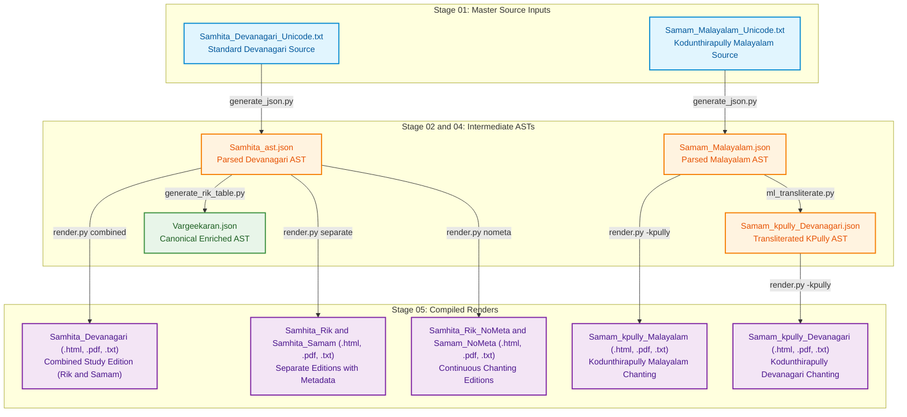

# Jaimineeya Samavedam — Traceability & Lineage Report: Samhita

- **Corpus**: `samhita`
- **Edition**: `3.29`
- **Generated Timestamp**: `12-10-2026 15:55:28`
- **Validation Status**: `PASSED`

---

## 1. Liturgical Invariants & Metrics
| Metric | Active Count | Baseline Invariant | Status |
| :--- | :--- | :--- | :--- |
| **Pathas (SuperSections)** | 6 | 6 | PASS |
| **Khandas (Sections)** | 59 | 59 | PASS |
| **Samas (Liturgical Chants)** | 1226 | 1226 | PASS |

---

## 2. End-to-End Pipeline Lineage Flowchart
The following diagram illustrates how active master inputs flow through intermediate parsed/canonical ASTs to produce each final render in `05_renders/`:



---

## 3. Direct Output-to-Source Lineage Mapping
This table directly maps each compiled file in `05_renders/` back to the active master source text in `01_input/` and intermediate AST in `02_ast/` that produced it.

| Output Render Artifact | Format | Compiled Timestamp | Purpose / Description | Master Input File (`01_input/`) | Intermediate AST (`02_ast/`) | Pipeline Generation Path |
| :--- | :--- | :--- | :--- | :--- | :--- | :--- |
| [`Samam_kpully_Malayalam.pdf`](../05_renders/pdf/Samam_kpully_Malayalam.pdf) | `PDF` | `01-10-2026 23:59:01` | Kodunthirapully Chanting (Malayalam) | [`Samam_Malayalam_Unicode.txt`](../01_input/Samam_Malayalam_Unicode.txt) | `Samam_Malayalam.json` | `generate_json.py -> render.py (-kpully)` |
| [`Samhita_Devanagari.pdf`](../05_renders/pdf/Samhita_Devanagari.pdf) | `PDF` | `07-10-2026 08:08:15` | Standard Samhita Text | [`Samhita_Devanagari_Unicode.txt`](../01_input/Samhita_Devanagari_Unicode.txt) | `Samhita_ast.json (Canonical: Vargeekaran.json)` | `generate_json.py -> render.py` |
| [`Samhita_kpully_Devanagari.pdf`](../05_renders/pdf/Samhita_kpully_Devanagari.pdf) | `PDF` | `01-10-2026 23:59:01` | Kodunthirapully Chanting (Devanagari) | [`Samam_Malayalam_Unicode.txt`](../01_input/Samam_Malayalam_Unicode.txt) | `Samam_Malayalam.json -> Samam_kpully_Devanagari.json` | `generate_json.py -> ml_transliterate.py -> render.py (-kpully)` |
| [`Samhita_Malayalam.pdf`](../05_renders/pdf/Samhita_Malayalam.pdf) | `PDF` | `01-10-2026 23:59:01` | Standard Samhita Text | [`Samhita_Devanagari_Unicode.txt`](../01_input/Samhita_Devanagari_Unicode.txt) | `Samhita_ast.json (Canonical: Vargeekaran.json)` | `generate_json.py -> render.py` |
| [`Samhita_Rik_Devanagari.pdf`](../05_renders/pdf/Samhita_Rik_Devanagari.pdf) | `PDF` | `01-10-2026 23:59:01` | Standard Samhita Text | [`Samhita_Devanagari_Unicode.txt`](../01_input/Samhita_Devanagari_Unicode.txt) | `Samhita_ast.json (Canonical: Vargeekaran.json)` | `generate_json.py -> render.py` |
| [`Samhita_Rik_NoMeta_Devanagari.pdf`](../05_renders/pdf/Samhita_Rik_NoMeta_Devanagari.pdf) | `PDF` | `01-10-2026 23:59:01` | Standard Samhita Text | [`Samhita_Devanagari_Unicode.txt`](../01_input/Samhita_Devanagari_Unicode.txt) | `Samhita_ast.json (Canonical: Vargeekaran.json)` | `generate_json.py -> render.py` |
| [`Samhita_Samam_Devanagari.pdf`](../05_renders/pdf/Samhita_Samam_Devanagari.pdf) | `PDF` | `01-10-2026 23:59:01` | Standard Samhita Text | [`Samhita_Devanagari_Unicode.txt`](../01_input/Samhita_Devanagari_Unicode.txt) | `Samhita_ast.json (Canonical: Vargeekaran.json)` | `generate_json.py -> render.py` |
| [`Samhita_Samam_NoMeta_Devanagari.pdf`](../05_renders/pdf/Samhita_Samam_NoMeta_Devanagari.pdf) | `PDF` | `01-10-2026 23:59:01` | Standard Samhita Text | [`Samhita_Devanagari_Unicode.txt`](../01_input/Samhita_Devanagari_Unicode.txt) | `Samhita_ast.json (Canonical: Vargeekaran.json)` | `generate_json.py -> render.py` |
| [`Samam_kpully_Devanagari.html`](../05_renders/html/Samam_kpully_Devanagari.html) | `HTML` | `02-10-2026 01:13:01` | Kodunthirapully Chanting (Devanagari) | [`Samam_Malayalam_Unicode.txt`](../01_input/Samam_Malayalam_Unicode.txt) | `Samam_Malayalam.json -> Samam_kpully_Devanagari.json` | `generate_json.py -> ml_transliterate.py -> render.py (-kpully)` |
| [`Samam_kpully_Devanagari_Samam.html`](../05_renders/html/Samam_kpully_Devanagari_Samam.html) | `HTML` | `11-10-2026 15:26:16` | Kodunthirapully Chanting (Devanagari) | [`Samam_Malayalam_Unicode.txt`](../01_input/Samam_Malayalam_Unicode.txt) | `Samam_Malayalam.json -> Samam_kpully_Devanagari.json` | `generate_json.py -> ml_transliterate.py -> render.py (-kpully)` |
| [`Samam_kpully_Malayalam.html`](../05_renders/html/Samam_kpully_Malayalam.html) | `HTML` | `01-10-2026 23:59:00` | Kodunthirapully Chanting (Malayalam) | [`Samam_Malayalam_Unicode.txt`](../01_input/Samam_Malayalam_Unicode.txt) | `Samam_Malayalam.json` | `generate_json.py -> render.py (-kpully)` |
| [`Samam_kpully_Malayalam_Samam.html`](../05_renders/html/Samam_kpully_Malayalam_Samam.html) | `HTML` | `11-10-2026 15:26:14` | Kodunthirapully Chanting (Malayalam) | [`Samam_Malayalam_Unicode.txt`](../01_input/Samam_Malayalam_Unicode.txt) | `Samam_Malayalam.json` | `generate_json.py -> render.py (-kpully)` |
| [`Samhita_Devanagari.html`](../05_renders/html/Samhita_Devanagari.html) | `HTML` | `11-10-2026 15:26:12` | Standard Samhita Text | [`Samhita_Devanagari_Unicode.txt`](../01_input/Samhita_Devanagari_Unicode.txt) | `Samhita_ast.json (Canonical: Vargeekaran.json)` | `generate_json.py -> render.py` |
| [`Samhita_kpully_Devanagari.html`](../05_renders/html/Samhita_kpully_Devanagari.html) | `HTML` | `01-10-2026 23:59:01` | Kodunthirapully Chanting (Devanagari) | [`Samam_Malayalam_Unicode.txt`](../01_input/Samam_Malayalam_Unicode.txt) | `Samam_Malayalam.json -> Samam_kpully_Devanagari.json` | `generate_json.py -> ml_transliterate.py -> render.py (-kpully)` |
| [`Samhita_Malayalam.html`](../05_renders/html/Samhita_Malayalam.html) | `HTML` | `01-10-2026 23:59:01` | Standard Samhita Text | [`Samhita_Devanagari_Unicode.txt`](../01_input/Samhita_Devanagari_Unicode.txt) | `Samhita_ast.json (Canonical: Vargeekaran.json)` | `generate_json.py -> render.py` |
| [`Samhita_Rik_Devanagari.html`](../05_renders/html/Samhita_Rik_Devanagari.html) | `HTML` | `01-10-2026 23:59:01` | Standard Samhita Text | [`Samhita_Devanagari_Unicode.txt`](../01_input/Samhita_Devanagari_Unicode.txt) | `Samhita_ast.json (Canonical: Vargeekaran.json)` | `generate_json.py -> render.py` |
| [`Samhita_Rik_NoMeta_Devanagari.html`](../05_renders/html/Samhita_Rik_NoMeta_Devanagari.html) | `HTML` | `01-10-2026 23:59:01` | Standard Samhita Text | [`Samhita_Devanagari_Unicode.txt`](../01_input/Samhita_Devanagari_Unicode.txt) | `Samhita_ast.json (Canonical: Vargeekaran.json)` | `generate_json.py -> render.py` |
| [`Samhita_Samam_Devanagari.html`](../05_renders/html/Samhita_Samam_Devanagari.html) | `HTML` | `01-10-2026 23:59:01` | Standard Samhita Text | [`Samhita_Devanagari_Unicode.txt`](../01_input/Samhita_Devanagari_Unicode.txt) | `Samhita_ast.json (Canonical: Vargeekaran.json)` | `generate_json.py -> render.py` |
| [`Samhita_Samam_NoMeta_Devanagari.html`](../05_renders/html/Samhita_Samam_NoMeta_Devanagari.html) | `HTML` | `01-10-2026 23:59:01` | Standard Samhita Text | [`Samhita_Devanagari_Unicode.txt`](../01_input/Samhita_Devanagari_Unicode.txt) | `Samhita_ast.json (Canonical: Vargeekaran.json)` | `generate_json.py -> render.py` |
| [`Samam_kpully_Devanagari_Samam_Unicode.txt`](../05_renders/txt/Samam_kpully_Devanagari_Samam_Unicode.txt) | `TXT` | `11-10-2026 15:26:16` | Kodunthirapully Chanting (Devanagari) | [`Samam_Malayalam_Unicode.txt`](../01_input/Samam_Malayalam_Unicode.txt) | `Samam_Malayalam.json -> Samam_kpully_Devanagari.json` | `generate_json.py -> ml_transliterate.py -> render.py (-kpully)` |
| [`Samam_kpully_Devanagari_Unicode.txt`](../05_renders/txt/Samam_kpully_Devanagari_Unicode.txt) | `TXT` | `02-10-2026 01:13:01` | Kodunthirapully Chanting (Devanagari) | [`Samam_Malayalam_Unicode.txt`](../01_input/Samam_Malayalam_Unicode.txt) | `Samam_Malayalam.json -> Samam_kpully_Devanagari.json` | `generate_json.py -> ml_transliterate.py -> render.py (-kpully)` |
| [`Samam_kpully_Malayalam_Devanagari_Unicode.txt`](../05_renders/txt/Samam_kpully_Malayalam_Devanagari_Unicode.txt) | `TXT` | `01-10-2026 23:59:01` | Kodunthirapully Chanting (Malayalam) | [`Samam_Malayalam_Unicode.txt`](../01_input/Samam_Malayalam_Unicode.txt) | `Samam_Malayalam.json` | `generate_json.py -> render.py (-kpully)` |
| [`Samam_kpully_Malayalam_Samam_Devanagari_Unicode.txt`](../05_renders/txt/Samam_kpully_Malayalam_Samam_Devanagari_Unicode.txt) | `TXT` | `11-10-2026 15:26:14` | Kodunthirapully Chanting (Malayalam) | [`Samam_Malayalam_Unicode.txt`](../01_input/Samam_Malayalam_Unicode.txt) | `Samam_Malayalam.json` | `generate_json.py -> render.py (-kpully)` |
| [`Samam_kpully_Malayalam_Samam_Unicode.txt`](../05_renders/txt/Samam_kpully_Malayalam_Samam_Unicode.txt) | `TXT` | `11-10-2026 15:26:13` | Kodunthirapully Chanting (Malayalam) | [`Samam_Malayalam_Unicode.txt`](../01_input/Samam_Malayalam_Unicode.txt) | `Samam_Malayalam.json` | `generate_json.py -> render.py (-kpully)` |
| [`Samam_kpully_Malayalam_Unicode.txt`](../05_renders/txt/Samam_kpully_Malayalam_Unicode.txt) | `TXT` | `01-10-2026 23:59:01` | Kodunthirapully Chanting (Malayalam) | [`Samam_Malayalam_Unicode.txt`](../01_input/Samam_Malayalam_Unicode.txt) | `Samam_Malayalam.json` | `generate_json.py -> render.py (-kpully)` |
| [`Samhita_Devanagari_Unicode.txt`](../05_renders/txt/Samhita_Devanagari_Unicode.txt) | `TXT` | `11-10-2026 15:26:11` | Standard Samhita Text | [`Samhita_Devanagari_Unicode.txt`](../01_input/Samhita_Devanagari_Unicode.txt) | `Samhita_ast.json (Canonical: Vargeekaran.json)` | `generate_json.py -> render.py` |
| [`Samhita_kpully_Devanagari_Unicode.txt`](../05_renders/txt/Samhita_kpully_Devanagari_Unicode.txt) | `TXT` | `01-10-2026 23:59:01` | Kodunthirapully Chanting (Devanagari) | [`Samam_Malayalam_Unicode.txt`](../01_input/Samam_Malayalam_Unicode.txt) | `Samam_Malayalam.json -> Samam_kpully_Devanagari.json` | `generate_json.py -> ml_transliterate.py -> render.py (-kpully)` |
| [`Samhita_Malayalam_Unicode.txt`](../05_renders/txt/Samhita_Malayalam_Unicode.txt) | `TXT` | `01-10-2026 23:59:01` | Standard Samhita Text | [`Samhita_Devanagari_Unicode.txt`](../01_input/Samhita_Devanagari_Unicode.txt) | `Samhita_ast.json (Canonical: Vargeekaran.json)` | `generate_json.py -> render.py` |
| [`Samhita_Rik_Devanagari_Unicode.txt`](../05_renders/txt/Samhita_Rik_Devanagari_Unicode.txt) | `TXT` | `01-10-2026 23:59:01` | Standard Samhita Text | [`Samhita_Devanagari_Unicode.txt`](../01_input/Samhita_Devanagari_Unicode.txt) | `Samhita_ast.json (Canonical: Vargeekaran.json)` | `generate_json.py -> render.py` |
| [`Samhita_Rik_NoMeta_Devanagari_Unicode.txt`](../05_renders/txt/Samhita_Rik_NoMeta_Devanagari_Unicode.txt) | `TXT` | `01-10-2026 23:59:01` | Standard Samhita Text | [`Samhita_Devanagari_Unicode.txt`](../01_input/Samhita_Devanagari_Unicode.txt) | `Samhita_ast.json (Canonical: Vargeekaran.json)` | `generate_json.py -> render.py` |
| [`Samhita_Samam_Devanagari_Unicode.txt`](../05_renders/txt/Samhita_Samam_Devanagari_Unicode.txt) | `TXT` | `01-10-2026 23:59:01` | Standard Samhita Text | [`Samhita_Devanagari_Unicode.txt`](../01_input/Samhita_Devanagari_Unicode.txt) | `Samhita_ast.json (Canonical: Vargeekaran.json)` | `generate_json.py -> render.py` |
| [`Samhita_Samam_NoMeta_Devanagari_Unicode.txt`](../05_renders/txt/Samhita_Samam_NoMeta_Devanagari_Unicode.txt) | `TXT` | `01-10-2026 23:59:01` | Standard Samhita Text | [`Samhita_Devanagari_Unicode.txt`](../01_input/Samhita_Devanagari_Unicode.txt) | `Samhita_ast.json (Canonical: Vargeekaran.json)` | `generate_json.py -> render.py` |

---

## 4. Active Master Inputs (`01_input/`)
Only the active master source files utilized for pipeline generation are listed below:

| Active Input File | Size | SHA-256 Checksum |
| :--- | :--- | :--- |
| [`Samam_Malayalam_Unicode.txt`](../01_input/Samam_Malayalam_Unicode.txt) | 35.0 KB | `f4c79dda06c41315438899d7e158ebf1d813b8115bf7bab8a645e21a292ee9c1` |
| [`Samhita_Devanagari_Unicode.txt`](../01_input/Samhita_Devanagari_Unicode.txt) | 1.21 MB | `ab960427c7691ab8268cef6db0f5963beb49ccef475984027201810d407c8b18` |

---

## 5. Intermediate ASTs & Canonical Datasets

### Parsed ASTs (`02_ast/`)
| AST File | Size | SHA-256 Checksum |
| :--- | :--- | :--- |
| [`Samam_kpully_Devanagari.json`](../02_ast/Samam_kpully_Devanagari.json) | 52.1 KB | `23cd6e315473ee20b7a53351cbca2ce3e236aa19fb979a3dc0d7e20985d0147d` |
| [`Samam_Malayalam.json`](../02_ast/Samam_Malayalam.json) | 66.0 KB | `f0fbb6d95b24b8b6851af4ce19bac516baf9661127d1ff3fe7b36d7a0201dc80` |
| [`Samhita_ast.json`](../02_ast/Samhita_ast.json) | 1.74 MB | `91ff1de841d783ad04e7e034f7410fa1eba7bd2926cb03e62cc8cf192b6e1dfe` |

### Canonical Datasets (`04_canonical/`)
| Canonical File | Size | SHA-256 Checksum |
| :--- | :--- | :--- |
| [`Vargeekaran.json`](../04_canonical/Vargeekaran.json) | 2.22 MB | `b253eaeb9cfe5698c0f8c5614809a4b83a524dca79f24aafa689d13d1564c537` |

### Reconciliation Tables (`03_reconciliation/`)
| File Name | Size |
| :--- | :--- |
| [`JSV_Rik_Table - for analysis.xlsx`](../03_reconciliation/JSV_Rik_Table - for analysis.xlsx) | 232.6 KB |
| [`JSV_Rik_Table.csv`](../03_reconciliation/JSV_Rik_Table.csv) | 272.3 KB |
| [`JSV_Rik_Table.txt`](../03_reconciliation/JSV_Rik_Table.txt) | 203.4 KB |
| [`JSV_Samam_Granular_Table.csv`](../03_reconciliation/JSV_Samam_Granular_Table.csv) | 830.0 KB |
| [`JSV_Samam_Granular_Table.xlsx`](../03_reconciliation/JSV_Samam_Granular_Table.xlsx) | 130.7 KB |
| [`Rik Reconciliation table (JSV-KSV).xlsx`](../03_reconciliation/Rik Reconciliation table (JSV-KSV).xlsx) | 2.88 MB |

---

## 6. Compiled Render Catalog (`05_renders/`)

### PDF Documents (`05_renders/pdf/`)
| File Name | Mode / Edition | Target Script | Size | SHA-256 Checksum |
| :--- | :--- | :--- | :--- | :--- |
| [`Samam_kpully_Malayalam.pdf`](../05_renders/pdf/Samam_kpully_Malayalam.pdf) | Separate (Samam Only) | Malayalam | 85.6 KB | `75ee383a9dbb09d2cdcb755a28b7dd0e4408b9c2bf3acdf5bd2fba2236176386` |
| [`Samhita_Devanagari.pdf`](../05_renders/pdf/Samhita_Devanagari.pdf) | Combined (Study Edition) | Devanagari (Standard) | 1.12 MB | `6beb458c6ac052385daf1da6eb8b6dd39e1d2f90900318a52fd2e1dc6f605135` |
| [`Samhita_kpully_Devanagari.pdf`](../05_renders/pdf/Samhita_kpully_Devanagari.pdf) | Combined (Study Edition) | Devanagari (Kodunthirapully) | 110.3 KB | `ff12a87022de8232ce094893184cf74183c695217e7ace27071f5c607e01faf7` |
| [`Samhita_Malayalam.pdf`](../05_renders/pdf/Samhita_Malayalam.pdf) | Combined (Study Edition) | Malayalam | 1.16 MB | `2b0cdc46cdba0b8e88c35934264b6be7e60ab98641ffc7d148fcb8e23e7bc615` |
| [`Samhita_Rik_Devanagari.pdf`](../05_renders/pdf/Samhita_Rik_Devanagari.pdf) | Combined (Study Edition) | Devanagari (Standard) | 292.2 KB | `c6cc143e730ba4f51d213636eb19461ddc69b16d1968307f8ee0a76264f7024c` |
| [`Samhita_Rik_NoMeta_Devanagari.pdf`](../05_renders/pdf/Samhita_Rik_NoMeta_Devanagari.pdf) | NoMeta (Continuous Chanting) | Devanagari (Standard) | 247.1 KB | `cd8233161739fabfe1655b25e9e03ce376b6da2880e82ceb92bf740a47466833` |
| [`Samhita_Samam_Devanagari.pdf`](../05_renders/pdf/Samhita_Samam_Devanagari.pdf) | Combined (Study Edition) | Devanagari (Standard) | 877.7 KB | `6b59301ed7ffd0278295e847a715ce1eee0e8678409c723c99ca185fdf53ddf3` |
| [`Samhita_Samam_NoMeta_Devanagari.pdf`](../05_renders/pdf/Samhita_Samam_NoMeta_Devanagari.pdf) | NoMeta (Continuous Chanting) | Devanagari (Standard) | 845.3 KB | `1d527fada63117071b42b518cb25494e2fb2dee7d402dc32d6dd29ea353cd2d5` |

### HTML Readers (`05_renders/html/`)
| File Name | Mode / Edition | Target Script | Size | SHA-256 Checksum |
| :--- | :--- | :--- | :--- | :--- |
| [`Samam_kpully_Devanagari.html`](../05_renders/html/Samam_kpully_Devanagari.html) | Separate (Samam Only) | Devanagari (Kodunthirapully) | 2.91 MB | `81b16e4c7aede24f22baa36a4671c3372eab499e4a9c0e4676f8701048297273` |
| [`Samam_kpully_Devanagari_Samam.html`](../05_renders/html/Samam_kpully_Devanagari_Samam.html) | Separate (Samam Only) | Devanagari (Kodunthirapully) | 2.90 MB | `aa2555400f1c341c660de6fc62fcf5bc1b6bacafbc8abb1f57e15497481b33bb` |
| [`Samam_kpully_Malayalam.html`](../05_renders/html/Samam_kpully_Malayalam.html) | Separate (Samam Only) | Malayalam | 1.23 MB | `0875e38a228c9bf655f9270bcd02644d12c46ef157aec675298e3307335bf50d` |
| [`Samam_kpully_Malayalam_Samam.html`](../05_renders/html/Samam_kpully_Malayalam_Samam.html) | Separate (Samam Only) | Malayalam | 1.23 MB | `c9d2cdd304d284854183fdad713e18521a04f9b3469ee2408b5d007d4a84af32` |
| [`Samhita_Devanagari.html`](../05_renders/html/Samhita_Devanagari.html) | Combined (Study Edition) | Devanagari (Standard) | 11.84 MB | `8daaf0046f79c8453fba619e3097dd9bcd0f5d86f7b6b986317e579d014885e7` |
| [`Samhita_kpully_Devanagari.html`](../05_renders/html/Samhita_kpully_Devanagari.html) | Combined (Study Edition) | Devanagari (Kodunthirapully) | 11.84 MB | `bf10c3a28fe233da8a19d78582c3ff1f1684168c3205f0c8c3475f287f683999` |
| [`Samhita_Malayalam.html`](../05_renders/html/Samhita_Malayalam.html) | Combined (Study Edition) | Malayalam | 1.23 MB | `5d13c96c931c65fcd4a5efe990564defdb5db3141dd5dc88a70cc176d796d04a` |
| [`Samhita_Rik_Devanagari.html`](../05_renders/html/Samhita_Rik_Devanagari.html) | Combined (Study Edition) | Devanagari (Standard) | 3.78 MB | `0a1a071f07dacb1d94254c9da1adc90cba2079fe54ada350e7e9fc42abc194e0` |
| [`Samhita_Rik_NoMeta_Devanagari.html`](../05_renders/html/Samhita_Rik_NoMeta_Devanagari.html) | NoMeta (Continuous Chanting) | Devanagari (Standard) | 3.65 MB | `02abe737058fb920c7ddd74f0292bb3b18aa7ea62fb08a29c1af5d5090ce0369` |
| [`Samhita_Samam_Devanagari.html`](../05_renders/html/Samhita_Samam_Devanagari.html) | Combined (Study Edition) | Devanagari (Standard) | 10.93 MB | `8f7fe8ea9b277772075ca8c3a4094ab65368eb4baa0b7d37432d5d387fb655d9` |
| [`Samhita_Samam_NoMeta_Devanagari.html`](../05_renders/html/Samhita_Samam_NoMeta_Devanagari.html) | NoMeta (Continuous Chanting) | Devanagari (Standard) | 10.80 MB | `8109e91e4fa95f03b2e2c0c36b5848805233ab5fd0f5e0b3f16ac7fecca9440d` |

### PlainText Exports (`05_renders/txt/`)
| File Name | Mode / Edition | Target Script | Size | SHA-256 Checksum |
| :--- | :--- | :--- | :--- | :--- |
| [`Samam_kpully_Devanagari_Samam_Unicode.txt`](../05_renders/txt/Samam_kpully_Devanagari_Samam_Unicode.txt) | Separate (Samam Only) | Devanagari (Kodunthirapully) | 33.6 KB | `e829cd254ab3203d166dc8de51220a7d81abf3a64053df3ee094168c8ab745da` |
| [`Samam_kpully_Devanagari_Unicode.txt`](../05_renders/txt/Samam_kpully_Devanagari_Unicode.txt) | Separate (Samam Only) | Devanagari (Kodunthirapully) | 33.7 KB | `bbc0f2fc08ceb882c5e8d08406012830846d0679a13dea71d14acfbb51196feb` |
| [`Samam_kpully_Malayalam_Devanagari_Unicode.txt`](../05_renders/txt/Samam_kpully_Malayalam_Devanagari_Unicode.txt) | Separate (Samam Only) | Malayalam | 33.5 KB | `4e5d03dba92470f578e4f049877708ee0d034fe8f81a898d73e83058e3817bf2` |
| [`Samam_kpully_Malayalam_Samam_Devanagari_Unicode.txt`](../05_renders/txt/Samam_kpully_Malayalam_Samam_Devanagari_Unicode.txt) | Separate (Samam Only) | Malayalam | 33.5 KB | `206afb765c3850d0b58c3682865456e335dbce063961c27c32351b482cb28b47` |
| [`Samam_kpully_Malayalam_Samam_Unicode.txt`](../05_renders/txt/Samam_kpully_Malayalam_Samam_Unicode.txt) | Separate (Samam Only) | Malayalam | 34.9 KB | `279fecf3b1f06a9793441e6d4fde90c60598f24e3ad473af589211d80131fb1b` |
| [`Samam_kpully_Malayalam_Unicode.txt`](../05_renders/txt/Samam_kpully_Malayalam_Unicode.txt) | Separate (Samam Only) | Malayalam | 34.9 KB | `70449397215eb686683607030d814158887c5685eaeba483fc507e9b446fc106` |
| [`Samhita_Devanagari_Unicode.txt`](../05_renders/txt/Samhita_Devanagari_Unicode.txt) | Combined (Study Edition) | Devanagari (Standard) | 1.30 MB | `e12b5f682401e9daee340f22392c3bc030b560fd28ac99ae06588591eb706f83` |
| [`Samhita_kpully_Devanagari_Unicode.txt`](../05_renders/txt/Samhita_kpully_Devanagari_Unicode.txt) | Combined (Study Edition) | Devanagari (Kodunthirapully) | 1.30 MB | `53cd3187795481264ec8511f48e4fad37ce7b8be34f5d485aaa5436cdcd892ad` |
| [`Samhita_Malayalam_Unicode.txt`](../05_renders/txt/Samhita_Malayalam_Unicode.txt) | Combined (Study Edition) | Malayalam | 1.41 MB | `71b0a1285b0cfb8cbe89ae32521663008eeed84cd1d239e5aafa56e124594fc1` |
| [`Samhita_Rik_Devanagari_Unicode.txt`](../05_renders/txt/Samhita_Rik_Devanagari_Unicode.txt) | Combined (Study Edition) | Devanagari (Standard) | 306.3 KB | `283969fe7971b9f0aa7d216e424f0fddfce500cb8ff721faa11440372d5ac7b4` |
| [`Samhita_Rik_NoMeta_Devanagari_Unicode.txt`](../05_renders/txt/Samhita_Rik_NoMeta_Devanagari_Unicode.txt) | NoMeta (Continuous Chanting) | Devanagari (Standard) | 288.6 KB | `c0222395806f4434ac6a42e209755a34c9fb7f22880b47fae2a55211c2afb26a` |
| [`Samhita_Samam_Devanagari_Unicode.txt`](../05_renders/txt/Samhita_Samam_Devanagari_Unicode.txt) | Combined (Study Edition) | Devanagari (Standard) | 963.7 KB | `8e5c750139f954686d4b82fbc142504da431ad4b3461dfc09a37ff06be982d72` |
| [`Samhita_Samam_NoMeta_Devanagari_Unicode.txt`](../05_renders/txt/Samhita_Samam_NoMeta_Devanagari_Unicode.txt) | NoMeta (Continuous Chanting) | Devanagari (Standard) | 816.7 KB | `4a1e5b25edd36b26d49cf89f76ba10ee0d15e640fba85581fdf051943df59b81` |

---

## 7. Audit Reports & Integrity Check

### Audit Reports (`06_reports/`)
| Report File | Size |
| :--- | :--- |
| [`JSON_Samam_Continuity_Report.txt`](JSON_Samam_Continuity_Report.txt) | 823 B |
| [`JSV_Structure_Summary.csv`](JSV_Structure_Summary.csv) | 3.8 KB |
| [`JSV_Structure_Summary.txt`](JSV_Structure_Summary.txt) | 6.4 KB |
| [`Samhita_corrected_out_continuity_report.txt`](Samhita_corrected_out_continuity_report.txt) | 987 B |

### Verification Command
To verify cryptographic and liturgical invariants against golden baselines:
```bash
python src/tools/validate_run.py samhita
```
