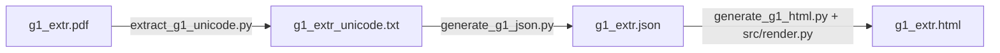

# Gramageyaganam (`g1_extr.pdf`) Unicode, JSON & Standalone HTML Pipeline

## 1. Overview
This pipeline extracts clean, logical-order Unicode Devanagari text from [`pdfconverter/data/input/g1_extr.pdf`](file:///c:/Users/sekha/OneDrive/Documents/GitHub/jaimineeyasamavedam/pdfconverter/data/input/g1_extr.pdf) (*Prakritiganam / Gramageyaganam*), structures it into a hierarchical JSON representation following the **`Parva -> Prapataka -> Kandah -> Samam`** schema with per-Samam **Checksums**, and renders an interactive standalone HTML viewer using the project's canonical [`templates/html/Devanagari_main_html.template`](file:///c:/Users/sekha/OneDrive/Documents/GitHub/jaimineeyasamavedam/templates/html/Devanagari_main_html.template) and [`src/render.py`](file:///c:/Users/sekha/OneDrive/Documents/GitHub/jaimineeyasamavedam/src/render.py) without modifying any existing source files in the main repository.



---

## 2. Scripts & Output Files

| File | Role |
| :--- | :--- |
| [`pdfconverter/src/extract_g1_unicode.py`](file:///c:/Users/sekha/OneDrive/Documents/GitHub/jaimineeyasamavedam/pdfconverter/src/extract_g1_unicode.py) | Extracts raw PDF content streams, decodes Siddhanta Private Use Area (PUA) glyphs, restores logical character ordering, preserves Vedic Tone Prenkha (`U+1CD2` `᳒`), and normalizes `(स्थि)` markers. |
| [`pdfconverter/src/generate_g1_json.py`](file:///c:/Users/sekha/OneDrive/Documents/GitHub/jaimineeyasamavedam/pdfconverter/src/generate_g1_json.py) | Parses the extracted pages into the `Parva -> Prapataka -> Kandah -> Samam` JSON hierarchy and extracts structured Checksum metadata for every Samam. |
| [`pdfconverter/src/generate_g1_html.py`](file:///c:/Users/sekha/OneDrive/Documents/GitHub/jaimineeyasamavedam/pdfconverter/src/generate_g1_html.py) | Interfaces with [`src/render.py`](file:///c:/Users/sekha/OneDrive/Documents/GitHub/jaimineeyasamavedam/src/render.py) (`CreateHtmlFile`, `html_jinja_env`) to build the standalone HTML viewer, grouping Samams by Rik (e.g. `1.1`–`1.3`), rendering continuous Prenkha overlines over `ऽ२`, and scaling up superscript swara numerals (`1.55x`). |
| [`pdfconverter/data/output/g1_extr_unicode.txt`](file:///c:/Users/sekha/OneDrive/Documents/GitHub/jaimineeyasamavedam/pdfconverter/data/output/g1_extr_unicode.txt) | Extracted clean Unicode Devanagari text across all 50 pages. |
| [`pdfconverter/data/output/g1_extr.json`](file:///c:/Users/sekha/OneDrive/Documents/GitHub/jaimineeyasamavedam/pdfconverter/data/output/g1_extr.json) | Structured JSON (`1` Parva, `6` Prapataka sections, `13` Kandahs, `149` Samams, `0` missing checksums). |
| [`pdfconverter/data/output/g1_extr.html`](file:///c:/Users/sekha/OneDrive/Documents/GitHub/jaimineeyasamavedam/pdfconverter/data/output/g1_extr.html) | Self-contained standalone HTML viewer with embedded base64 Vedic fonts. |

---

## 3. Key Technical Achievements

### 3.1. Siddhanta Font PUA Decoding & Logical Reordering
The source PDF uses an embedded `FRRNCK+Siddhanta` font whose `ToUnicode` CMap maps 74+ contextual glyph variants into the Unicode Private Use Area (`U+F300`–`U+F753`, `U+A830`–`U+A831`) and stores glyphs in visual rendering order rather than logical Unicode order. [`extract_g1_unicode.py`](file:///c:/Users/sekha/OneDrive/Documents/GitHub/jaimineeyasamavedam/pdfconverter/src/extract_g1_unicode.py) resolves all of these:
- **PUA Width Variants & Half-Consonants**: Maps all 17 width variants of pre-base `ि` (`\uF30D`–`\uF320`), 9 width variants of `ी` (`\uF321`–`\uF32A`), half-consonants (`\uF337`–`\uF35C`), Rakar conjuncts (`\uF73C` + `\uF334`–`\uF39E`), and special ligatures (`ग्न`, `ध्न`, `म्भ`, `न्द`, `द्ध`, `द्भ`, `द्म`, `ल्ल`, `ष्ट`, `ह्न`, `ह्व`, `द्द`, `क्ष्व`) to standard Unicode Devanagari sequences.
- **Pre-base Short `ि` (`U+093F`) Reordering**: Moves visual pre-base `ि` from before a consonant cluster (`C1 + ् + C2`) to its canonical logical position immediately after the consonant cluster.
- **Post-base Repha (`र्`) Reordering**: Distinguishes true post-base Rephas from PUA half-consonants and moves `र्` to the logical onset of the syllable (`र् + consonant + matras + swaras`).
- **Split Vowel Composition**: Composes decomposed vowel sequences (`अा` $\rightarrow$ `आ`, `अाे` $\rightarrow$ `ओ`, `अाै` $\rightarrow$ `औ`, `एे` $\rightarrow$ `ऐ`, `ाे` $\rightarrow$ `ो`, `ाै` $\rightarrow$ `ौ`).
- **`(स्थि)` Marker Preservation**: Restores dropped parentheses around standalone *sthitam* chant markers (`स्थि` $\rightarrow$ `(स्थि)`).

### 3.2. Vedic Tone Prenkha (`U+1CD2` `᳒`) Extraction & HTML Rendering
- **PDF Vector Stroke Detection**: In `g1_extr.pdf`, the horizontal Prenkha line over `ऽ२` (as in `तो꣡याऽ२᳒इ`) is not a font character in the text stream; it is drawn via raw PDF vector graphics (`q .5738 w x1 y1 m x2 y2 l S Q`) immediately preceding `BT ... [<002b0011...>]TJ` (`ऽ२`).
- **Unicode Injection**: [`extract_g1_unicode.py`](file:///c:/Users/sekha/OneDrive/Documents/GitHub/jaimineeyasamavedam/pdfconverter/src/extract_g1_unicode.py) inspects the PDF content stream before text extraction and injects `<051b>` (`U+1CD2` `᳒` `VEDIC TONE PRENKHA`) onto all **125** occurrences of `ऽ२` (`ऽ२᳒`).
- **Continuous Overline in HTML**: Because a Unicode combining mark on `२` only places a short bar over `२` in plain text, [`render_prenkha_html`](file:///c:/Users/sekha/OneDrive/Documents/GitHub/jaimineeyasamavedam/pdfconverter/src/generate_g1_html.py#L120-L138) matches `<avagraha><syllable/numeral>\u1CD2` (`PRENKHA_RE`) and wraps **both** the preceding avagraha (`ऽ`) and the numeral/syllable (`२`) in a `.prenkha-overline` span with a continuous horizontal bar spanning across `ऽ२`.

### 3.3. Enlarged Superscript Swara Numerals in HTML
- In the stock `AdishilaVedic.ttf` font, the combining Vedic swara numerals (`꣠`–`꣱`, `U+A8E0`–`U+A8F1`) have a glyph height of only `458` font units out of `2048` (`22%` of the em-square), making them appear small.
- [`build_scaled_swara_font_b64`](file:///c:/Users/sekha/OneDrive/Documents/GitHub/jaimineeyasamavedam/pdfconverter/src/generate_g1_html.py#L40-L117) loads `AdishilaVedic.ttf` and `AdishilaVedicBold.ttf` in memory via `fontTools`, replaces the `U+A8E0`–`U+A8F1`, `U+1CD0`, and `U+1CDA` glyphs with their bolder contours scaled up by **`1.55x` (55% larger)** around `(xCenter, yMin)`, scales the GPOS `PairPos` kerning offsets for double swaras (such as `꣡꣯`) proportionally, and embeds the resulting base64 font directly into `g1_extr.html` without altering any font files on disk.

### 3.4. Hierarchical JSON & Rik-Grouped HTML Sections
- **JSON Hierarchy (`Parva -> Prapataka -> Kandah -> Samam`)**:
  Each Samam entry in [`g1_extr.json`](file:///c:/Users/sekha/OneDrive/Documents/GitHub/jaimineeyasamavedam/pdfconverter/data/output/g1_extr.json) records:
  - `samam_id` (e.g. `"१.१"`), `rik_num` (`1`), `variant_num` (`1`)
  - `header`, `name`, `metadata` (Rishi, Chandas, Devata)
  - `mantra_lines` and `mantra_text`
  - `checksum`: structured object with `dirghah` (`दी॰`), `parvani` (`प॰`), `matrah` (`मा॰`), `prapataka_samam_num`, `code` (aksharapalli code, e.g. `"झो"`), `global_samam_num`, and `raw`.
- **Rik Grouping in HTML**:
  [`group_samams_by_rik`](file:///c:/Users/sekha/OneDrive/Documents/GitHub/jaimineeyasamavedam/pdfconverter/src/generate_g1_html.py#L276-L291) groups all Samam variants corresponding to a single Rik (e.g., `१।१।`, `१।२।`, `१।३।` or `४।१।`, `४।२।`, `४।३।`) into a single `.subsection` card in the HTML viewer, separated by dashed dividers, with each Samam displaying its own header, mantra lines, and blue Checksum pill box.

---

## 4. Usage Commands

Run from the repository root (`jaimineeyasamavedam/`):

```powershell
# 1. Extract Unicode text and generate hierarchical JSON from g1_extr.pdf
python pdfconverter/src/generate_g1_json.py `
  --input-pdf pdfconverter/data/input/g1_extr.pdf `
  --output-txt pdfconverter/data/output/g1_extr_unicode.txt `
  --output-json pdfconverter/data/output/g1_extr.json

# 2. Generate standalone HTML viewer via src/render.py
python pdfconverter/src/generate_g1_html.py `
  --input pdfconverter/data/output/g1_extr.json `
  --output pdfconverter/data/output/g1_extr.html `
  --swara-scale 1.55
```
