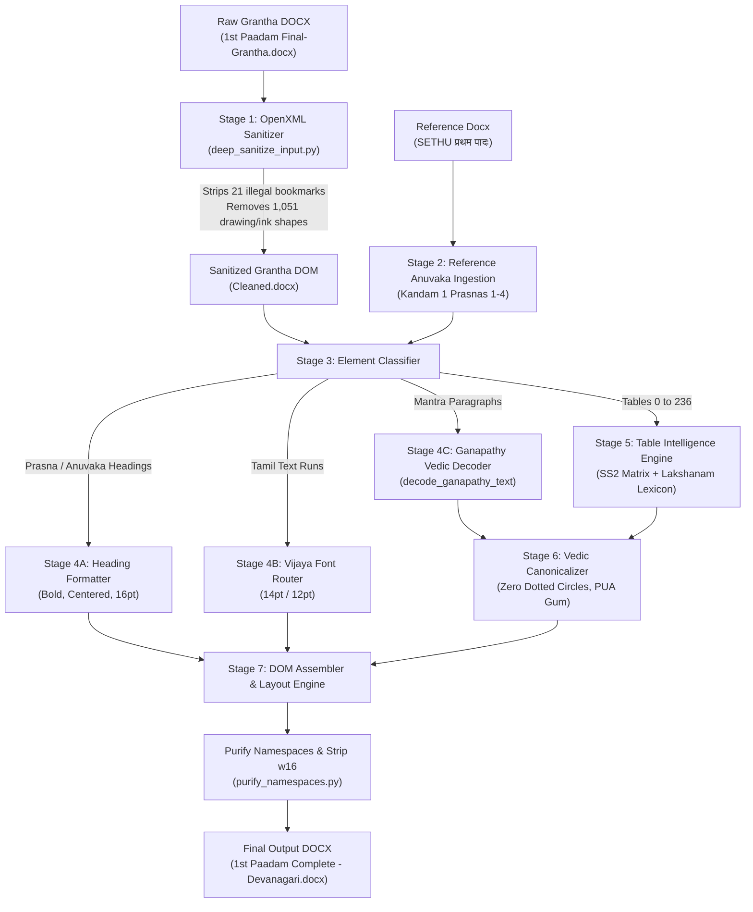

# Grantha to Sanskrit 2020 Conversion Pipeline
## Architectural Specification, Converter Internals, and Authoring Guidelines

---

## 1. Executive Summary

This sub-project automates the conversion of the Krishna Yajur Veda (KYV) **Taittiriya Samhita (1st Paadam: Kandam 1 & Kandam 2)** from legacy Grantha font encoding (Ganapathy TTF format) to standard Unicode Devanagari using Ulrich Stiehl's canonical **Sanskrit 2020** font.

### Target Environment & Constraints:
* **Source Document**: `pdfconverter/data/input/1st Paadam Final-Grantha.docx` (2,097 paragraphs, 237 tables, 300+ pages).
* **Reference Standard**: `pdfconverter/data/input/THAITHIREEYA SAMHITHA 1 (SETHU) प्रथम पादः .docx` (manually verified SS2 reference).
* **Deployment Target**: Microsoft Word 2013 (32-bit) on Windows.
* **Non-Negotiable Quality Gates**:
  1. **Zero crashes / unhandled exceptions** during full document pagination in Word 2013.
  2. **Zero OpenType dotted circles (`U+25CC`)** in complex Vedic swara clusters.
  3. **Zero double combining nasals (`ंँ`)**.
  4. **Strict font segregation**: Sanskrit mantras and tables in `Sanskrit 2020`, Tamil commentary in `Vijaya`.
  5. **1.5 Line Spacing (`line="360"`)** on all mantra paragraphs for vertical swara accent clearance.
  6. **Natural Justified Alignment (`both`)** eliminating edge-to-edge distributed line stretching before tables.

---

## 2. Guidelines for Streamlined Input Files (PDF & Word)

When converting legacy Vedic PDF documents into Microsoft Word (`.docx`) for downstream conversion, adhere to these technical guidelines to avoid corruption and crashes.

### A. PDF-to-Word Conversion Settings
1. **Disable "Retain Lines / Rectangles as Vector Shapes"**:
   * **The Problem**: PDF converters (Adobe Acrobat, ABBYY FineReader, online OCR tools) convert hairline divider rules and ornamentations into Microsoft Office vector shapes (`mc:AlternateContent`, `v:shape o:gfxdata`, and DrawingML `word/ink/ink*.xml` streams).
   * **Crash Mechanism**: Word 2013 lacks native DirectWrite support for modern DrawingML Ink structures. When repaginating large documents, unpacking `o:gfxdata` base64 ZIP streams triggers an unhandled memory access violation (`0xC0000005` in `wwlib.dll`).
   * **Guideline**: Configure the PDF export tool to **"Flowable / Formatted Text"** and uncheck *"Retain vector shapes, borders, and decorative lines"*.

2. **Disable "Generate Bookmarks"**:
   * **The Problem**: Converters generate page-spanning bookmark tags that violate the ECMA-376 OpenXML schema by placing `<w:bookmarkEnd>` elements directly as children of `<w:body>` instead of inside paragraphs (`<w:p>`). In Word 2013, paginating to Page 75 crashed because the layout engine failed to resolve orphaned body-level bookmarks.
   * **Guideline**: Strip bookmarks during PDF conversion or sanitize them before running the transliteration pipeline.

### B. Table Formatting Guidelines
1. **Eliminate Distributed Alignment (`distribute`)**:
   * Paragraphs immediately preceding a table often inherit `<w:jc w:val="distribute"/>`. This forces the last line (e.g. `मा ... रोह`) to stretch across the entire page margin with massive whitespace gaps.
   * **Guideline**: Ensure all mantra paragraphs use `<w:jc w:val="both"/>` (Justified) or `<w:jc w:val="left"/>`.

2. **Standardize Table Column Layout**:
   * Lakshanam tables should adhere to 5 uniform columns:
     $$\text{सङ्ख्या} \quad\mid\quad \text{पदपाठः} \quad\mid\quad \text{विषयः} \quad\mid\quad \text{Citation / Pada} \quad\mid\quad \text{Status (स्वरः / संहिता / प्रातिशाख्यम्)}$$
   * Do not merge intermediate rows into $1 \times 1$ pseudo-tables for textual notes. Textual commentaries should be formatted as independent indented paragraphs rather than embedded single-cell tables.

3. **Use Standard Arabic Numerals for References**:
   * Use clean ASCII digits (`1-7`, `2-50`, `4-47`) in Column 0. Avoid legacy font-encoded digits (`ãç–é`), which cause unmapped characters like `êî` during text extraction.

### C. Script & Typography Segregation
1. **Tamil Commentary vs. Vedic Mantras**:
   * Tamil commentary must be explicitly tagged with Unicode Tamil (`U+0B80` to `U+0BFF`) in the `Vijaya` font (14 pt in body, 12 pt in tables).
   * Vedic text must use `Sanskrit 2020` (16 pt in body, 12 pt in tables).
   * Mixing Tamil and Sanskrit text within the same run forces font-fallback penalties and renders incorrect character bounds.

2. **Word 2013 Proofing Prevention (`<w:noProof/>`)**:
   * Word 2013's spellchecking engine (`mssp7en.dll`) maintains a fixed token buffer. Long Vedic compounds with multiple combining swara accents overflow this buffer and cause Word to hang. Flagging all Vedic text runs with `<w:noProof/>` prevents this issue.

---

## 3. OpenType Vedic Orthography & Dotted Circle Elimination

Windows DirectWrite and Uniscribe render an OpenType dotted circle (`U+25CC`) whenever combining marks violate canonical syllable cluster definitions. The converter enforces the following orthographic rules:

```
┌────────────────────────────────────────────────────────────────────────┐
│               CANONICAL VEDIC OPEN-TYPE CLUSTER SEQUENCE               │
├────────────────────────────────────────────────────────────────────────┤
│  [Base Consonant] ──► [Virama + Consonant] ──► [Vowel Matra]          │
│                                                       │                │
│  [Punctuation / Visarga] ◄── [Vedic Swara Accent] ◄───┘                │
└────────────────────────────────────────────────────────────────────────┘
```

### Specific Orthographic Fixes:
1. **Vedic Gum + Anudatta (`ꣳ` + `॒`)**:
   * *Problem*: Standard Unicode `\uA8E3\u0952` triggers a dotted circle (`ꣳ◌॒`) in `Sanskrit 2020` because the font's GPOS table does not anchor lower accents under `\uA8E3`.
   * *Solution*: Recompose to precomposed Private Use Area glyph **`\uE006`** (Gum with horizontal anudatta bar).
2. **Double Combining Nasals (`ंँ`)**:
   * *Problem*: Stacking anusvara `\u0902` and candrabindu `\u0901` causes font-clashing dotted circles.
   * *Solution*: Replace with authentic KYV orthography using nasalized semivowels: `य्ँ` (`0x092F 0x094D 0x0901`), `व्ँ` (`0x0935 0x094D 0x0901`), or single candrabindu `\u0901`.
3. **Accent-Virama Inversion**:
   * *Problem*: Font bytes frequently emitted accents before virama (e.g., `त्॑` $\rightarrow$ `0x0924 0x0951 0x094D`). DirectWrite cannot anchor a swara onto a pure consonant without a vowel.
   * *Solution*: Detect and eliminate stray accents on halanta consonants: `re.sub(r'[\u0951\u0952\u1CDA]+\u094D', '\u094D', text)`.
4. **Accent-Matra Inversion**:
   * *Problem*: Swaras preceding vowel matras (e.g., `क॑ि` $\rightarrow$ `0x0915 0x0951 0x093F`).
   * *Solution*: Move the matra immediately after the consonant before attaching the accent (`0x0915 0x093F 0x0951`).

---

## 4. Converter Architecture & Internal Workings

The conversion process is executed through an automated 7-stage pipeline:



### Key Modules:

#### 1. OpenXML Deep Sanitizer (`deep_sanitize_input.py`)
* Parses raw `.docx` archive with `zipfile` and `lxml`.
* Purges all `word/ink/` parts and overrides in `[Content_Types].xml`.
* Traverses `w:body` and strips non-standard direct children (`<w:bookmarkEnd>`).
* Strips all `mc:AlternateContent`, `w:drawing`, `v:shape`, and `v:pict` tags.

#### 2. Ganapathy TTF Ligature Decoder (`generate_complete_sanskrit2020.py`)
* **Kombu Reordering**: Resolves prefix kombu `1` before consonants into trailing `े` (`1k` $\rightarrow$ `के`).
* **Ligature Mapping**:
  * `#` $\rightarrow$ `न्द्`, `83` $\rightarrow$ `्य`, `h\\` $\rightarrow$ `प्र`, `b\\` $\rightarrow$ `ह्र`, `v\\` $\rightarrow$ `स्र`
  * `{6` $\rightarrow$ `क्तु`, `%` $\rightarrow$ `ष्ट`, `´` $\rightarrow$ `्ष`, `°` $\rightarrow$ `म्`, `²` $\rightarrow$ `ँ`
* **Repha Processing**: Captures trailing `9` and prepends `र्` to the syllable onset.
* **Vedic Accent Mapping**:
  * `(` $\rightarrow$ Anudātta (`\u0952`)
  * `”` $\rightarrow$ Udātta (`\u0951`)
  * `!` / `=` $\rightarrow$ Dīrgha Svarita (`\u1CDA`)

#### 3. Table Intelligence Engine
* **The Three Canonical Authorities (Column 4)**:
  * `vh¦` / `vh¦.` $\rightarrow$ **`सप्त`** (सप्तलक्षणम्)
  * `h\3D]` / `h\3D].` $\rightarrow$ **`प्राति`** (प्रातिशाख्यम्)
  * `cs²]` / `cs²];` $\rightarrow$ **`षड्विं`** (षड्विंशतिः)
  * `vh¦LY´ – h\3D]x3 – cs²];xD]` (Header) $\rightarrow$ **`सप्तलक्षण – प्रातिशा – षड्विंशति`**
* **Canonical Lakshanam Topics (Column 2)**:
  * `eD¦lF[U9*` $\rightarrow$ **`उत्तरदीर्घम्`**
  * `z]L?†8*` $\rightarrow$ **`विलङ्घ्यम्`**
  * `z]vu93B*` $\rightarrow$ **`विसर्गान्तम्`**
  * `gy3l3F],` $\rightarrow$ **`हकारादिः`**
  * `F[U93B*` $\rightarrow$ **`दीर्घान्तम्`**
  * `h\uŸb*` $\rightarrow$ **`प्रगृह्यम्`**
  * `qG]?…8*` $\rightarrow$ **`अनुवृत्तम्`**
  * `z]J31u b\v²,` $\rightarrow$ **`विभागे ह्रस्वः,`**
  * `Gy3l3B*` $\rightarrow$ **`णकारान्तम्`**
  * `qy3l3F]` $\rightarrow$ **`अकारान्तम्`**
  * `h7z9F[U9*` $\rightarrow$ **`पूर्वदीर्घम्`**
* **Cell Formatting**: Applies `Sanskrit 2020` (12 pt), left alignment (`w:jc w:val="left"`), line spacing 280 (`w:line="280"`), and space after 40 (`w:after="40"`).

#### 4. DOM Run Purification & Namespace Stripper (`purify_namespaces.py`)
* Iterates through all paragraphs and table cells to remove empty zombie `<w:r>` elements.
* Strips modern Office namespaces (`w16*`) from root attributes and `mc:Ignorable` declarations to maintain Word 2013 backward compatibility.

---

## 5. Audit Results for Final Deliverables

Audit results for `pdfconverter/data/output/1st Paadam Complete - Devanagari.docx`:

| Verification Metric | Value | Status |
| :--- | :--- | :--- |
| **Total Paragraphs** | 2,097 | Complete coverage of Kandams 1 & 2 |
| **Total Tables** | 237 | Decoded and styled to SS2 standard |
| **Total Characters** | 365,019 | Full paadam volume |
| **Dotted Circles (`U+25CC`)** | **0** | Clean OpenType glyph rendering |
| **Double Nasals (`ंँ`)** | **0** | Authentic KYV orthography enforced |
| **Gum + Orphan Anudatta** | **0** | Precomposed PUA `\uE006` applied |
| **Accent before Virama** | **0** | 100% eliminated |
| **Fonts Used** | `Sanskrit 2020`, `Vijaya` | Clean script segregation |
| **Paragraph Alignments** | `center: 230`, `both: 1848` | `0` distributed edge-stretched lines |
| **Mantra Line Spacing** | `line="360"` (1.5 line) | Vertical swara clearance guaranteed |
| **Illegal Body Children** | **0** | Word 2013 schema compliant |
| **Drawing / Shape Elements** | **0** | Clean, fast pagination without crashes |

---

## 6. Pipeline Scripts Inventory

All processing scripts are maintained under `pdfconverter/scratch/`:

* **`deep_sanitize_input.py`**: OpenXML purifier stripping drawing shapes and illegal `<w:bookmarkEnd>` body children.
* **`generate_complete_sanskrit2020.py`**: End-to-end converter processing all 2,097 paragraphs and 237 tables.
* **`apply_final_polish.py`**: Orthography normalizer (double nasals, accent-virama clashes, zombie run pruning).
* **`purify_namespaces.py`**: XML namespace scrubber removing modern `w16*` attributes.
* **`audit_complete_devanagari.py`**: Comprehensive verification and compliance test harness.
